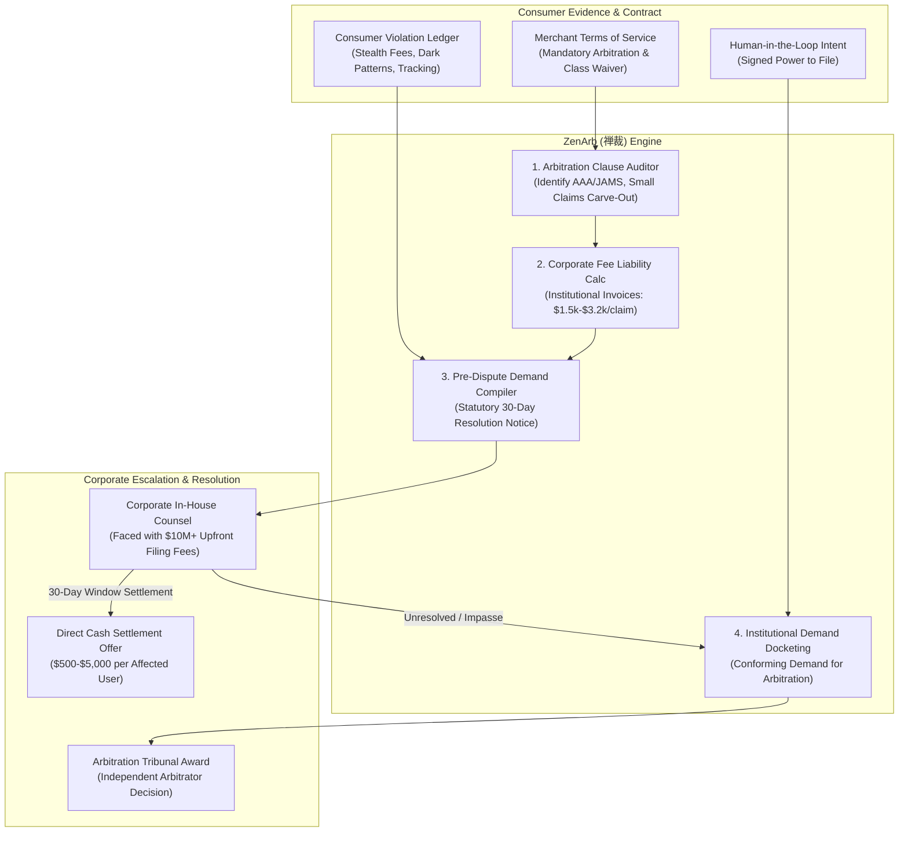

# zenarb-ai-skill (ZenArb · 禅裁)

> *"The cage of mandatory arbitration becomes the lever of justice when thousands speak in unison." (束缚之笼，反为正义之枢；万夫同裁，独裁自溃。)*  
> Autonomous Consumer Mass Arbitration & Forced Arbitration Reverse-Leverage Engine, AAA/JAMS Administrative Filing Fee Obligation Sentinel, Pre-Dispute Statutory Notice Generator & Individual Settlement Arbiter distilled from **FairShake, Level, and American Arbitration Association (AAA) Consumer Arbitration Rules**.

---

## 1. Overview & Architectural Problem Statement

For over two decades, Fortune 500 corporations, telecom carriers, fintech apps, gig platforms, and e-commerce conglomerates used a devastating legal weapon against consumers: **Mandatory Binding Individual Arbitration Clauses coupled with Class-Action Waivers** buried inside boilerplate Terms of Service (ToS). Under the Federal Arbitration Act (FAA, 9 U.S.C. § 1 et seq.), these clauses blocked aggrieved consumers from joining together in class action lawsuits over systemic deceptive practices (such as unannounced price hikes, stealth subscription billing, data privacy tracking pixel leaks, or hidden service fees).

However, corporate lawyers created an existential structural vulnerability for themselves:
1. **The Asymmetric Fee Burden**: Under consumer due process protocols established by the American Arbitration Association (AAA Consumer Arbitration Rules R-44) and JAMS, the **drafting company is legally required to pay 80% to 95% of all administrative and arbitrator fees** ($1,500 to $3,200+ per individual case), while the consumer's share is capped at nominal amounts ($200 to $250, often waivable).
2. **The Reverse-Leverage Tipping Point**: When hundreds or thousands of consumers simultaneously file individual arbitration demands for identical unlawful conduct, the corporation faces **millions of dollars in non-refundable upfront filing fee invoices** from AAA or JAMS before an arbitrator ever touches the merits.
3. **The Strategic Pre-Dispute Notice Window**: Standard arbitration agreements mandate a 30-day informal dispute resolution period. When presented with an audit-proof evidence dossier and notice of intent to file arbitration, corporate risk counsel will frequently offer prompt cash settlements ($500 to $5,000) rather than incur $3,000+ in non-refundable institutional filing fees per claimant.

**ZenArb (禅裁)** automates this reverse-leverage consumer defense:
* **Arbitration Clause & Venue Protocol Auditor (`ArbitrationClauseAuditor`)**: Parses Terms of Service to identify the designated arbitration provider (AAA, JAMS, CPR, NAM), fee-shifting provisions, small-claims court carve-outs, and mandatory pre-dispute notice periods.
* **Pre-Dispute Notice of Dispute Dossier Generator (`PreDisputeNoticeCompiler`)**: Compiles formal statutory 30-day settlement demand notices with transaction receipts, dark pattern screenshots, and contractual breach theories.
* **Corporate Fee Liability Ledger (`CorporateFeeLiabilityCalculator`)**: Computes the exact institutional filing and arbitrator fees the respondent corporation will incur upon docketing, establishing maximum settlement leverage.
* **AAA/JAMS Consumer Demand Docketing Engine (`ArbitrationDemandDockets`)**: Generates conforming individual demands for arbitration ready for electronic filing if informal negotiations fail.
* **Bilateral Settlement Escrow & Release Arbiter (`SettlementReleaseArbiter`)**: Audits corporate settlement agreements to strip overbroad liability releases, gag clauses, or rights waivers before execution.



---

## 2. Core Architectural Subsystems

### 2.1 Terms of Service Arbitration Reverse-Auditor (`ArbitrationClauseAuditor`)
Deconstructs complex dispute resolution sections in corporate contracts:
* **Provider Determination**: Maps provider rules (e.g. AAA Consumer Rule R-44, JAMS Streamlined Rule 24, CPR Administered Rules).
* **Fee Provisions**: Verifies whether the contract requires the merchant to pay the consumer's share or advance all costs upon hardship declarations.
* **Small Claims Carve-Out**: Flags whether the consumer maintains the unilateral right to pursue the claim in municipal Small Claims Court without arbitration.

### 2.2 Corporate Fee Liability Ledger (`CorporateFeeLiabilityCalculator`)
Computes the exact financial burden imposed on the corporate respondent under the provider's fee schedule:
$$\text{Corporate Upfront Incurrence} = \text{Initial Filing Fee} + \text{Case Management Fee} + \text{Arbitrator Hearing Deposit}$$
Under current AAA Consumer Schedules, the corporate respondent pays **\$1,400 to \$3,400 per case** at initiation, whereas the consumer pays only \$200 (or \$0 under California Code of Civil Procedure § 1284.3 for indigent consumers).

### 2.3 Statutory Pre-Dispute Notice Compiler (`PreDisputeNoticeCompiler`)
Formulates formal correspondence fulfilling contractual prerequisites:
* **Detailed Factual Statement**: Timeline of transactions, screenshots of misleading disclosures, and calculation of statutory and actual damages (e.g., California UCL § 17200, New York GBL § 349, Wiretap Act, or FCBA).
* **Clear Statutory Demand**: Requests immediate reimbursement and compensation within the contractual 30-day notice cure window.
* **Notice of Impending Filing**: Explicitly notifies corporate legal counsel that upon expiration of day 30, the individual claim will be formally submitted to AAA/JAMS with corporate fee invoicing triggered.

---

## 3. OpenClaw MCP Tool Interfaces

```typescript
export interface ArbitrationClauseAnalysis {
  provider: 'AAA' | 'JAMS' | 'CPR' | 'NAM' | 'None';
  mandatoryNoticeDays: number;
  smallClaimsCarveOutAllowed: boolean;
  corporateFeePerCaseUsd: number;
  consumerFeePerCaseUsd: number;
  batchArbitrationClausePresent: boolean;
  batchThreshold?: number;
}

export interface PreDisputeNoticeParams {
  claimantName: string;
  respondentCorporateName: string;
  respondentLegalAgentEmail: string;
  contractVersionDate: string;
  violationCategory: 'unauthorized_billing' | 'dark_pattern_cancellation' | 'data_privacy_pixel' | 'false_advertising';
  actualDamagesUsd: number;
  statutoryDamagesBasis?: string;
  demandSettlementUsd: number;
  evidenceAttachments: string[];
}

export interface GenerateAaaDemandParams {
  claimantContact: {
    fullName: string;
    streetAddress: string;
    cityStateZip: string;
    phone: string;
    email: string;
  };
  respondentContact: {
    entityName: string;
    registeredAgentAddress: string;
  };
  disputeNarrative: string;
  requestedReliefUsd: number;
  arbitrationAgreementExcerpt: string;
}
```

---

## 4. Human-in-the-Loop (HITL) Guardrails

1. **Anti-Spam & Individual Verification**: Every single claim must reflect an authentic, verified consumer who interacted with the platform. Fabricated or bot-scraped claims are strictly forbidden.
2. **Explicit Claimant Confirmation**: No formal demand for arbitration is ever filed with an institution (AAA/JAMS) without affirmative one-tap authorization by the consumer.
3. **Full Settlement Transparency**: Any settlement offer received from corporate counsel must be presented to the claimant in full without undisclosed deductions or mandatory legal cuts.
