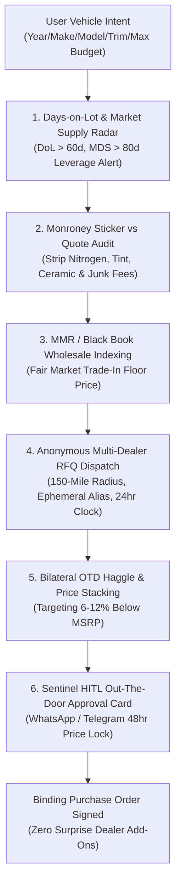

# zenauto-ai-skill

## Overview
**ZenAuto (禅驭)** is an autonomous automotive decision, procurement, and negotiation agent skill for the GenPark ecosystem, distilled from **CarEdge** (AI Buying Agent) and **CoPilot** (Copilot Search, Market Days Supply & Price Pulse).

Automotive retail is notorious for extreme information asymmetry, deceptive monthly payment "Four-Square" manipulations, bloated dealer add-ons (nitrogen, ceramic coatings, VIN etching), and intentional evasion of transparent **Out-The-Door (OTD)** pricing. ZenAuto completely levels the playing field:
1. **Inventory Aging Telemetry**: Ingests dealer floorplan age, Days on Lot (DoL), and regional Market Days Supply (MDS) to calculate the dealer's holding carrying cost and leverage point.
2. **Monroney Sticker vs. Quote Audit**: Cross-references factory window stickers against dealer proposals to identify and strip junk fees and unauthorized dealer markups.
3. **Wholesale Auction Arbitrage**: Benchmarks trade-in vehicles against live Manheim Market Report (MMR) and Black Book auction indices to protect trade-in equity.
4. **Anonymous Multi-Dealer RFQ Engine**: Issues standardized, cryptographic quote requests with ephemeral aliases to 5–15 dealers within a 150-mile radius, demanding binding OTD sheets.
5. **Bilateral Game-Theoretic OTD Arbitrage**: Pits dealers against each other in structured counter-offer rounds, locking guaranteed purchase agreements before disclosing buyer PII.



---

## Core Capabilities

### 1. Days on Lot (DoL) & Market Days Supply (MDS) Telemetry
Dealerships finance their inventory using high-interest commercial floorplan loans. Once a vehicle sits past 60–90 days, holding costs rapidly eat into dealership profits.
- **DoL Tracking**: Tracks exact arrival dates and price reduction cadence for every specific VIN across regional franchised dealerships.
- **MDS Ratio Analysis**: Computes `MDS = (Current Regional Inventory / 30-Day Sales Velocity) * 30`. High MDS (>80 days) triggers aggressive buyer leverage routines; low MDS (<35 days) activates inventory expansion or wait-and-see protocols.

### 2. Monroney Factory Sticker & Dealer Add-On Stripper
Dealerships routinely pad margins by adding non-negotiable dealer accessories ($1,500 ceramic coating, $895 nitrogen fill, $1,295 pulse brake light, $995 doc fees).
- **OEM Window Sticker Deconstruction**: Decodes factory Monroney stickers via official OEM VIN decoders, isolating true Base MSRP, Factory Options, and Destination Freight.
- **Junk Fee Elimination**: Systematically classifies every quote line item into **Statutory Mandatory** (State Tax, Title, DMV Registration, Capped Doc Fee) vs. **Deceptive Discretionary** (Dealer Prep, Protection Package, Etching, Market Adjustment), automatically submitting an itemized strike-through counter-offer ($0 or at-cost).

### 3. MMR & Black Book Wholesale Trade-In Arbiter
Dealerships make the majority of their profit by lowballing trade-in appraisals under the guise of "local market reconditioning."
- **Auction Data Feeds**: Pulls real-time Manheim Market Report (MMR) auction transactions and Black Book wholesale data based on VIN, mileage, and condition tiers.
- **Equity Decoupling**: Explicitly uncouples the new vehicle purchase price from the trade-in valuation, ensuring the trade-in is negotiated at or above MMR clean auction value rather than subsidizing dealer discounts.

### 4. Ephemeral Anonymous Multi-Dealer RFQ Engine
Avoids the deluge of high-pressure sales phone calls and spam emails from dealership Business Development Centers (BDCs).
- **Ephemeral Identity Shield**: Provisions temporary forwarding email aliases and virtual VOIP numbers for all dealer communications.
- **Standardized OTD Inquiry**: Issues a strict, standardized purchase inquiry to 5–15 dealers within a 150-mile radius, demanding an itemized Out-the-Door proposal with factory window sticker and invoice breakdown within 24 hours.

### 5. Bilateral OTD Game-Theoretic Negotiation
- **BATNA Formulation**: Establishes the Best Alternative to a Negotiated Agreement based on historical invoice transactions and regional pricing curves.
- **Competitive Laddering**: Uses Dealer A's verified written OTD quote as leverage against Dealer B (e.g., "Dealer A has committed to $38,400 OTD with zero add-ons on VIN ...; if you match $37,800 OTD, my client will execute a deposit within 2 hours").

---

## MCP Tool Specifications

```json
{
  "tools": [
    {
      "name": "telemetry_inventory_scan",
      "description": "Scans regional dealer inventory for target make/model/trim, computing Days on Lot (DoL), Market Days Supply (MDS), and dealer floorplan leverage rating.",
      "parameters": {
        "type": "object",
        "properties": {
          "make": { "type": "string" },
          "model": { "type": "string" },
          "trim": { "type": "string" },
          "year": { "type": "integer" },
          "zip_code": { "type": "string" },
          "search_radius_miles": { "type": "integer", "default": 100 }
        },
        "required": ["make", "model", "trim", "zip_code"]
      }
    },
    {
      "name": "audit_monroney_vs_quote",
      "description": "Audits a dealership quote sheet against the OEM Monroney window sticker to detect and itemize predatory dealer add-ons, doc fee inflation, and markup.",
      "parameters": {
        "type": "object",
        "properties": {
          "vin": { "type": "string" },
          "quote_line_items": {
            "type": "array",
            "items": {
              "type": "object",
              "properties": {
                "label": { "type": "string" },
                "amount": { "type": "number" },
                "is_taxable": { "type": "boolean" }
              },
              "required": ["label", "amount"]
            }
          },
          "state": { "type": "string" }
        },
        "required": ["vin", "quote_line_items", "state"]
      }
    },
    {
      "name": "benchmark_mmr_tradein",
      "description": "Calculates real-time wholesale auction value (MMR and Black Book) for a trade-in vehicle to establish an uncompromising baseline trade-in valuation.",
      "parameters": {
        "type": "object",
        "properties": {
          "vin": { "type": "string" },
          "mileage": { "type": "integer" },
          "condition": { "type": "string", "enum": ["clean", "average", "rough"] },
          "zip_code": { "type": "string" }
        },
        "required": ["vin", "mileage", "condition", "zip_code"]
      }
    },
    {
      "name": "dispatch_anonymous_otd_rfq",
      "description": "Generates disposable communication aliases and dispatches standardized Out-The-Door RFQ packages to shortlisted franchised dealerships.",
      "parameters": {
        "type": "object",
        "properties": {
          "vin_candidates": { "type": "array", "items": { "type": "string" } },
          "target_discount_percentage": { "type": "number", "default": 8.0 },
          "response_deadline_hours": { "type": "integer", "default": 24 }
        },
        "required": ["vin_candidates"]
      }
    },
    {
      "name": "arbitrate_otd_negotiation",
      "description": "Runs bilateral game-theoretic counter-offers across competing dealer quotes to compress Out-The-Door price to lowest regional wholesale floor.",
      "parameters": {
        "type": "object",
        "properties": {
          "dealer_proposals": {
            "type": "array",
            "items": {
              "type": "object",
              "properties": {
                "dealer_name": { "type": "string" },
                "vin": { "type": "string" },
                "msrp": { "type": "number" },
                "dealer_discount": { "type": "number" },
                "mandatory_fees": { "type": "number" },
                "total_otd": { "type": "number" }
              },
              "required": ["dealer_name", "vin", "msrp", "total_otd"]
            }
          },
          "target_otd_ceiling": { "type": "number" }
        },
        "required": ["dealer_proposals", "target_otd_ceiling"]
      }
    }
  ]
}
```

---

## Autonomous HITL Safety Gates & Operating Protocol

1. **Anti-Four-Square Isolation**: Never discuss or negotiate monthly payments, loan term lengths, or down payments with dealership representatives until the net Out-The-Door purchase price has been cryptographically signed and locked in writing.
2. **Dealer Add-On Veto Circuit Breaker**: If a dealership refuses to remove non-factory dealer installed accessories (e.g., $1,200 paint sealant, $500 wheel locks, $800 doc fees exceeding statutory caps), ZenAuto immediately halts negotiations and pivots to the next lowest-bidding regional dealer.
3. **Wholesale Decoupling**: If a trade-in is involved, ZenAuto strictly demands separate Purchase Agreements for the new car and the trade-in, preventing dealerships from inflating discounts while undervaluing the trade.
4. **Interactive WhatsApp / Telegram Approval Card**:
   ```
   🚗 [ZenAuto Out-The-Door Price Lock Proposal]
   Target: 2026 Toyota RAV4 Prime XSE (VIN: 4T3...9182)
   Dealership: Metro Toyota (Days on Lot: 87 days | High Leverage)
   
   Factory MSRP:       $48,500.00
   Dealer Concession:  -$4,200.00 (-8.66% Below MSRP)
   Factory Rebate:     -$1,500.00
   Junk Add-ons:            $0.00 [Stripped $1,895 Ceramic/Nitrogen/Etch]
   Doc Fee (State Cap):   $175.00
   Govt Taxes & Reg:    $3,480.00
   ---------------------------------
   Guaranteed Net OTD: $46,255.00 (Saved $6,095 vs Initial Dealer Sheet)
   
   [ ✅ Sign 48-Hour Deposit ($500) ]  [ ❌ Reject & Seek Competitor ]
   ```
