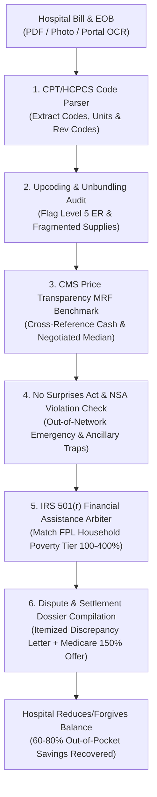

# zenbill-ai-skill

## Overview
**ZenBill (禅医)** is an autonomous medical bill audit, CPT code error detection, and hospital billing dispute negotiation skill for the GenPark ecosystem, distilled from **Goodbill** (patient billing advocacy and EOB auditing), **Turquoise Health** (hospital price transparency and Machine-Readable File indexing), and **Healthcare Bluebook** (fair market health pricing analytics).

Medical billing is one of the most stressful, opaque, and predatory expenditure categories in modern life. Industry studies reveal that **over 80% of itemized hospital bills contain billing errors**, including:
- **Upcoding**: Billing for higher-intensity service levels (e.g., Level 5 ER code `99285` for routine sprains).
- **Unbundling**: Separating all-inclusive procedural packages into fragmented individual charges (e.g., billing sterile gloves, IV tubing, and suture removal separately).
- **Phantom Charges**: Invoicing for medications, lab tests, or telemetry beds that were ordered but never administered.
- **Predatory Chargemaster Markups**: Invoicing uninsured or deductible-phase patients at 400%–1,000% of actual hospital cost.
- **Surprise Out-of-Network Balance Billing**: Illegally charging patients for non-network physicians working inside in-network hospitals.

Operating local-first within OpenClaw, ZenBill protects patients and family bank accounts:
1. **Itemized Bill & EOB Ingestion**: OCR scans hospital bills and insurance Explanation of Benefits (EOB) statements, extracting 5-digit CPT, HCPCS, and DRG billing codes.
2. **CMS Price Transparency MRF Cross-Referencing**: Pulls the facility's official federal Machine-Readable File (MRF) to benchmark billed charges against negotiated commercial rates and cash discounts.
3. **No Surprises Act (NSA) Compliance Sentry**: Flags out-of-network emergency or ancillary provider surprise billing violations under federal law.
4. **IRS Section 501(r) Charity Care Write-Off Engine**: Evaluates patient household income against the hospital's non-profit Financial Assistance Policy (FAP) to secure mandatory 50%–100% debt forgiveness.
5. **Fair-Market Settlement Dossier Compiler**: Formulates legally grounded dispute packages offering 150%–200% of Medicare rates, forcing hospital billing departments to settle or correct claims.



---

## Core Capabilities

### 1. CPT / HCPCS & Revenue Code Deconstruction
- **Itemized Bill Parsing**: Ingests multi-page hospital billing records, mapping every line item to its Current Procedural Terminology (CPT), Healthcare Common Procedure Coding System (HCPCS), and Revenue Center Code (RCC).
- **EOB Reconciliation**: Cross-examines hospital billing codes against insurance Explanation of Benefits (EOB) claims to isolate claim denials, patient deductible obligations, and contractual write-off adjustments.

### 2. Upcoding, Unbundling & Phantom Charge Detection
- **Evaluation & Management (E/M) Severity Audit**: Scrutinizes emergency department service levels (CPT `99281` through `99285`) against documented medical acuity to prevent hospital automated upcoding.
- **National Correct Coding Initiative (NCCI) Edits**: Applies CMS NCCI bundling edits to detect unbundled surgical supplies, monitoring charges, and pharmacy compounding line items that should legally be absorbed into facility room rates.
- **Duplicate & Canceled Order Scrubbing**: Identifies duplicate blood draws, canceled imaging orders, and redundant nursing charges.

### 3. CMS Hospital Price Transparency MRF Benchmarking
- **Federal MRF Data Index**: Directly queries the hospital's published Machine-Readable File (MRF) mandated by CMS price transparency rules.
- **Rate Arbitrage**:
  - Compares the patient's billed chargemaster price against the hospital's **Discounted Cash Price** and **Median In-Network Negotiated Rate** across major commercial payers.
  - Generates pricing variance graphs exposing markups exceeding 300% of regional fair market value.

### 4. No Surprises Act (NSA) Statutory Violation Sentry
- **Surprise Out-of-Network Defense**: Automatically detects violations of the federal No Surprises Act:
  - Out-of-network emergency services billed at non-participating rates.
  - Out-of-network anesthesiologists, radiologists, pathologists, or assistant surgeons at in-network hospitals balance billing patients without valid notice and consent waivers.
- **Dispute Trigger**: Assembles federal Patient-Provider Dispute Resolution (PPDR) complaint packages when billed charges exceed pre-treatment Good Faith Estimates by \$400 or more.

### 5. IRS Section 501(r) Non-Profit Charity Care Recovery
- **501(r) Policy Ingestion**: Ingests non-profit hospital Financial Assistance Policies (FAP) required by IRS Section 501(r)(4).
- **Poverty Line Tier Matching**: Correlates user household size and gross income with federal poverty guidelines (FPL):
  - Incomes $\le 200\%$ FPL: Mandates 100% complete debt write-off.
  - Incomes $201\% - 400\%$ FPL: Enforces sliding-scale reductions capped at Amounts Generally Billed (AGB).
- **Application Automation**: Assembles proof of income (W-2s, pay stubs, tax returns) into ready-to-sign charity care petitions.

### 6. Algorithmic Settlement Dossier & Dispute Automation
- **Grounded Counter-Offers**: Computes mathematically defensible settlement offers anchored to Medicare cost benchmarks ($\text{Offer} = 1.50 \times \text{Medicare Fee Schedule}$).
- **Formal Dispute Dossier**: Auto-generates certified dispute letters citing specific billing errors, NCCI bundling rules, CMS transparency disclosures, and state consumer protection statutes.

---

## Standard ZenBill Audit Dossier Schema

```json
{
  "protocol": "zenbill-audit/v1.0",
  "facility": "Regional Memorial Health System",
  "patient_account": "ACC_99812401",
  "dates_of_service": "2026-08-12 to 2026-08-14",
  "chargemaster_total_billed": 14250.00,
  "audit_findings": {
    "upcoding_detected": [
      {
        "line": 4,
        "billed_cpt": "99285",
        "billed_description": "Emergency Dept Visit - High Severity / Immediate Threat",
        "audited_cpt": "99283",
        "audited_description": "Emergency Dept Visit - Moderate Severity",
        "billed_amount": 2840.00,
        "fair_market_amount": 720.00,
        "excess_charge": 2120.00
      }
    ],
    "unbundled_supplies": [
      {
        "line": 9,
        "cpt": "99070",
        "description": "Sterile Tray & Gloves Kit",
        "billed_amount": 340.00,
        "reason": "NCCI Rule: Routine surgical supplies must be bundled into facility fee"
      }
    ],
    "price_transparency_mrf_variance": {
      "facility_discounted_cash_rate": 3400.00,
      "commercial_median_in_network": 4120.00,
      "medicare_allowable_base": 1850.00
    },
    "charity_care_eligibility": {
      "hospital_fap_type": "IRS 501(r) Non-Profit",
      "patient_fpl_percentage": 245.0,
      "fap_sliding_scale_discount": 0.70
    }
  },
  "recommended_dispute_action": {
    "proposed_settlement_total": 2775.00,
    "total_potential_savings": 11475.00,
    "statutory_citations": [
      "No Surprises Act 42 U.S.C. § 300gg-111",
      "CMS Hospital Price Transparency 45 CFR Part 180",
      "Internal Revenue Code 26 U.S.C. § 501(r)(4)"
    ]
  }
}
```

---

## Operational Guidelines

1. **HIPAA & PII Enclave Redaction**: All patient medical history, diagnostic clinical notes, and Social Security numbers must be redacted or held strictly within local Secure Enclave memory; never transmit unredacted PHI off-device.
2. **Itemized Bill Prerequisite**: Never accept or attempt to dispute summary "balance due" statements; always demand an official itemized bill featuring standard 5-digit CPT/HCPCS and revenue codes from the hospital before executing audit routines.
3. **Collection Clock Management**: Verify statutory dispute notification deadlines (typically 30–60 days from initial notice) and issue immediate formal letters of dispute to halt collections reporting to credit bureaus.
4. **Prioritize 501(r) Charity Relief**: For non-profit facilities, always evaluate charity care relief prior to negotiating cash settlements, as non-profit write-offs provide statutory 100% debt elimination.
