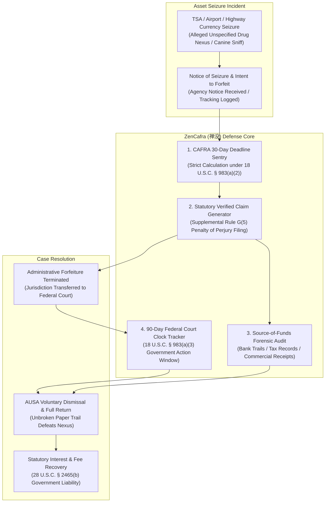

# zencafra-ai-skill (ZenCafra · 禅没)

> *"Property lawfully acquired shall not be confiscated without due process; arbitrary state seizures falter against verified accounting." (私产本有据，岂容莫须没；三十日限如金汤，法槌之下还清白。)*  
> Autonomous Civil Asset Forfeiture Defense, CAFRA 18 U.S.C. § 983 Statutory 30-Day Verified Claim Sentry, Airport & Highway Currency Seizure Defense, and Source-of-Funds Forensic Audit Engine distilled from **the Civil Asset Forfeiture Reform Act of 2000 (CAFRA, 18 U.S.C. § 983), Supplemental Rule G of the Federal Rules of Civil Procedure, and 28 U.S.C. § 2465(b)**.

---

## 1. Overview & Architectural Problem Statement

Every year, federal law enforcement agencies (such as the DEA, CBP, FBI, and Homeland Security Investigations) and state police task forces seize hundreds of millions of dollars in cash and negotiable instruments from travelers at domestic airports (TSA checkpoints), train stations, and interstate highways without ever charging the owners with a crime:
1. **The Pretextual Cash Seizure Trap**: Domestic air travelers carrying substantial currency ($10,000 to $100,000+) are intercepted by interdiction agents. Using unscientific dog sniffs (narcotics detection canines alerting to ubiquitous trace cocaine on circulated cash) or nervous traveler profiles, agents seize the traveler's money alleging it is "proceeds of illegal narcotics trafficking" under 21 U.S.C. § 881.
2. **The 30-Day Administrative Forfeiture Death Clock**: The seizing agency issues a "Notice of Seizure and Intent to Forfeit." Under **18 U.S.C. § 983(a)(2)**, the property owner has a strict statutory window of **only 30 days** from the date of personal receipt (or 30 days from the final date of newspaper/online publication) to file a formal **Verified Claim** under penalty of perjury. If this 30-day window is missed by even a single day, the agency declares the money **administratively forfeited** to the United States government forever, without judicial review!
3. **The Petition for Remission Deception**: Federal agencies often steer unrepresented citizens toward filing a "Petition for Remission or Mitigation." Filing a petition concedes the legitimacy of the seizure and begs the agency for mercy; it **does NOT toll or stop the 30-day administrative forfeiture clock**, frequently leading to total forfeiture while the victim waits for an agency response.
4. **The Verified Claim Transfer Leverage**: Filing a timely, compliant **Verified Claim under 18 U.S.C. § 983(a)(2)** immediately terminates administrative forfeiture jurisdiction and forces the government to either:
   - Return the seized property in full within 90 days; or
   - Refer the case to the Assistant U.S. Attorney (AUSA) to file a formal civil judicial complaint in rem in U.S. District Court within 90 days (18 U.S.C. § 983(a)(3)), where the government carries the statutory burden of proof by a preponderance of the evidence!
5. **Government Fee-Shifting Penalties (28 U.S.C. § 2465(b))**: If the claimant substantially prevails in court or forces voluntary dismissal, the United States is statutorily liable for reasonable attorney fees, litigation costs, and post-seizure interest.

**ZenCafra (禅没)** provides automated defense infrastructure for asset forfeiture targets:
* **CAFRA Statutory Deadline Sentry (`CafraDeadlineSentry`)**: Ingests Seizure Notices and tracking data, computes the precise 30-day statutory filing cutoffs, and sends automated red-alert reminders.
* **Verified Claim Compiler (`VerifiedClaimCompiler`)**: Generates court-admissible Verified Claims compliant with 18 U.S.C. § 983(a)(2) and Supplemental Rule G(5), identifying claimant ownership interest under penalty of perjury and preempting administrative forfeiture.
* **Source-of-Funds Forensic Auditor (`SourceOfFundsAuditor`)**: Ingests bank statements, ATM withdrawal slips, W-2s, 1099s, business tax filings, real estate closing statements, or vehicle sale receipts to construct an airtight evidentiary timeline of legitimate earnings.
* **90-Day Judicial Clock Tracker (`JudicialClockTracker`)**: Monitors the federal government's mandatory 90-day statutory deadline to initiate district court litigation, auto-generating motions for immediate return of seized property if the deadline lapses.



---

## 2. Core Architectural Subsystems

### 2.1 CafraDeadlineSentry: Statutory Calculation Engine
* Under **18 U.S.C. § 983(a)(2)(B)**, any person claiming seized property must file a claim with the appropriate official by the deadline set forth in the personal notice, which **shall not be less than 35 days** after the date the personal notice is mailed (or 30 days after the date of final publication if no personal notice was received).
* Calculates exact federal civil computation rules (Fed. R. Civ. P. 6) accounting for legal holidays and weekends.
* Flags and warns against deceptive agency "Petition for Remission" forms, ensuring the claimant prioritizes the Verified Claim to safeguard their judicial rights.

### 2.2 VerifiedClaimCompiler: 18 U.S.C. § 983(a)(2) Admissible Drafting
* Adheres strictly to **Supplemental Rule G(5)** of the Federal Rules of Civil Procedure:
  1. Identifies the specific seized property (currency amount, serial numbers if cataloged, seizure number).
  2. States the claimant's specific ownership or possessory interest in the property.
  3. Executed under penalty of perjury (28 U.S.C. § 1746).
* Dispatches claims via Certified Mail with Return Receipt Requested and FedEx overnight delivery to the designated seizing agency forfeiture counsel (e.g. DEA Forfeiture Counsel in Arlington, VA; CBP Fines, Penalties, and Forfeiture Officer at the specific port of entry).

### 2.3 SourceOfFundsAuditor: Legitimate Capital Forensic Compiler
* Federal courts recognize that carrying large sums of cash is entirely lawful under the U.S. Constitution and federal law (there is no federal limit on domestic cash travel).
* Ingests and correlates:
  * Bank checking/savings withdrawal slips matching seizure amounts within reasonable temporal windows.
  * Federal tax returns (Form 1040, Schedule C) proving annual income capacity.
  * Documented cash transactions: auto sale bills of sale, property closings, equipment purchases, casino win/loss statements, or peer-to-peer business proceeds.
* Formulates a comprehensive **Evidentiary Proffer Dossier** debunking the seizing agent's reliance on trace dog alerts (which courts including the Ninth and Seventh Circuits have held insufficient to establish probable cause due to widespread currency contamination).

### 2.4 JudicialClockTracker: 90-Day Government Forfeiture Mandate
* Under **18 U.S.C. § 983(a)(3)(A)**, not later than **90 days** after a claim has been filed, the United States must either:
  1. File a civil forfeiture complaint in district court;
  2. Obtain a criminal indictment alleging that the property is subject to forfeiture; or
  3. Promptly release the property to the claimant and take no further forfeiture action.
* If the 90 days elapse without federal court filing, ZenCafra generates a formal **Demand for Immediate Property Release** and draft Complaint for Injunctive Relief under Fed. R. Civ. P. 41(g).

---

## 3. Tool Specifications & MCP Interfaces

```typescript
// MCP Tool 1: Calculate CAFRA Filing Deadlines and Risk Assessment
interface CalculateCafraDeadlineParams {
  seizingAgency: 'DEA' | 'CBP' | 'FBI' | 'HSI' | 'STATE_LOCAL_TASKFORCE';
  dateOfSeizure: string;
  dateNoticeMailedOrReceived: string;
  seizureAssetDescription: string;
  seizedAmountUsd: number;
  hasPersonalNoticeBeenReceived: boolean;
  publicationDateFinal?: string;
}

interface CafraDeadlineResult {
  statutoryDeadlineDate: string;
  daysRemainingUntilForfeiture: number;
  urgencyLevel: 'CRITICAL_UNDER_7_DAYS' | 'WARNING_UNDER_15_DAYS' | 'ACTIVE';
  designatedForfeitureOfficeAddress: string;
  governingStatute: string; // "18 U.S.C. § 983(a)(2)"
  warningAgainstRemissionPetitionOnly: string;
}

// MCP Tool 2: Generate Court-Admissible 18 U.S.C. § 983 Verified Claim
interface GenerateVerifiedClaimParams {
  claimantLegalFullName: string;
  claimantAddress: string;
  claimantPhone: string;
  seizureNumber: string;
  seizingAgency: string;
  seizureLocation: string; // e.g. "Los Angeles International Airport (LAX) Terminal 4"
  exactAmountSeizedUsd: number;
  basisOfOwnership: 'sole_owner' | 'business_owner_agent' | 'borrower_or_custodian';
  affirmationUnderPenaltyOfPerjury: boolean;
}

interface VerifiedClaimDossier {
  verifiedClaimDocumentMarkdown: string;
  certificateOfServiceMarkdown: string;
  mailingInstructions: {
    sendMethod: 'USPS_CERTIFIED_RETURN_RECEIPT_AND_FEDEX';
    recipientTitle: string;
    officeAddress: string;
  };
  ninetyDayClockTriggerNote: string;
}

// MCP Tool 3: Compile Source-of-Funds Evidentiary Proffer
interface CompileSourceOfFundsParams {
  claimantFullName: string;
  totalSeizedUsd: number;
  primaryIncomeSource: 'w2_employment' | 'sole_proprietorship' | 'asset_sale' | 'bank_savings';
  evidenceArtifacts: Array<{
    documentType: 'bank_withdrawal_slip' | 'tax_return_1040' | 'bill_of_sale' | 'commercial_contract';
    documentDate: string;
    verifiedAmountUsd: number;
    description: string;
  }>;
}

interface SourceOfFundsProfferResult {
  profferMemoMarkdown: string;
  totalAccountedPercentage: number;
  forensicAuditSummary: string;
  rebuttalOfCanineSniffPretext: string;
}
```

---

## 4. Human-In-The-Loop (HITL) Guardrails

1. **Mandatory Claimant Perjury Affirmation**: Because filing a Verified Claim exposes the claimant to federal perjury penalties if false, the agent requires affirmative, explicit user confirmation of true and lawful ownership before finalizing the claim.
2. **Double-Delivery Redundancy Check**: All CAFRA claims require proof of delivery. The agent insists on tracking numbers (USPS Certified Mail + FedEx) to prevent agency claims of non-receipt.
3. **No Waiving of Judicial Rights**: The agent strictly blocks any automated concession or exclusive election of administrative remission without prior legal counsel consultation.

---

## 5. Zen Ethical & Operational Alignment

* **Kyoto Minimalism**: Objective, factual, and strictly anchored in the plain text of CAFRA 18 U.S.C. § 983 and Supplemental Rule G.
* **Presumption of Innocence**: Domestic possession of United States legal tender is a protected constitutional activity. The burden of proof rests entirely on the sovereign.
* **Statutory Timing Integrity**: A procedural default in asset forfeiture is irreversible. Timing vigilance is the paramount shield.
