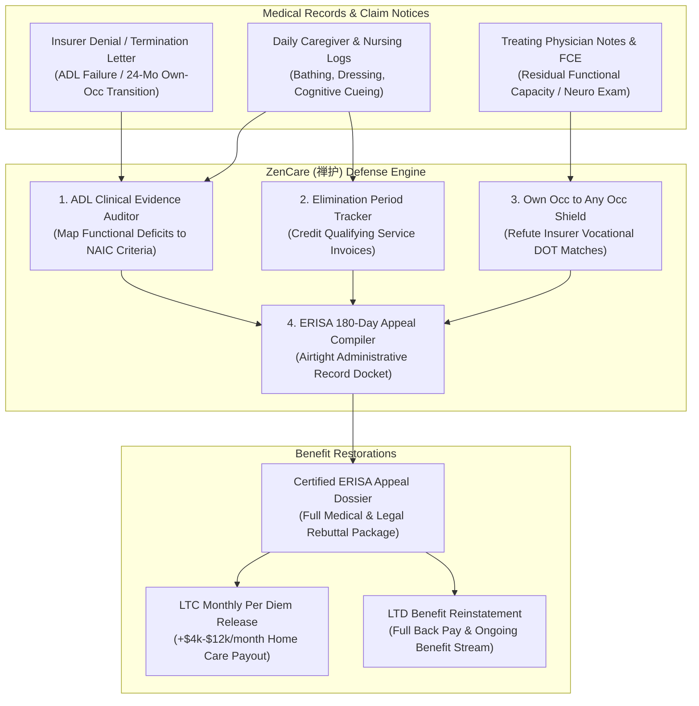

# zencare-ai-skill (ZenCare · 禅护)

> *"Care in vulnerability is a sacred trust; no algorithmic checklist may sever lifetime promises." (老安少怀，信诺无移；持正卫道，护持余年。)*  
> Autonomous Long-Term Care (LTC) & Long-Term Disability (LTD) Insurance Claim Denial Defense, Activities of Daily Living (ADL) Clinical Evidence Certification, 24-Month "Own Occ to Any Occ" Transition Shield, and ERISA Administrative Appeal Dossier Compiler distilled from **ERISA (29 U.S.C. § 1133 / 29 C.F.R. § 2560.503-1), NAIC Long-Term Care Model Act, and Genworth/Unum/MetLife claim defense frameworks**.

---

## 1. Overview & Architectural Problem Statement

Over 15 million seniors and disabled workers hold Long-Term Care (LTC) and Long-Term Disability (LTD) policies designed to prevent financial ruin during catastrophic illness or severe cognitive decline. However, private insurers (Genworth, Unum, Mutual of Omaha, MetLife, Lincoln Financial) operate institutional claim rejection funnels designed to terminate or deny valid claims, withholding **$50,000 to $250,000+ in lifetime contractual benefits**:

1. **The LTC "2-of-6 ADL" Clinical Denial Trap**: To qualify for LTC benefits, a policyholder must typically demonstrate inability to perform at least 2 of 6 Activities of Daily Living (ADLs: bathing, dressing, toileting, transferring, continence, eating) without substantial assistance, or suffer severe cognitive impairment. Insurers send biased nurse evaluators for brief 20-minute home visits to falsely mark claimants as "independent," ignoring daily caregiver logs.
2. **The 90-Day Elimination Period Stalling Tactic**: Insurers artificially delay paying benefits by exploiting ambiguous definitions of "service days" versus "calendar days," rejecting invoices from qualified home health aides or adult day care centers.
3. **The Notorious 24-Month "Own Occ to Any Occ" Cliff in LTD**: In group disability policies, benefits are paid for the first 24 months if the claimant cannot perform their "Own Occupation." At month 24, insurers conduct rubber-stamp "paper reviews" by hired doctors, claiming the individual can perform "sedentary work in any occupation" (e.g. theoretical parking lot attendant), abruptly cutting off monthly disability checks.
4. **The Strict ERISA 180-Day Administrative Appeal Trap**: Under federal law (29 U.S.C. § 1133), claimants have exactly **180 days** to appeal an ERISA benefit denial. Crucially, federal courts will **refuse to consider any evidence not included in the administrative record** during this window. If a family fails to submit a comprehensive medical dossier during the internal appeal, the denial becomes permanent.

**ZenCare (禅护)** automates clinical proof compilation and statutory appeal defense:
* **ADL Clinical Evidence & Cognitive Impairment Auditor (`AdlClinicalEvidenceAuditor`)**: Dissects daily nursing notes, caregiver logs, and physical therapy records, translating clinical observations into certified proofs of "hands-on" or "standby" assistance matching statutory NAIC model definitions.
* **Elimination Period Verification & Invoice Sentry (`EliminationPeriodTracker`)**: Audits qualified service dates, aggregates licensed care invoices, and enforces the exact calendar date when the carrier must commence benefit disbursements.
* **Vocational & Medical "Own Occ" Transition Shield (`OwnOccTransitionShield`)**: Cross-examines insurer paper reviews against the Dictionary of Occupational Titles (DOT) and O*NET, refuting phantom job opportunities with treating physician Residual Functional Capacity (RFC) affirmations.
* **ERISA 180-Day Statutory Administrative Appeal Dossier (`ErisaAppealCompiler`)**: Builds an audit-proof, exhaustive administrative record under 29 C.F.R. § 2560.503-1, compiling Functional Capacity Evaluations (FCE), physician rebuttals, and bad-faith statutory notices.



---

## 2. Core Architectural Subsystems

### 2.1 ADL Clinical Evidence & Cognitive Impairment Auditor (`AdlClinicalEvidenceAuditor`)
Deconstructs informal home notes and medical records into objective legal criteria:
* **The 6 Core ADLs**: Bathing, Dressing, Toileting, Transferring, Continence, Eating.
* **Assistance Levels**: Distinguishes "Hands-on Physical Assistance" (direct physical touch required) from "Standby Assistance" (verbal cueing and supervision needed for safety due to fall risk or disorientation).
* **Severe Cognitive Impairment**: Maps clinical findings (MMSE $\le 24$, MoCA $\le 21$, neuro-psych evaluations) to demonstrate need for continual supervision to protect claimant from threats to health and safety.

### 2.2 90-Day Elimination Period Tracker (`EliminationPeriodTracker`)
Enforces prompt policy triggering:
* Tracks policy definition: "Days of Service" (days where paid care was rendered) vs. "Calendar Days" (days elapsed since certified disability onset).
* Validates provider credentials (state-licensed home health agencies or qualified independent CNAs/LPNs), preventing carriers from disqualifying legitimate receipts.

### 2.3 Vocational & "Own Occ to Any Occ" Defense Engine (`OwnOccTransitionShield`)
Neutralizes insurance doctor "paper reviews":
* **Vocational Transferability Cross-Examination**: Ingests the insurer's Labor Market Survey and disproves that suggested alternative jobs exist in significant numbers in the local economy or pay the statutory wage threshold (typically $\ge 60\%$ of pre-disability earnings).
* **Treating Physician Priority**: Formulates a detailed Residual Functional Capacity (RFC) counter-affidavit for the treating physician to execute, exposing factual errors in the insurer's non-examining paper consultant.

### 2.4 ERISA 180-Day Administrative Appeal Compiler (`ErisaAppealCompiler`)
Ensures total evidentiary preservation under 29 U.S.C. § 1133:
* Synthesizes all doctor counter-opinions, objective imaging, medication side-effect profiles, and sworn affidavits from family caregivers.
* Formulates a formal legal memorandum citing controlling federal circuit court precedents on insurer conflicts of interest and arbitrary-and-capricious claim terminations.

---

## 3. OpenClaw MCP Tool Interfaces

```typescript
export interface AdlDeficitAssessment {
  adlName: 'bathing' | 'dressing' | 'toileting' | 'transferring' | 'continence' | 'eating';
  assistanceRequired: 'independent' | 'standby_cueing' | 'hands_on_partial' | 'total_dependence';
  clinicalEvidenceExcerpts: string[];
  qualifiesUnderPolicy: boolean;
}

export interface AuditLtcClaimParams {
  claimantName: string;
  carrierName: string;
  policyFormType: 'tax_qualified_7702B' | 'non_tax_qualified';
  eliminationPeriodDays: number;
  eliminationType: 'service_days' | 'calendar_days';
  dailyNursingNotesRawText: string;
  physicianStatementsRawText: string;
  caregiverInvoices: Array<{
    dateOfService: string;
    hoursRendered: number;
    hourlyRateUsd: number;
    licensedAgencyName?: string;
  }>;
}

export interface CompileErisaLtdAppealParams {
  claimantName: string;
  employerPlanName: string;
  disabilityCarrierName: string;
  denialNoticeDate: string;
  denialRationale: 'failed_adl_threshold' | 'own_occ_transition_any_occ' | 'pre_existing_condition' | 'lack_objective_medical';
  preDisabilityOccupation: string;
  treatingPhysicianStatementRawText: string;
  vocationalEvaluationSummary: string;
  monthlyBenefitAmountUsd: number;
}
```

---

## 4. Human-in-the-Loop (HITL) Guardrails

1. **Strict 180-Day ERISA Deadline Guard**: The system calculates the exact calendar cutoff and issues continuous urgent countdown warnings to prevent accidental deadline expirations.
2. **Treating Physician Execution**: All clinical capacity forms must be reviewed, confirmed, and signed by the claimant's licensed attending physician.
3. **No Unlicensed Legal Practice**: ZenCare functions as an evidentiary and clinical compilation toolkit for the claimant or their authorized ERISA attorney.
