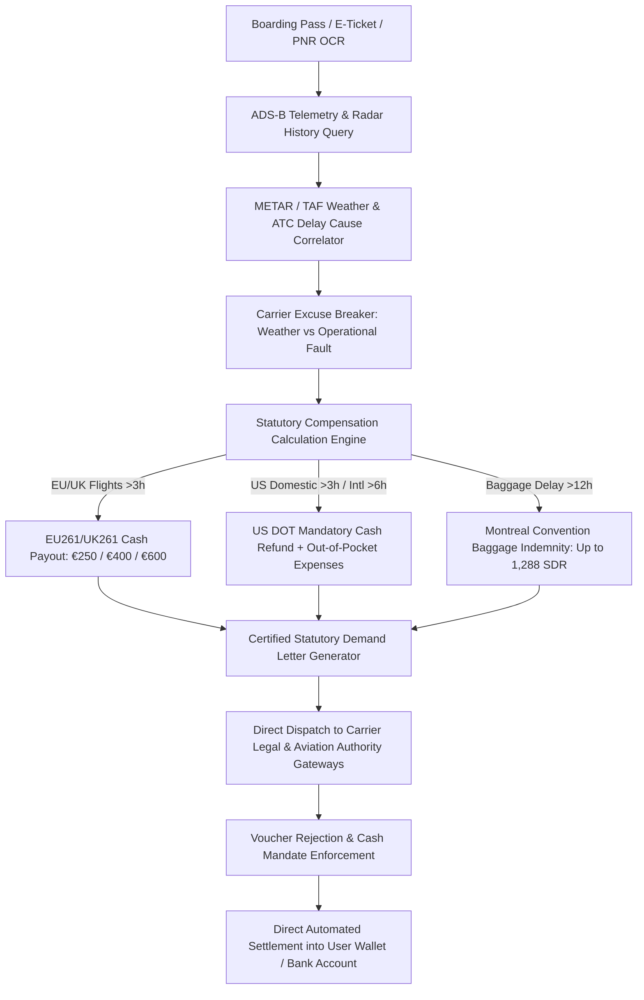

# ZenClaim: Autonomous Airline Passenger Rights & Delay Compensation Arbitrage Agent

`zenclaim-ai-skill` is an open-standard, production-grade autonomous decision agent distilled from **AirHelp (`airhelp.com`)**, **Flightright (`flightright.com`)**, and **ClaimCompass (`claimcompass.eu`)**. It breaks down the systemic friction erected by commercial airlines—where carriers intentionally bury compensation claim portals, deflect liability through fraudulent "extraordinary circumstances" weather claims, and issue depreciating travel vouchers rather than mandatory statutory cash refunds.



---

## 1. Core Architectural Capabilities

### 1.1 Multi-modal PNR & Flight Ticket Reverse Parsing
Extracts booking confirmation codes (PNR), operating airline IATA/ICAO codes, marketing carriers, connecting segments, seat class, and baggage claim tags from emails, Apple Wallet pkpass files, or boarding pass scans.

### 1.2 ADS-B Telemetry & METAR Weather Proof Correlation
When airlines claim delays were caused by "Act of God / Weather / ATC strikes" (Extraordinary Circumstances under EU261 Article 5(3)), ZenClaim cross-references:
1. ADS-B flight tracking data for the exact aircraft tail number (identifying preceding knock-on delays or maintenance faults).
2. Historical METAR/TAF weather observations at origin, destination, and en-route alternate airports.
3. Concurrent departures from the same runway/terminal within a ±45-minute window.
If other carriers operated normally, the airline's weather defense is legally rebutted in the opening dossier.

### 1.3 Statutory Multi-Jurisdiction Compensation Solver
- **EU 261/2004 & UK 261**:
  - Distance $\le 1,500\text{ km}$: €250 (£220) for delays $\ge 3\text{h}$.
  - Intra-EU $> 1,500\text{ km}$ or all flights between $1,500\text{ km}$ and $3,500\text{ km}$: €400 (£350).
  - All flights $> 3,500\text{ km}$ delayed $\ge 4\text{h}$: €600 (£520).
- **US DOT Title 14 CFR Part 260 (2024/2026 Rules)**:
  - Involuntary cancellation or significant change (departure/arrival delayed $\ge 3\text{h}$ domestic, $\ge 6\text{h}$ international) mandates **full cash refund** within 7 business days for credit cards, regardless of non-refundable ticket status.
  - Baggage delay refunds: Bag fee automatically refunded if not delivered within 12h (domestic) or 15-30h (international).
- **Montreal Convention (1999)**:
  - Up to 1,288 Special Drawing Rights (SDR, approximately \$1,700–\$1,750 USD) for lost, damaged, or delayed luggage essentials.

### 1.4 Airline Voucher Downgrade Shield
Commercial airlines routinely send deceptive 1-click links: *"Accept a \$100 future travel credit voucher"*. ZenClaim automatically blocks voucher acceptance, asserting the passenger's statutory right under Article 8(1)(a) of EU 261 or 14 CFR § 260 to unencumbered cash (bank electronic transfer / original payment method refund).

---

## 2. JSON Schema Definitions

### 2.1 Passenger Flight Claim Assessment Schema
```json
{
  "$schema": "https://json-schema.org/draft/2020-12/schema",
  "title": "FlightDisruptionClaim",
  "type": "object",
  "required": ["claimId", "pnr", "flightNumber", "scheduledDeparture", "disruptionType", "calculatedEntitlement"],
  "properties": {
    "claimId": { "type": "string", "pattern": "^CLM-[0-9]{8}-[A-Z0-9]{4}$" },
    "pnr": { "type": "string", "pattern": "^[A-Z0-9]{6}$" },
    "carrierCode": { "type": "string", "pattern": "^[A-Z0-9]{2,3}$" },
    "flightNumber": { "type": "string" },
    "scheduledDeparture": { "type": "string", "format": "date-time" },
    "actualArrival": { "type": "string", "format": "date-time" },
    "delayMinutes": { "type": "integer", "minimum": 0 },
    "disruptionType": {
      "type": "string",
      "enum": ["DELAY_OVER_3H", "FLIGHT_CANCELLED", "DENIED_BOARDING_BUMP", "MISSED_CONNECTION", "LOST_BAGGAGE"]
    },
    "claimedDefense": {
      "type": "string",
      "enum": ["AIRLINE_CLAIMED_WEATHER", "AIRLINE_CLAIMED_ATC", "TECHNICAL_DEFECT", "CREW_SICKNESS", "UNKNOWN"]
    },
    "telemetryRebuttal": {
      "type": "object",
      "properties": {
        "concurrentFlightsNormal": { "type": "boolean" },
        "metarConditionsFavorable": { "type": "boolean" },
        "aircraftPrecedingDelayEvidence": { "type": "string" }
      }
    },
    "calculatedEntitlement": {
      "type": "object",
      "required": ["jurisdiction", "statutoryCashAmount", "currency"],
      "properties": {
        "jurisdiction": { "type": "string", "enum": ["EU261", "UK261", "US_DOT", "MONTREAL_CONVENTION"] },
        "statutoryCashAmount": { "type": "number", "minimum": 0 },
        "currency": { "type": "string", "enum": ["EUR", "GBP", "USD"] },
        "ancillaryExpensesClaimable": { "type": "number", "description": "Meals, hotels, rideshare receipts" }
      }
    }
  }
}
```

---

## 3. Tool Calling & Execution Flow

```javascript
import { ZenClaimEngine } from 'genpark-hub/zenclaim';

// 1. Ingest PNR and Flight details
const claimSession = await ZenClaimEngine.analyzeDisruption({
  pnr: "X8K9LQ",
  carrier: "LH",
  flightNumber: "LH402",
  departureDate: "2026-10-20",
  originIATA: "FRA",
  destIATA: "EWR",
  actualDelayHours: 4.5,
  carrierExcuse: "Weather and ATC restrictions at Frankfurt"
});

// 2. Correlate ADS-B & METAR historical records
const rebuttalDossier = await claimSession.verifyWeatherAndATCRebuttal();
console.log(`Carrier weather defense legally destroyed: ${rebuttalDossier.defenseRebutted}`);

// 3. Draft and certified dispatch statutory demand
const dispatchReceipt = await claimSession.dispatchStatutoryDemand({
  mandatedCashPayout: 600,
  currency: "EUR",
  strictDeadlineDays: 14,
  payoutRoutingIBAN: "DE89370400440532013000"
});

console.log(`Demand submitted to carrier regulatory portal. Docket: ${dispatchReceipt.docketId}`);
```

---

## 4. OpenClaw & Agent Protocol Compatibility
- **MCP Server Tools**: `zenclaim_assess_pnr`, `zenclaim_audit_telemetry`, `zenclaim_generate_legal_demand`.
- **Payment Settlement**: Integration with Google AP2 & Network Tokenization for instantaneous bank payout settlement.
