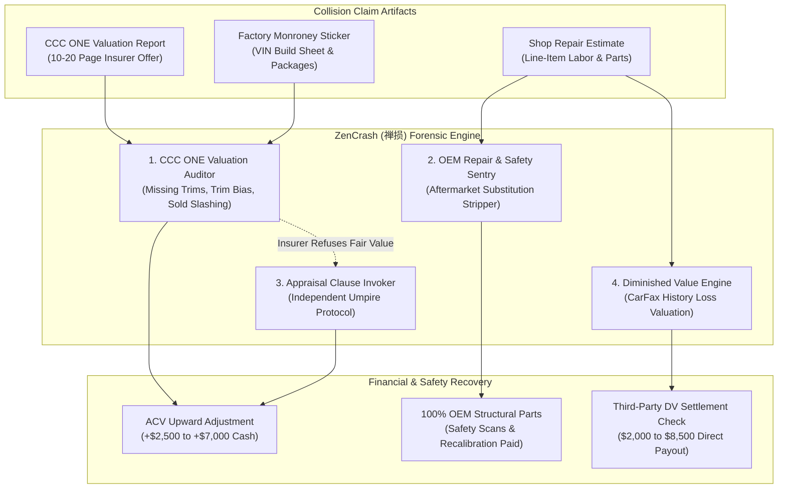

# zencrash-ai-skill (ZenCrash · 禅损)

> *"True value is restored not by masking damage, but by exacting honest reconstruction." (明鉴损益，复归权衡。)*  
> Autonomous Auto Collision Estimate & Total Loss Audit, CCC ONE & Mitchell Valuation Re-Engineering, OEM Repair Procedure Enforcement, Appraisal Clause Invocation & Third-Party Diminished Value (DV) Recovery Engine distilled from **Collision Safety Consultants, SnapClaim, and I-CAR repair standards**.

---

## 1. Overview & Architectural Problem Statement

Every year, over 12 million motorists in the United States and Europe are involved in automotive collisions. In the immediate aftermath, consumers confront an opaque, automated insurance claims industrial complex dominated by automated estimating software—most notably **CCC ONE**, **Mitchell**, and **Audatex**:

1. **Systematic Total Loss Valuation Depletion**: When a vehicle is deemed a total loss, insurance adjusters rely on automated CCC ONE Market Valuation Reports designed to depress actual cash value (ACV) payouts by **$2,000 to $8,000 per claim**. Software algorithms routinely omit expensive factory option packages, apply arbitrary negative "condition adjustments" without photographic evidence, cherry-pick distant or lower-trim comparable vehicles (comps), and apply blanket 4%–7% "Projected Sold Adjustments" that artificially deflated dealer sales prices.
2. **Structural Safety Compromise via Non-OEM Crash Parts**: In repairable collision claims, insurers rewrite body shop estimates to substitute certified Original Equipment Manufacturer (OEM) sheet metal and structural components with cheap, uncertified aftermarket imitation parts (often lacking crumple-zone metallurgical certification) or salvaged junkyard assemblies, while refusing to compensate shops for mandatory pre/post ADAS calibration diagnostic scans.
3. **The Unclaimed Multi-Billion Dollar Diminished Value (DV) Black Hole**: Even when a vehicle is repaired to structural perfection, its permanent vehicle history record (CarFax, AutoCheck) records an accident footprint, instantly erasing **15% to 30% of its fair market resale value** ($2,000 to $9,000 loss). Insurers are legally obligated under third-party tort law to compensate vehicle owners for this lost equity, yet virtually never disclose this right to claimants.
4. **Appraisal Clause Obfuscation**: Policy contracts contain a powerful consumer remedy—the **Appraisal Clause**—which allows policyholders to bypass biased insurance adjusters and hire an independent appraiser to establish true value. Insurers intentionally hide this process behind bureaucratic delay tactics.

**ZenCrash (禅损)** automates collision claim forensic auditing and equity recovery:
* **CCC ONE Market Valuation Re-Engineering (`CccValuationAuditor`)**: Performs line-by-line forensic audits of total loss valuation reports against factory Monroney window stickers, recalculates localized comp averages, and strips arbitrary condition penalties.
* **OEM Position Statement & Safety Enforcement (`OemRepairStandardsEnforcer`)**: Cross-references OEM collision repair procedures (I-CAR, Honda, GM, Ford, Toyota), prohibiting structural aftermarket substitutions and mandating complete ADAS sensor recalibration.
* **Contractual Appraisal Clause Umpire Invocation (`AppraisalClauseInvoker`)**: Formulates statutory appraisal demand packages appointing certified independent appraisers, binding the insurer to impartial umpire arbitration.
* **Certified Diminished Value (DV) Recovery Dossier (`DiminishedValueRecoveryEngine`)**: Replaces discredited insurer formulas (e.g. Georgia Rule 17c) with paired market auction regression models, compiling formal tort settlement demand dossiers.



---

## 2. Core Capabilities

### 2.1 CCC ONE & Mitchell Total Loss Valuation Re-Engineering (`CccValuationAuditor`)
* **Factory Build Sheet Option Verification**: Compares vehicle identification numbers (VINs) against OEM build sheets and Monroney window stickers, isolating omitted high-value packages (e.g., Technology Package, leather upholstery, panoramic sunroof, premium audio, towing kit).
* **Condition Adjustment Deconstruction**: Reverses arbitrary negative condition deductions ("Normal Wear" vs. "Dealer Turn-In Condition") lacking date-stamped photographic evidence.
* **Comparable Vehicle (Comp) Hygiene & Geographic Audit**: Discards invalid comps selected by CCC ONE (e.g. out-of-market vehicles >100 miles away, lower trim levels, missing AWD).
* **Projected Sold Adjustment Stripper**: Automatically computes and strikes down automated 4%–7% discounts applied to dealer asking prices, citing prevailing market precedent.

### 2.2 OEM Repair Procedure & Safety Scan Enforcer (`OemRepairStandardsEnforcer`)
* Audits body shop repair lines against manufacturer position statements (OEM Collision Repair Statements):
  * **Zero Non-Certified Crash Parts**: Mandates OEM structural panels, bumper reinforcements, and frame rails where aftermarket parts fail metallurgy crash compliance.
  * **Mandatory Pre- and Post-Diagnostic Scans**: Enforces insurance payment for pre-repair DTC diagnostic trouble code scans and post-repair sensor calibration.
  * **Blend Panel & Flex Additive Parity**: Enforces paint labor standard times for clear coat blending into adjacent panels to guarantee color match.

### 2.3 Contractual Appraisal Clause Invocation Engine (`AppraisalClauseInvoker`)
* Identifies and extracts the Appraisal Clause in first-party auto insurance policies (e.g., *"If you and we fail to agree on the amount of loss, either may demand an appraisal..."*).
* Drafts a certified legal notice of appraisal demand, appointing an independent licensed automotive appraiser.
* Establishes a 15-day countdown clock for the insurer to appoint their appraiser and select an impartial umpire, stripping the insurance claims adjuster of unilateral settlement leverage.

### 2.4 Third-Party Diminished Value (DV) Recovery Engine (`DiminishedValueRecoveryEngine`)
* Assesses post-accident vehicle market loss caused by structural damage notations on CarFax or AutoCheck:
  * **Rejection of Insurer 17c Formula**: Proves why the insurance industry's automated State Farm 17c formula (which caps recovery at 10% of vehicle value with severe modifier penalties) is unconstitutional and unscientific outside Georgia.
  * **Dealer Trade-In Stigma Regression**: Calculates real-world auction devaluation percentages (typically 15%–25% for unibody damage, 10%–15% for bolt-on panel repair).
  * **Demand Package Compilation**: Generates a certified Diminished Value demand packet with local paired sales data, repair order documentation, and formal legal cover letters citing state tort liability statutes.

---

## 3. MCP Tool Interface Specifications

```typescript
// MCP Tool: Audit CCC ONE total loss valuation report
interface AuditCccValuationRequest {
  cccReportPdfBase64: string;
  monroneyStickerPdfBase64?: string;
  vehicleVin: string;
  zipCode: string;
}

interface AuditCccValuationResponse {
  baseVehicleDetails: {
    vin: string;
    identifiedTrim: string;
    mileage: number;
    cccBaseValueUsd: number;
  };
  detectedErrors: Array<{
    category: 'missing_option' | 'arbitrary_condition' | 'flawed_comp' | 'projected_sold_cut';
    description: string;
    claimedUnderValueUsd: number;
  }>;
  rectifiedMarketValueUsd: number;
  netUnderpaymentDeltaUsd: number;
  rebuttalDossierUri: string;
}

// MCP Tool: Generate Diminished Value tort demand dossier
interface GenerateDiminishedValueDemandRequest {
  repairInvoicePdfBase64: string;
  accidentDateIso: string;
  atFaultInsurerName: string;
  claimNumber: string;
  vehicleMakeModelYear: string;
  preAccidentMileage: number;
}

interface GenerateDiminishedValueDemandResponse {
  damageSeverityClassification: 'minor_cosmetic' | 'moderate_structural' | 'severe_frame';
  estimatedDiminishedValueRangeUsd: {
    minUsd: number;
    maxUsd: number;
    recommendedDemandUsd: number;
  };
  demandLetterPdfUri: string;
  supportingMarketComps: Array<{
    vin: string;
    cleanPriceUsd: number;
    accidentHistoryPriceUsd: number;
    spreadPercent: number;
  }>;
}
```

---

## 4. Human-in-the-Loop (HITL) Safety & Governance

| Trigger Event | Policy Constraint | Autonomous Action | HITL Escalation Protocol |
| :--- | :--- | :--- | :--- |
| **CCC ONE Rebuttal Dispatch** | Claim Delta > $1,000 USD | **Dossier Assembled** | Renders itemized valuation discrepancy preview on messenger; requires single-tap approval before email dispatch. |
| **Appraisal Clause Invocation** | Binding Contract Clause | **Notice Formatted** | Explains independent appraiser fee structure ($250–$400) and expected ROI (+ $2,500–$6,000) for user confirmation. |
| **Diminished Value Demand** | Third-Party Claim | **Legal Packet Compiled** | Verifies claimant is non-fault party before sending demand packet to third-party insurer adjuster. |
| **Safety Scan Omission** | ADAS Sensor Component | **Halt Repair Authorization** | Flags safety liability; generates directive instructing shop not to release vehicle without verified post-scan. |

---

## 5. Directory Structure & Verification

```
skills/zencrash-ai-skill/
├── SKILL.md                          # Comprehensive specification and MCP interface
├── README.md                         # Quick start, star appeal banner, and documentation
├── schema/
│   ├── ccc_valuation_schema.json     # CCC ONE audit parse schema
│   └── diminished_value_schema.json  # DV market valuation schema
└── tests/
    └── test_ccc_audit_engine.py      # Unit tests for Monroney comparison and comp filtering
```
