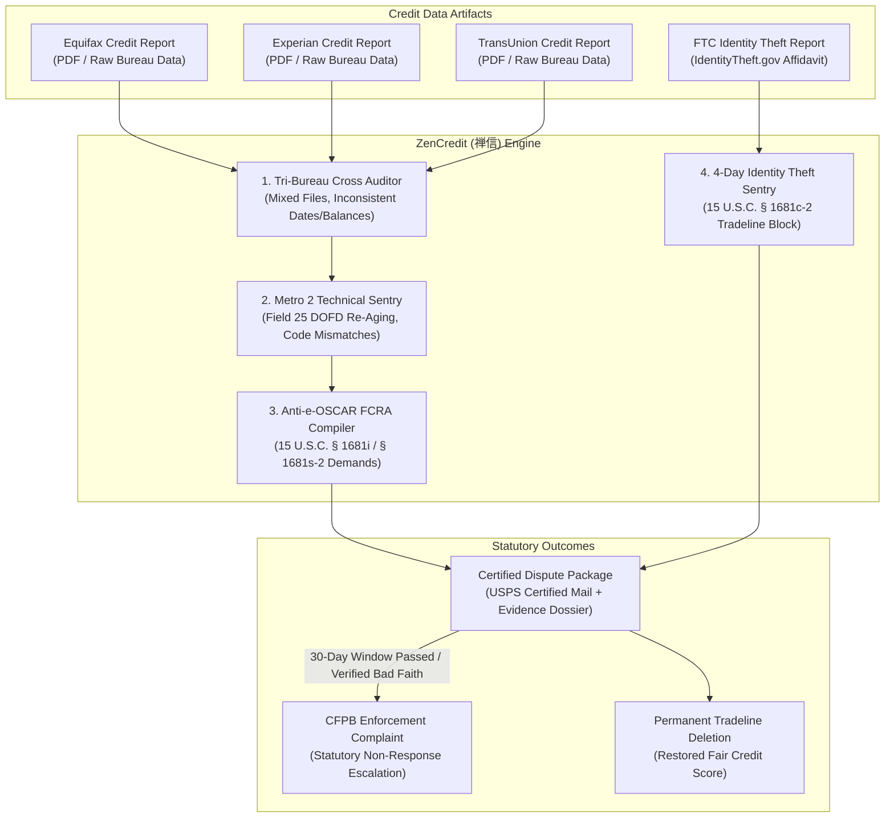

# zencredit-ai-skill (ZenCredit · 禅信)

> *"True credit reflects authentic integrity, not the distorted echoes of automated negligence." (人无信不立，籍有妄必正；荡涤瑕疵，还复清白。)*  
> Autonomous Tri-Bureau Credit Report Forensic Audit, Metro 2 Format Non-Compliance Sentry, FCRA § 611/§ 623 Statutory Reinvestigation Engine, e-OSCAR 2-Digit Reduction Disqualification, and Identity Theft Fraud Block Automation distilled from **the Fair Credit Reporting Act (15 U.S.C. § 1681), CDIA Metro 2 Resource Guide, and CFPB Directives**.

---

## 1. Overview & Architectural Problem Statement

Over 70 million Americans have errors on their consumer credit reports maintained by the three nationwide credit reporting agencies (CRAs: Equifax, Experian, TransUnion). Erroneous negative tradelines destroy consumer credit scores, resulting in predatory mortgage rates, denied auto loans, inflated insurance premiums, and blocked rental housing applications.

Consumers are trapped in an automated, Kafkaesque reporting complex:
1. **The e-OSCAR Two-Digit Reduction Scandal**: When a consumer mails a comprehensive dispute letter with bank statements and canceled checks, the credit bureaus do not read it. Instead, low-wage overseas contractors reduce the entire dossier to an arbitrary two-digit code (e.g. "01 - Not His/Hers", "08 - Account Closed") on the **e-OSCAR** clearinghouse system. Crucial supporting documents are never forwarded to the data furnisher, directly violating **FCRA § 611(a)(2) [15 U.S.C. § 1681i(a)(2)]**.
2. **Metro 2 Format Violations & Re-Aged Zombie Debt**: Collection agencies manipulate the **Date of First Delinquency (DOFD, Field 25)** in the CDIA Metro 2 reporting format to artificially extend the 7-year statutory obsolescence cutoff mandated by **15 U.S.C. § 1681c**, keeping expired debts on consumer files for a decade.
3. **Mixed Files & False Derogatory Cross-Contamination**: Bureaus match tradelines using partial Social Security Numbers or similar names, polluting a consumer's credit file with strangers' bankruptcies and foreclosures.
4. **Ignored Identity Theft Block Mandates**: Under **15 U.S.C. § 1681c-2**, when a consumer provides an official Identity Theft Report (FTC IdentityTheft.gov affidavit) and proof of identity, bureaus are legally mandated to block the fraudulent information within **4 business days**. Bureaus routinely ignore this statutory deadline.

**ZenCredit (禅信)** automates forensic credit auditing and statutory FCRA enforcement:
* **Tri-Bureau Tradeline Reconciliation (`TriBureauCrossAuditor`)**: Ingests reports from Equifax, Experian, and TransUnion simultaneously, aligning tradeline fields side-by-side to detect cross-bureau discrepancies, balance mismatches, and mixed-file data.
* **Metro 2 Specification Non-Compliance Sentry (`Metro2ComplianceAuditor`)**: Inspects reported tradeline attributes against CDIA Metro 2 technical standards (Account Status Field 17A, DOFD Field 25, Compliance Condition Code Field 19), identifying non-compliant reporting.
* **Anti-e-OSCAR Statutory Dispute Compiler (`FcraReinvestigationCompiler`)**: Compiles factual, customized dispute packets citing 15 U.S.C. § 1681i and § 1681s-2, legally demanding that bureaus forward all physical evidentiary attachments to furnishers and threatening § 1681n willful non-compliance statutory damages ($100–$1,000 per violation).
* **Identity Theft 4-Day Statutory Block Engine (`IdentityTheftBlockEngine`)**: Packages FTC Identity Theft Affidavits with formal § 1681c-2 demand letters, forcing nationwide bureaus to block fraudulent tradelines within 96 hours.



---

## 2. Core Architectural Subsystems

### 2.1 Tri-Bureau Tradeline Reconciliation (`TriBureauCrossAuditor`)
Performs 1-to-1 tradeline alignment across Equifax, Experian, and TransUnion:
* **Balance & Payment Status Discrepancies**: Identifies when Account X is marked "Paid in Full" on Experian but reported as an active collection on Equifax.
* **Mixed-File Detection**: Analyzes associated names, former addresses, and demographic variations to isolate credit contamination from individuals with similar names.

### 2.2 Metro 2 Specification Non-Compliance Sentry (`Metro2ComplianceAuditor`)
Audits tradelines against Consumer Data Industry Association (CDIA) technical specifications:
* **DOFD Re-Aging (Field 25)**: Calculates whether the Date of First Delinquency has been unlawfully advanced to reset the 7-year obsolescence clock under 15 U.S.C. § 1681c.
* **Compliance Condition Code (Field 19)**: Verifies that data furnishers correctly appended code "XB" (Account information disputed by consumer under Fair Credit Reporting Act). Failure to report the dispute violates FCRA § 623(a)(3).

### 2.3 Anti-e-OSCAR FCRA § 611 Reinvestigation Compiler (`FcraReinvestigationCompiler`)
Crafts dispute packages structured to prevent automated truncation:
* **Explicit Evidentiary Formatting**: Mandates that the CRA transmit all attached documentation to the furnisher pursuant to 15 U.S.C. § 1681i(a)(2).
* **Statutory Willfulness Warning**: Cites controlling appellate case law (e.g. *Cushman v. Trans Union Corp.*, *Stevenson v. TRW*) establishing that reliance on superficial e-OSCAR automated verification without inspecting documents constitutes reckless disregard under 15 U.S.C. § 1681n.

### 2.4 Identity Theft 4-Day Statutory Block Engine (`IdentityTheftBlockEngine`)
Automates urgent relief under 15 U.S.C. § 1681c-2:
* Bundles the verified FTC IdentityTheft.gov police/affidavit report, driver's license, and proof of address.
* Issues formal block demand requiring deletion within 4 business days, notifying the furnisher that the account resulted from identity theft.

---

## 3. OpenClaw MCP Tool Interfaces

```typescript
export interface TradelineDiscrepancy {
  accountName: string;
  accountNumberMasked: string;
  bureauReported: 'Equifax' | 'Experian' | 'TransUnion' | 'All';
  errorCategory: 're_aged_dofd' | 'mixed_file' | 'incorrect_balance' | 'unauthorized_inquiry' | 'identity_theft';
  reportedDofdDate?: string;
  calculatedStatutoryPurgeDate?: string;
  metro2ViolationField?: string;
}

export interface AuditCreditReportsParams {
  claimantFullName: string;
  claimantSsnLast4: string;
  equifaxTextContent?: string;
  experianTextContent?: string;
  transUnionTextContent?: string;
  priorDisputeHistoryNotes?: string;
}

export interface GenerateFcraDisputeParams {
  claimantProfile: {
    fullName: string;
    currentAddress: string;
    ssnLast4: string;
    dateOfBirth: string;
  };
  targetBureau: 'Equifax' | 'Experian' | 'TransUnion';
  disputedTradelines: Array<{
    furnisherName: string;
    accountNumber: string;
    statutoryFcraViolation: string;
    factualExplanation: string;
    documentaryProofNames: string[];
  }>;
  isIdentityTheftClaim: boolean;
  ftcAffidavitNumber?: string;
}
```

---

## 4. Human-in-the-Loop (HITL) Guardrails

1. **Factual Integrity Mandate**: ZenCredit will never dispute accurate, verified negative tradelines simply to artificially inflate a credit score. All disputes must be grounded in genuine factual or technical non-compliance.
2. **Identity Verification & Privacy**: Social Security Numbers and government IDs remain strictly encrypted in the local Secure Enclave and are never transmitted to external AI endpoints.
3. **Certified Mail Delivery**: Official dispute packages must be sent via USPS Certified Mail with Return Receipt Requested to preserve proof of the 30-day statutory reinvestigation clock.
