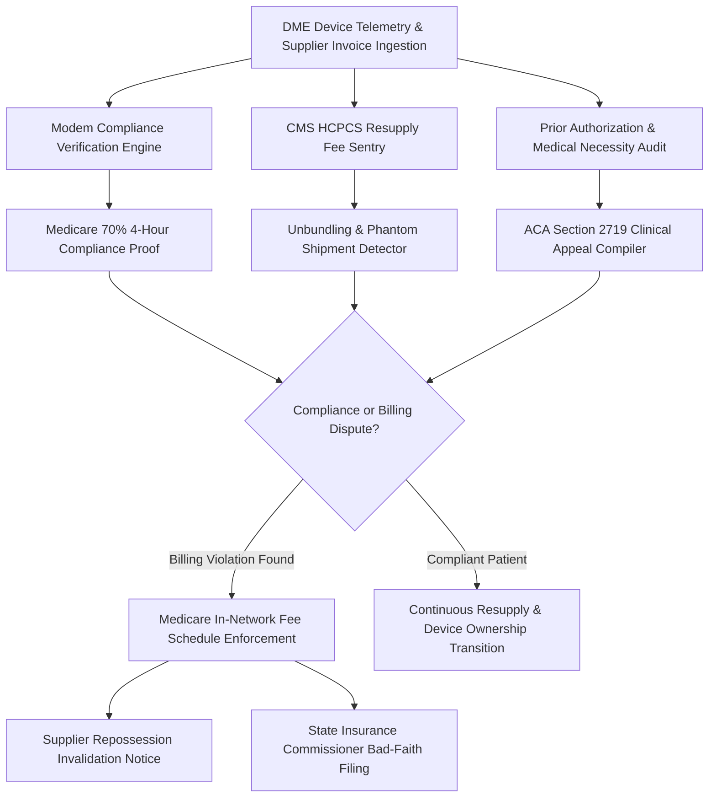

# zendme-ai-skill

## Overview
**ZenDME (禅械)** is an autonomous medical device consumer defense agent. It protects patients who rely on Durable Medical Equipment (DME)—such as CPAP/BiPAP machines for obstructive sleep apnea (OSA), Continuous Glucose Monitors (CGM) for diabetes, and oxygen concentrators—from predatory supplier billing, sudden insurance denials, and device repossession. By extracting machine compliance telemetry from SD cards and cloud modems, auditing CMS HCPCS coding schedules against Medicare/commercial maximum allowable fee thresholds, dismantling illegal phantom auto-shipments, and compiling clinical prior authorization appeal dossiers under ACA § 2719, ZenDME guarantees patient therapy continuity and prevents thousands of dollars in surprise out-of-pocket charges.



## Core Capabilities

### 1. CPAP & CGM Modem Telemetry Compliance Auditor
- Ingests raw sleep therapy telemetry from SD cards and manufacturer cloud APIs (ResMed myAir / AirView, Philips Care Orchestrator, OSCAR, SleepHQ) and continuous glucose data (Dexcom G7, Abbott FreeStyle Libre).
- Calculates the strict Medicare/commercial compliance threshold: usage exceeding **4 hours per night on at least 70% of nights within any consecutive 30-day window during the first 90 days of therapy**.
- Detects supplier clerical errors, time-zone shifts, or corrupted cellular modem uploads that lead to fraudulent compliance breach notices and threatened device repossessions.

### 2. CMS HCPCS Resupply Fee Schedule Sentry
- Ingests monthly recurring supplier bills for replacement supplies: masks (A7030, A7034), tubing (A7037), filters (A7038), and water chambers (A7046).
- Audits itemized billing against the Centers for Medicare & Medicaid Services (CMS) DMEPOS Fee Schedule and commercial in-network negotiated rates.
- Uncovers common industry abuses: unbundling bundled kits, charging 500% over the statutory maximum allowable rate, and billing patients via balance billing when the supplier is contractually bound to in-network rates.

### 3. Phantom Auto-Shipment & Subscription Trap Neutralizer
- Identifies unauthorized automatic supply shipments initiated without affirmative patient confirmation (violating Medicare regulations requiring verified replacement need prior to shipment).
- Generates formal legal notices rejecting phantom invoices, demanding prepaid return shipping labels, and halting unauthorized credit card recurring billing.

### 4. ACA § 2719 Expedited Prior Authorization Appeal Engine
- When an insurer suddenly cancels coverage or denies prior authorization for replacement machines, ZenDME compiles comprehensive clinical appeal packages.
- Cross-references diagnostic Polysomnography (PSG) sleep studies, Apnea-Hypopnea Index (AHI) metrics, Epworth Sleepiness Scale scores, and physician clinical notes to establish indisputable medical necessity under Section 2719 of the Affordable Care Act.
- Generates ready-to-dispatch internal appeal briefs and external Independent Review Organization (IRO) petitions.

## Input JSON Schema

```json
{
  "$schema": "http://json-schema.org/draft-07/schema#",
  "title": "ZenDMEDisputePayload",
  "type": "object",
  "required": ["patientInfo", "deviceDetails", "claimData"],
  "properties": {
    "patientInfo": {
      "type": "object",
      "required": ["patientId", "state", "insuranceCarrier"],
      "properties": {
        "patientId": { "type": "string" },
        "state": { "type": "string", "maxLength": 2 },
        "insuranceCarrier": { "type": "string" }
      }
    },
    "deviceDetails": {
      "type": "object",
      "required": ["deviceType", "manufacturer", "model", "therapyStartDate"],
      "properties": {
        "deviceType": { "type": "string", "enum": ["CPAP", "BIPAP", "CGM", "OXYGEN_CONCENTRATOR"] },
        "manufacturer": { "type": "string" },
        "model": { "type": "string" },
        "therapyStartDate": { "type": "string", "format": "date" },
        "modemSerialNumber": { "type": "string" }
      }
    },
    "claimData": {
      "type": "object",
      "required": ["supplierName", "hcpcsCodes", "billedAmount", "disputeType"],
      "properties": {
        "supplierName": { "type": "string" },
        "hcpcsCodes": {
          "type": "array",
          "items": { "type": "string" }
        },
        "billedAmount": { "type": "number" },
        "allowableAmount": { "type": "number" },
        "disputeType": { 
          "type": "string", 
          "enum": ["COMPLIANCE_DENIAL", "UNAUTHORIZED_AUTOSHIP", "EXCESSIVE_BALANCE_BILLING", "REPOSSESSION_THREAT"] 
        }
      }
    }
  }
}
```

## Node.js Implementation Example

```javascript
import { ZenDMEArbiter } from '@alpha-park/zendme-ai-skill';

const dmeCase = {
  patientInfo: {
    patientId: 'PT-994821',
    state: 'IL',
    insuranceCarrier: 'Blue Cross Blue Shield of Illinois'
  },
  deviceDetails: {
    deviceType: 'CPAP',
    manufacturer: 'ResMed',
    model: 'AirSense 11 AutoSet',
    therapyStartDate: '2024-01-10',
    modemSerialNumber: 'SN-24819203'
  },
  claimData: {
    supplierName: 'AdaptHealth / Apria Healthcare',
    hcpcsCodes: ['E0601', 'A7034', 'A7037', 'A7038'],
    billedAmount: 1840.00,
    allowableAmount: 412.50,
    disputeType: 'COMPLIANCE_DENIAL'
  }
};

const arbiter = new ZenDMEArbiter({
  cmsFeeScheduleYear: 2024,
  allowStateInsuranceEscalation: true
});

// 1. Audit raw telemetry for 70% 4-hour rule compliance
const complianceReport = await arbiter.verifyComplianceTelemetry({
  sdCardPath: './data/resmed_sd_card/',
  windowDays: 30
});
console.log('Compliance Status:', complianceReport.isCompliant ? 'VERIFIED PASSED' : 'FAILED');
console.log('Compliant Nights Ratio:', complianceReport.qualifyingNightsRatio * 100 + '%');

// 2. Audit resupply billing & generate legal challenge
const audit = await arbiter.auditSupplierBilling(dmeCase);
console.log('Excessive Surcharge Detected:', '$' + audit.excessiveBilledDelta);

const appealDossier = await arbiter.generateACAAppealAndRepossessionDefense(audit, complianceReport);
console.log('Dispute Dossier Compiled. Pages:', appealDossier.pageCount);
```
