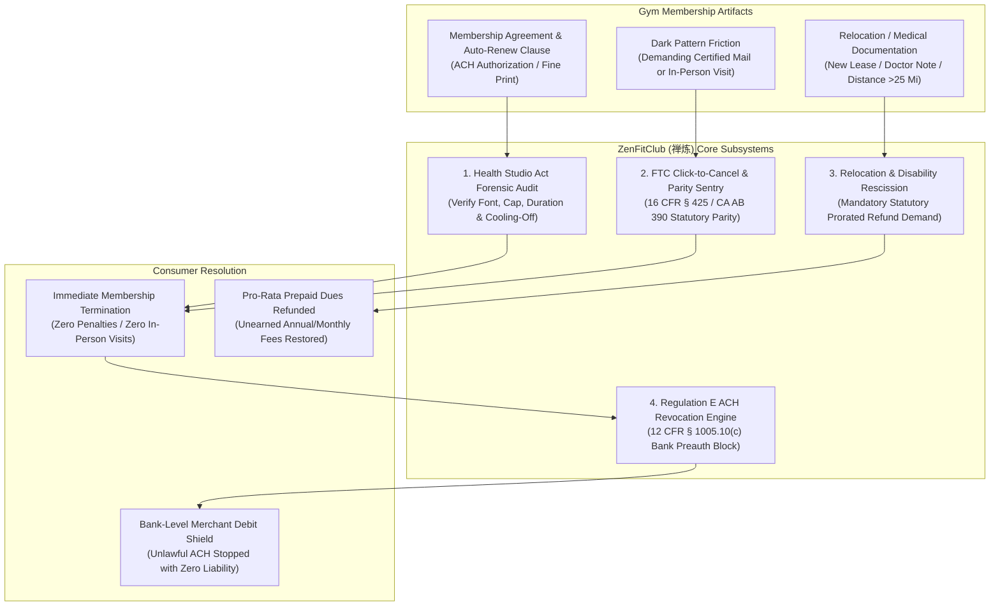

# zenfitclub-ai-skill (ZenFitClub · 禅炼)

> *"Commitment to physical wellness should never become a financial prison; arbitrary barriers to cancellation crumble before statutory parity." (强身健体本由心，岂容契约作囹圄；暗度陈仓阻退约，法定解禁还自由。)*  
> Autonomous Gym & Fitness Club Membership Dark-Pattern Cancellation, State Health Studio Services Act Enforcement, FTC Click-to-Cancel Parity, and Regulation E ACH Revocation Engine distilled from **the FTC Click-to-Cancel Rule (16 CFR Part 425), California Health Studio Services Act (CA Civ. Code § 1812.80 et seq.), Florida Health Studio Statute (FL Stat. § 501.017), New York Health Club Services Law (NY Gen. Bus. Law § 624), and CFPB Regulation E (12 CFR § 1005.10(c))**.

---

## 1. Overview & Architectural Problem Statement

Fitness clubs, commercial gyms, and boutique health studios (such as Planet Fitness, Equinox, LA Fitness, Anytime Fitness, and boutique franchise studios) routinely employ aggressive **subscription trap dark patterns**:
1. **The Asymmetrical Friction Dark Pattern**: Consumers can enroll instantly in 30 seconds via mobile app or web browser, but cancellation is deliberately restricted to certified mail or in-person appearances during restrictive manager-only working hours.
2. **Relocation & Disability Obstacle Mazes**: When members relocate over 25 miles away or suffer severe orthopedic injuries, gyms demand onerous, non-statutory proof (e.g. newly stamped utility bills, multi-year apartment leases, intrusive complete medical records) while continuing to debit recurring monthly dues.
3. **Statutory Health Studio Violations**: State Health Studio Services Acts (e.g. CA Civ. Code § 1812.80 et seq., NY Gen. Bus. Law § 624) mandate strict statutory protections: mandatory 3-to-5 day cooling-off rescission notices in 10-to-14 point bold font, statutory caps on total contract value (e.g. CA $4,400 max), and statutory bans on contracts exceeding 36 months. Omission of these mandatory statutory clauses makes the entire contract **void and unenforceable** by law!
4. **FTC "Click-to-Cancel" Rule (16 CFR Part 425)**: The Federal Trade Commission's Negative Option Rule explicitly prohibits sellers from requiring consumers who registered online to cancel via burdensome offline channels. The cancellation mechanism must be at least as simple and accessible as the enrollment pathway.
5. **Unauthorized ACH Direct Debit Plundering**: Gyms frequently demand checking account routing/account numbers to bypass credit card chargeback mechanisms. When consumers freeze credit cards, gyms continue pulling funds via ACH or refer accounts to aggressive third-party collections.

**ZenFitClub (禅炼)** automates consumer defense against gym subscription extortion:
* **Health Studio Contract Forensic Auditor (`HealthStudioAuditor`)**: Scans membership agreements against state Health Studio Services statutes for void clauses, non-compliant font sizes, missing cooling-off rights, and statutory contract duration violations.
* **FTC Click-to-Cancel & Electronic Parity Sentry (`ClickToCancelSentry`)**: Enforces 16 CFR Part 425 and state electronic cancellation statutes (e.g. CA AB 390 / SB 313), serving formal legal notices holding the facility in statutory violation if online cancellation is denied.
* **Relocation & Medical Disability Statutory Rescission Compiler (`RelocationDisabilityCompiler`)**: Assembles verified statutory lease breaks for members moving >25 miles from any affiliated facility or suffering medical disability, demanding immediate contract termination and pro-rata prepaid fee refunds.
* **Regulation E Bank Pre-Authorized ACH Stop-Payment Lock (`RegEAchRevocationLock`)**: Formulates CFPB Regulation E (12 CFR § 1005.10(c)) statutory stop-payment notices to the consumer's bank, revoking debit authorization and immunizing against wrongful overdraft charges or collections.



---

## 2. Core Architectural Subsystems

### 2.1 HealthStudioAuditor: State Statutory Compliance Engine
Audits agreements against state-specific fitness facility consumer protection statutes:
* **California Health Studio Services Act (CA Civil Code §§ 1812.80–1812.97)**:
  * Maximum contract duration: cannot exceed 3 years (§ 1812.84).
  * Financial cap: total contract payments cannot exceed $4,400 (§ 1812.86).
  * Required 5-day cancellation cooling-off disclosure in 14-point bold type (§ 1812.85).
  * Failure to comply renders the contract **void and unenforceable** as contrary to public policy (§ 1812.91), entitling the consumer to treble damages plus attorney fees (§ 1812.94).
* **Florida Health Studio Services Act (FL Stat. § 501.017)**:
  * Mandatory 3-business-day right of rescission with full refund within 30 days.
  * Mandatory cancellation clause upon death or disability certified by a physician.
  * Mandatory cancellation upon permanent relocation of member greater than 25 miles from the facility.
* **New York Health Club Services Law (NY Gen. Bus. Law §§ 620–631)**:
  * Requires 3-day right to cancel, maximum 36-month term, and bonded registration with state consumer authorities.

### 2.2 ClickToCancelSentry: FTC & State Digital Parity Enforcement
* **FTC Click-to-Cancel Rule (16 CFR Part 425)**: Mandates that negative option cancellation mechanisms must be as simple to use as the consent mechanism. If enrolled online via website or mobile app, the business cannot require an in-person visit or phone negotiation with a retention specialist.
* **State Automatic Renewal Laws (e.g. CA Business & Professions Code § 17602, IL 815 ILCS 601/)**: Mandates that any consumer who accepted an automatic renewal offer online must be allowed to terminate the subscription entirely online, without engaging in further steps.
* Generates statutory breach notices citing potential FTC civil penalties (up to $50,120 per violation) and state unfair competition statutes (e.g. CA UCL § 17200).

### 2.3 RelocationDisabilityCompiler: Relocation & Medical Break Engine
* **25-Mile Radius Geocoding Verification**: Calculates driving distance between the consumer's new verified residential address and the nearest franchised facility operated under the club's brand.
* **Statutory Relocation Rescission Notice**: Compiles standard proof of new domicile (utility statement, lease summary, or employer transfer letter) and serves notice demanding cancellation within 15–30 days with pro-rated refund of all prepaid dues.
* **Medical Disability Certification**: Synthesizes a standardized, HIPAA-compliant physician certification stating the member has sustained a physical disability preventing participation in athletic activities, halting future dues accrual immediately.

### 2.4 RegEAchRevocationLock: Bank-Level ACH Stop-Payment Sentry
* Under the **Electronic Fund Transfer Act (EFTA, 15 U.S.C. § 1693e)** and **CFPB Regulation E (12 CFR § 1005.10(c))**, a consumer has the absolute statutory right to stop payment of a pre-authorized electronic fund transfer by notifying their financial institution orally or in writing at least 3 business days before the scheduled transfer.
* Issues a formal **Written Notice of Pre-Authorized Transfer Authorization Revocation** to both the fitness facility and the consumer's depository bank.
* Precludes the financial institution from assessing insufficient funds fees or permitting unauthorized ACH debits once revocation has been received.

---

## 3. Tool Specifications & MCP Interfaces

```typescript
// MCP Tool 1: Audit gym contract against state Health Studio Services Acts
interface AuditGymContractParams {
  stateOfContract: 'CA' | 'FL' | 'NY' | 'IL' | 'TX' | string;
  contractRawText: string;
  enrollmentChannel: 'online_website' | 'mobile_app' | 'in_person_facility';
  monthlyDuesUsd: number;
  initiationFeeUsd: number;
  contractTermMonths: number;
  coolingOffDisclosed: boolean;
  coolingOffFontPt?: number;
}

interface GymContractAuditResult {
  isContractStatutorilyVoid: boolean;
  statutoryViolationsDetected: Array<{
    statuteCitation: string;
    violationType: 'missing_cooling_off' | 'term_exceeds_cap' | 'financial_cap_exceeded' | 'dark_pattern_cancellation_barrier';
    severity: 'fatal_void' | 'regulatory_penalty' | 'remedial';
    description: string;
  }>;
  ftcClickToCancelViolation: boolean;
  stateElectronicCancellationMandateApplies: boolean;
  recommendedAction: 'demand_statutory_unwind' | 'click_to_cancel_parity_demand' | 'standard_cooling_off_rescission';
}

// MCP Tool 2: Generate Relocation or Disability Cancellation Dossier
interface GenerateRelocationCancellationParams {
  memberFullName: string;
  memberEmail: string;
  memberId: string;
  gymFacilityName: string;
  facilityAddress: string;
  stateCode: string;
  cancellationGround: 'relocation_over_25_miles' | 'medical_disability' | 'cooling_off_period';
  newAddress?: string;
  calculatedDistanceMiles?: number;
  physicianNoteSummary?: string;
  unusedPrepaidDuesUsd: number;
}

interface RelocationCancellationDossier {
  formalRescissionNoticeMarkdown: string;
  statuteCitations: string[];
  proratedRefundDemandedUsd: number;
  deliveryMethodRecommended: 'certified_mail_and_email' | 'digital_parity_portal';
  statutoryResponseDeadlineDays: number;
}

// MCP Tool 3: Generate Regulation E ACH Revocation Notice to Bank
interface GenerateRegEAchRevocationParams {
  consumerFullName: string;
  bankName: string;
  bankRoutingNumberMasked: string;
  accountNumberMasked: string;
  gymMerchantOriginatorName: string;
  gymMerchantCompanyId?: string;
  expectedRecurringAmountUsd: number;
  cancellationDateServed: string;
}

interface RegEAchRevocationResult {
  formalBankNoticeMarkdown: string;
  regulationECitation: string; // "12 CFR § 1005.10(c)"
  merchantNoticeMarkdown: string;
  bankLiabilityWarning: string;
}
```

---

## 4. Human-In-The-Loop (HITL) Guardrails

1. **Verification of Membership ID and Account**: The agent never dispatches a binding cancellation or ACH stop-payment request without verified human approval of member ID, gym branch name, and bank details.
2. **Medical Privacy & HIPAA Redaction**: When processing medical disability certificates, the agent strictly redacts diagnostic codes and private health details, retaining only the authorized physician's certification of physical disability preventing gym activity.
3. **Prorated Refund Calculation Transparency**: The system presents a detailed itemization of prepaid annual fees, monthly dues already debited, and days elapsed before demanding refunds.

---

## 5. Zen Ethical & Operational Alignment

* **Kyoto Minimalism**: Clean, unambiguous, and resolute communication. No hostile escalation—pure statutory leverage and non-negotiable compliance.
* **Consumer Freedom of Movement**: Physical fitness is a voluntary endeavor. Trapping individuals in recurring billing when they have moved, become injured, or simply chosen to discontinue is predatory commercial conduct.
* **Statutory Certainty**: Leverages established federal and state consumer statutes that make deceptive fitness contracts null and void by operation of law.
