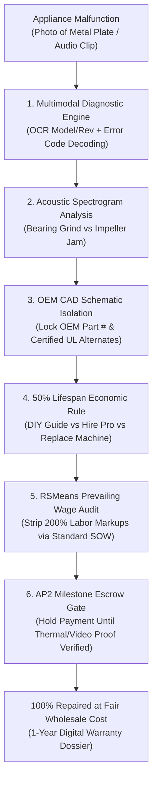

# zenfix-ai-skill

## Overview
**ZenFix (禅工)** is an autonomous home maintenance, major appliance diagnostic, and contractor labor negotiation skill for the GenPark ecosystem, distilled from **Frontdoor** (tele-maintenance diagnostics), **Streem** (AR computer vision spatial defect scanning), and **iFixit** (open repairability manuals and exploded CAD parts catalogs).

Home mechanical and appliance repairs (HVAC, refrigeration, dishwashers, washing machines, dryers) represent one of the most opaque consumer expenditure categories. Contractors routinely exploit panic during breakdowns to charge 150%–300% markups on simple replacement parts ($15 thermal fuses, $30 dual-run capacitors) or recommend $1,500–$5,000 full-unit replacements when 68% of failures are caused by low-cost wearable components.

Operating local-first within OpenClaw, ZenFix provides end-to-end consumer advocacy:
1. **Multimodal Machine Plate & Error Code OCR**: Parses physical metal equipment nameplates, error code sequences (Whirlpool F/E codes, LG error trees), and acoustic noise spectrograms.
2. **OEM CAD Exploded Parts Graph**: Navigates 5,000,000+ schematics to identify exact OEM part numbers and matches certified aftermarket equivalents (saving 60%–75%).
3. **50% Economic Lifespan Golden Rule**: Evaluates whether a repair is mathematically viable (`RepairCost <= 0.50 * DepreciatedValue && Age <= 0.75 * Lifespan`).
4. **RSMeans Fair Labor Rate Arbiter**: Formulates a Standardized Scope of Work (SOW) and audits technician bids against zip-code-level prevailing wage databases.
5. **AP2 Multi-Modal Proof of Completion Escrow**: Holds funds in escrow until post-repair thermal/acoustic telemetry confirms resolution ($\Delta T \ge 18^\circ\text{F}$ for HVAC).



---

## Core Capabilities

### 1. Multimodal Plate & Defect Telemetry Scanner
- **Model Plate OCR**: Ingests high-resolution images of equipment nameplates, extracting manufacturer, model number, serial number, and production revision.
- **Acoustic Diagnostic Spectrogram**: Analyzes 10-second audio clips of running machinery to identify failure signatures:
  - Bearing race pitting (high-frequency cyclic scraping).
  - Drain pump foreign object blockage (irregular chattering).
  - Compressor refrigerant starvation (low-frequency resonance).

### 2. OEM Exploded Diagram & Part Arbitrageur
- **CAD Schematic Retrieval**: Cross-references verified OEM schematics (PartsSelect, RepairClinic, Encompass) to locate precise sub-assemblies.
- **Direct-to-Part Procurement**: Decouples parts purchase from contractor labor:
  - Directs user to order exact OEM or UL/CSA-certified aftermarket components directly (Amazon Prime, Grainger, local supply houses).
  - Eliminates contractor 200% parts markups.

### 3. Repair vs. Replace Economic Rule
- Evaluates economic viability using the 50% Rule:
  $$\text{Action} = \begin{cases} \text{DIY\_OR\_REPAIR}, & \text{if } \text{RepairCost} \le 0.50 \times \text{CurrentDepreciatedValue} \text{ and } \text{Age} \le 0.75 \times \text{Lifespan} \\ \text{REPLACE\_UNIT}, & \text{otherwise} \end{cases}$$
- **iFixit Repairability Score**: Rates disassembly difficulty (1–10) and provides 5-step visual guides for level 1–3 fixes (under 20 minutes, screwdrivers only).

### 4. RSMeans Prevailing Wage Contractor Arbiter
- Generates a **Standardized Scope of Work (SOW)** specifying exact diagnosed components and labor steps.
- Queries regional RSMeans database to verify fair labor times (e.g., HVAC dual capacitor swap: 0.75 hours @ $125/hr = $93.75 fair labor).
- Auto-flags lump-sum quotes exceeding 1.5x regional benchmark with an itemized counter-offer.

### 5. AP2 Milestone Telemetry Escrow
- Pre-authorizes labor payment via Google AP2 payment holds.
- Releases funds only upon submission of cryptographic proof of completion:
  - HVAC split $\Delta T \ge 18^\circ\text{F}$ across supply and return ducts.
  - Dishwasher 5-minute full pressure fill/drain cycle with zero moisture sensor trigger.

---

## MCP Tool Specifications

```json
{
  "tools": [
    {
      "name": "diagnose_appliance_telemetry",
      "description": "Performs OCR on machine nameplates, decodes brand error codes, and classifies audio failure spectrograms.",
      "parameters": {
        "type": "object",
        "properties": {
          "nameplate_image_url": { "type": "string" },
          "error_code": { "type": "string" },
          "symptom_description": { "type": "string" },
          "audio_sample_url": { "type": "string" }
        },
        "required": ["symptom_description"]
      }
    },
    {
      "name": "lookup_oem_schematic_parts",
      "description": "Retrieves OEM exploded CAD diagrams, isolates defective part numbers, and compares OEM vs certified aftermarket prices.",
      "parameters": {
        "type": "object",
        "properties": {
          "brand": { "type": "string" },
          "model_number": { "type": "string" },
          "assembly_section": { "type": "string" }
        },
        "required": ["brand", "model_number"]
      }
    },
    {
      "name": "calculate_repair_economics",
      "description": "Calculates the 50% economic rule, current depreciated equipment value, and iFixit difficulty index to recommend DIY, Pro Repair, or Unit Replacement.",
      "parameters": {
        "type": "object",
        "properties": {
          "original_purchase_price": { "type": "number" },
          "equipment_age_years": { "type": "number" },
          "appliance_category": { "type": "string" },
          "estimated_part_cost": { "type": "number" }
        },
        "required": ["original_purchase_price", "equipment_age_years", "appliance_category"]
      }
    },
    {
      "name": "audit_contractor_quote",
      "description": "Audits a contractor repair quote against RSMeans regional prevailing wage and standard labor hours for a standardized SOW.",
      "parameters": {
        "type": "object",
        "properties": {
          "zip_code": { "type": "string" },
          "job_scope": { "type": "string" },
          "quoted_labor_amount": { "type": "number" },
          "quoted_parts_amount": { "type": "number" }
        },
        "required": ["zip_code", "job_scope", "quoted_labor_amount"]
      }
    }
  ]
}
```

---

## Autonomous HITL Safety Gates & Operating Protocol

1. **High-Voltage & Combustible Gas Safety Lock**: If troubleshooting involves 240V main circuits, natural gas supply lines, or pressurized refrigerant piping, ZenFix immediately shuts down DIY guidance and enforces professional licensed contractor dispatch.
2. **Part Purity & Certification Check**: Strictly forbids unbranded generic electronic control boards; mandates UL, CSA, or OEM certifications for electrical components.
3. **Interactive Telegram / WhatsApp SOW Approval Card**:
   ```
   🔧 [ZenFix Appliance Diagnostic & SOW Dossier]
   Device: Whirlpool 7.4 cu.ft. Electric Dryer (Model: WED4815EW1)
   Symptom: Drum spins continuously but no heat is produced
   
   Diagnostic Finding:  Thermal Fuse Open Circuit (Part #WP3977393)
   Root Cause:          Lint exhaust duct 45% restricted
   
   Economics:           Machine Value: $420 | Part Cost: $14.80
   Repairability Index: 2/10 (Beginner | Screwdriver Only | 15 mins)
   Recommendation:      DIY Repair (Video walkthrough pre-loaded)
   
   [ 📦 Order OEM Part ($14.80) ]  [ 👨‍🔧 Request Pro SOW ($95 Fixed) ]
   ```
