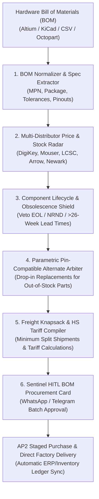

# zenforge-ai-skill

## Overview
**ZenForge (禅铸)** is an autonomous hardware engineering procurement, bill-of-materials (BOM) synthesis, and supply chain arbitrage skill for the GenPark ecosystem, distilled from **Waybill** (YC S2026 hardware procurement autopilot) and parametric electronic component exchange models.

Hardware development, prototyping, and small-batch electronics manufacturing suffer from massive operational friction: engineering teams spend up to 30% of their development cycles manually copy-pasting manufacturer part numbers (MPNs), checking 5–10 separate distributor portals (DigiKey, Mouser, Newark, Arrow, LCSC), getting blindsided by sudden lead-time blowouts (32+ weeks) or obsolete parts (EOL/NRND), navigating complex volume price-break tiers, and managing fragmented international freight and customs paperwork.

Operating local-first within OpenClaw, ZenForge provides a complete autonomous hardware procurement loop:
1. **Multimodal Engineering BOM & CAD Ingestion**: Ingests Altium, KiCad, Eagle, or CSV/Excel BOMs, normalizing manufacturer part numbers (MPNs), reference designators, package footprints, and tolerance specs.
2. **Federated Real-Time Multi-Distributor Inventory Radar**: Simultaneously queries global franchised distributors (DigiKey, Mouser, Arrow, Newark, LCSC, JLCPCB) for live stock counts, cut-tape/reel packaging, MOQs, and volume price breaks.
3. **Parametric Pin-Compatible Alternate Arbiter**: Evaluates component datasheets to find identical pin-compatible, drop-in replacement parts (matching package, pinout, voltage limits, ESR, thermal coefficients) to resolve stockouts and eliminate distributor price gouging.
4. **Lifecycle & Obsolescence Sentinel (EOL / NRND)**: Screens every component against factory obsolescence notices (Active, EOL, NRND, Last Time Buy) and lead-time spikes before committing procurement.
5. **Harmonized Tariff (HS Code) & Knapsack Freight Consolidation**: Computes global import tariffs by classifying components into standard HS codes and optimizes multi-vendor shipments into minimum-cost shipping knapsacks.



---

## Core Capabilities

### 1. Engineering BOM Ingestion & Parametric Normalization
- Ingests varied hardware export formats: Altium Designer, KiCad, Eagle, OrCAD, and standard tabular CSV/Excel manifests.
- Extracts and standardizes:
  - Manufacturer Part Number (MPN).
  - Target Quantity & Reference Designators (e.g., C1-C14, R5, U2).
  - Component Package Footprint (e.g., 0402, 0603, QFN-32, SOT-23-5).
  - Parametric Constraints: Capacitance/Resistance, Voltage Ratings, Tolerance (±1%, ±5%), Dielectric (X5R, X7R, C0G), and Operating Temperature ranges.

### 2. Multi-Distributor Live Inventory & Price Curve Compiler
- Simultaneously queries global electronic component distributor APIs:
  - North America / Europe: DigiKey, Mouser, Newark/Element14, Arrow Electronics.
  - Asia / Quick-Turn: LCSC, JLCPCB SMT Library, HQChip.
- Generates real-time price-break step functions:
  $$\text{Unit Cost}(Q) = f(Q, \text{Distributor Tier Price Breaks})$$
- Evaluates packaging types: Cut Tape, Tape & Reel, Digi-Reel, Tube, and Tray, ensuring compatibility with SMT pick-and-place feeders.

### 3. Pin-Compatible Parametric Alternate Arbiter
- When a primary MPN is out of stock or overpriced due to distributor allocation:
  - Queries parametric component databases for pin-compatible drop-in replacements.
  - Verifies exact pinout alignment, footprint pitch, logic thresholds ($V_{IH}, V_{IL}$), package height clearances, and thermal dissipation ratings.
  - Computes a **Substitution Confidence Score (0–100%)**; flags non-critical passive substitutions (e.g., swapping a 10µF 0603 capacitor from Yageo to Murata or TDK) for automated approval.

### 4. Lifecycle & Supply Chain Risk Sentinel
- Verifies factory production lifecycle status:
  - **Active**: Safe for mass production.
  - **NRND (Not Recommended for New Designs)**: Triggers redesign warning.
  - **EOL (End-of-Life) / LTB (Last Time Buy)**: Blocks purchase and proposes second-source alternates.
- Monitors factory lead-time trends; alerts engineers if a component's lead time unexpectedly spikes beyond 16–26 weeks.

### 5. Freight Knapsack & Harmonized Customs Optimization
- Classifies each electrical component into standard 6-digit to 10-digit Harmonized System (HS) export/import tariff codes (e.g., HS 8542.31 for processors, HS 8532.24 for multilayer ceramic capacitors).
- Solves multi-vendor shipment partitioning:
  - Balances distributor line-item price deltas against fragmented shipping costs ($25 flat international express fees per distributor).
  - Clusters orders to hit free shipping thresholds ($50 Mouser, $100 DigiKey) while respecting assembly line schedule deadlines.

---

## MCP Tool Specifications

```json
{
  "tools": [
    {
      "name": "ingest_hardware_bom",
      "description": "Parses and standardizes hardware Bill of Materials (BOM) files across Altium, KiCad, or CSV/Excel formats into strongly typed component arrays.",
      "parameters": {
        "type": "object",
        "properties": {
          "bom_file_path": { "type": "string" },
          "board_revision": { "type": "string" },
          "target_production_quantity": { "type": "integer", "default": 10 }
        },
        "required": ["bom_file_path"]
      }
    },
    {
      "name": "scan_distributor_inventory_pricing",
      "description": "Scans real-time inventory, packaging availability, lead times, and tiered price breaks across global component distributors.",
      "parameters": {
        "type": "object",
        "properties": {
          "mpn_list": { "type": "array", "items": { "type": "string" } },
          "preferred_distributors": { "type": "array", "items": { "type": "string" } },
          "target_quantity": { "type": "integer" }
        },
        "required": ["mpn_list", "target_quantity"]
      }
    },
    {
      "name": "find_pin_compatible_alternates",
      "description": "Finds pin-compatible, drop-in replacement component alternates for out-of-stock or high-lead-time parts based on parametric electrical constraints.",
      "parameters": {
        "type": "object",
        "properties": {
          "mpn": { "type": "string" },
          "package": { "type": "string" },
          "critical_parameters": { "type": "object" },
          "max_acceptable_lead_time_weeks": { "type": "integer", "default": 4 }
        },
        "required": ["mpn", "package"]
      }
    },
    {
      "name": "audit_component_lifecycle",
      "description": "Audits component lifecycle states (Active, EOL, NRND, Obsolete) and historical lead-time volatility to eliminate single points of failure.",
      "parameters": {
        "type": "object",
        "properties": {
          "mpn_list": { "type": "array", "items": { "type": "string" } }
        },
        "required": ["mpn_list"]
      }
    },
    {
      "name": "optimize_procurement_knapsack",
      "description": "Solves multi-distributor shipping, volume pricing, and customs tariff knapsack optimization to minimize landed BOM cost and delivery time.",
      "parameters": {
        "type": "object",
        "properties": {
          "bom_line_items": { "type": "array", "items": { "type": "object" } },
          "destination_country": { "type": "string", "default": "US" },
          "target_delivery_deadline": { "type": "string" }
        },
        "required": ["bom_line_items"]
      }
    }
  ]
}
```

---

## Autonomous HITL Safety Gates & Operating Protocol

1. **Active/EOL Circuit Breaker**: ZenForge automatically halts automated purchase orders if any active BOM component carries an EOL, Obsolete, or NRND status without an engineer-approved drop-in replacement.
2. **Silicon Revision & Footprint Gate**: Never substitute active ICs (microcontrollers, FPGAs, power management ICs) without explicit Human-In-The-Loop approval, even if pinouts appear identical, due to silicon errata and firmware register differences.
3. **Packaging Feeder Verification**: Enforces minimum reel/tape packaging requirements for automated pick-and-place lines (e.g., minimum 200mm leader tape on cut-tape reels).
4. **Interactive WhatsApp / Telegram Approval Card**:
   ```
   ⚡ [ZenForge Hardware BOM Procurement Dossier]
   Project: Drone Flight Controller v2.1 (Batch: 100 Units)
   Total Unique Line Items: 42 | Total Components: 1,840
   
   Sourcing Breakdown:
   - Mouser:  24 Lines | $482.10 (Free 2-Day Air)
   - DigiKey: 15 Lines | $315.40 (Free 2-Day Air)
   - LCSC:     3 Lines |  $78.50 ($16.00 DHL Express)
   
   Substitutions & Alternates:
   - Swapped STM32F405RGT6 ($14.50, 28-wk lead time) -> STM32F405RGT6V ($9.20, In Stock) [Drop-in 100%]
   - Swapped 0402 100nF Yageo -> Murata GRM155R71C104KA88D (Saved 32%)
   
   Total Landed Cost: $892.00 (Saved $348.60 vs Single-Vendor Quoting)
   Lead Time to Factory Dock: 3 Business Days
   
   [ ✅ Authorize Staged AP2 Purchase ]  [ 🔍 Inspect Full BOM Diff ]
   ```
