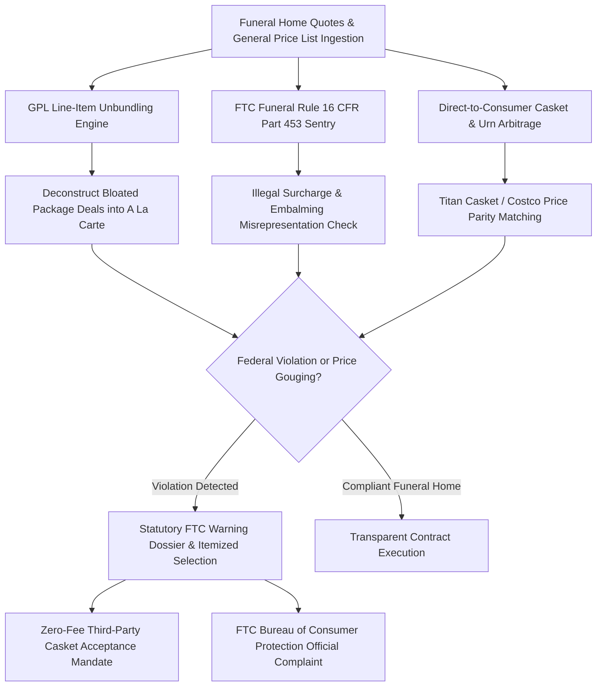

# zenfuneral-ai-skill

## Overview
**ZenFuneral (ZenHaven / 禅安)** is an autonomous funeral consumer defense and pricing transparency agent. It shields grieving families during their most emotionally vulnerable moments from predatory funeral home price-gouging and deceptive sales practices. By ingesting and unbundling funeral home General Price Lists (GPL), enforcing the federal **FTC Funeral Rule (16 CFR Part 453)**, eliminating illegal third-party casket handling surcharges ($500–$1,500), arbitrating direct-to-consumer casket pricing (saving $3,000–$7,000 via Costco/Titan Casket), debunking false "mandatory embalming" claims, and auditing prepaid funeral insurance trusts, ZenFuneral preserves thousands of dollars in family savings while ensuring dignified end-of-life arrangements.



## Core Capabilities

### 1. General Price List (GPL) Unbundling & OCR Parser
- Extracts and standardizes funeral home General Price Lists (GPL), Casket Price Lists (CPL), and Outer Burial Container Price Lists (OBCPL).
- Deconstructs all-inclusive package deals (e.g. "Traditional Burial Package" at $12,000–$20,000) into unbundled, itemized statutory components.
- Strips out redundant duplicate charges (e.g. charging separately for "transfer of remains" when already rolled into the basic services fee).

### 2. FTC Funeral Rule (16 CFR Part 453) Violation Sentry
- Strictly enforces federal statutory consumer protections:
  - **Right to Select Individual Goods**: Funeral providers cannot condition the purchase of any good or service upon the purchase of any other good or service.
  - **Prohibition of Casket Handling Fees (16 CFR § 453.4(b)(1))**: Funeral homes are strictly prohibited from charging a fee, fee premium, or extra service charge for accepting a casket purchased from a third-party retailer.
  - **Misrepresentation of Embalming Laws (16 CFR § 453.3(a))**: Flags deceptive statements claiming that state law mandates chemical embalming for viewings or immediate burial/cremation.
  - **Alternative Containers for Direct Cremation (16 CFR § 453.3(b))**: Prevents homes from forcing consumers to purchase a hardwood casket for cremation, enforcing access to inexpensive unfinished wood or cardboard alternative containers.

### 3. Direct-to-Consumer Casket & Urn Price Arbitrage
- Matches funeral home showroom caskets ($3,000–$8,000) with identical 18-gauge/20-gauge steel and solid wood models available direct-to-consumer (Titan Casket, Costco, Overton Casket) at $800–$1,500.
- Computes net household savings (typically $3,000–$6,000 per service).
- Generates the formal delivery acceptance notification citing federal statutes to compel the funeral director to accept the external casket without resistance or penalty.

### 4. Pre-Need Funeral Insurance & Trust Audit
- Audits prepaid funeral arrangements, cemetery plot contracts, and state regulated funeral trusts.
- Evaluates contract portability upon relocation, interest accrual guarantees, and cancellation refund formulas under state pre-need funeral sales statutes.

## Input JSON Schema

```json
{
  "$schema": "http://json-schema.org/draft-07/schema#",
  "title": "ZenFuneralDisputePayload",
  "type": "object",
  "required": ["caseInfo", "funeralHomeQuote", "servicePreferences"],
  "properties": {
    "caseInfo": {
      "type": "object",
      "required": ["state", "dispositionType"],
      "properties": {
        "state": { "type": "string", "maxLength": 2 },
        "dispositionType": { "type": "string", "enum": ["BURIAL", "CREMATION", "GREEN_BURIAL", "DONATION"] }
      }
    },
    "funeralHomeQuote": {
      "type": "object",
      "required": ["funeralHomeName", "totalQuoted", "lineItems"],
      "properties": {
        "funeralHomeName": { "type": "string" },
        "totalQuoted": { "type": "number" },
        "lineItems": {
          "type": "array",
          "items": {
            "type": "object",
            "required": ["description", "price"],
            "properties": {
              "description": { "type": "string" },
              "price": { "type": "number" },
              "isThirdPartyCasketFee": { "type": "boolean" },
              "isEmbalmingIncluded": { "type": "boolean" }
            }
          }
        }
      }
    },
    "servicePreferences": {
      "type": "object",
      "properties": {
        "casketSource": { "type": "string", "enum": ["FUNERAL_HOME", "DIRECT_TO_CONSUMER_TITAN_COSTCO"] },
        "viewingRequested": { "type": "boolean" },
        "refrigerationPreferredOverEmbalming": { "type": "boolean" }
      }
    }
  }
}
```

## Node.js Implementation Example

```javascript
import { ZenFuneralArbiter } from '@alpha-park/zenfuneral-ai-skill';

const funeralCase = {
  caseInfo: {
    state: 'PA',
    dispositionType: 'BURIAL'
  },
  funeralHomeQuote: {
    funeralHomeName: 'Heritage Memorial Chapel LLC',
    totalQuoted: 14250.00,
    lineItems: [
      { description: 'Basic Services of Funeral Director & Staff', price: 2495.00 },
      { description: 'Transfer of Remains to Funeral Home', price: 550.00 },
      { description: 'Embalming (Claimed Mandatory by Staff)', price: 1195.00, isEmbalmingIncluded: true },
      { description: '20-Gauge Gasketed Steel Casket (Showroom)', price: 4895.00 },
      { description: 'Third-Party Casket Handling & Receiving Fee', price: 850.00, isThirdPartyCasketFee: true },
      { description: 'Hearse Transportation', price: 650.00 }
    ]
  },
  servicePreferences: {
    casketSource: 'DIRECT_TO_CONSUMER_TITAN_COSTCO',
    viewingRequested: true,
    refrigerationPreferredOverEmbalming: true
  }
};

const arbiter = new ZenFuneralArbiter({
  jurisdiction: 'PA',
  enforceFtcRule: true
});

const auditResult = await arbiter.auditQuoteAgainstFtcRule(funeralCase);
console.log('Illegal Surcharges Stripped:', '$' + auditResult.illegalFeesIdentified);
console.log('Casket Arbitrage Savings:', '$' + auditResult.casketArbitrageSavings);
console.log('Total Family Savings:', '$' + auditResult.totalPotentialSavings);

const itemizedDirective = await arbiter.generateFtcStatementAndItemizedOrder(auditResult);
console.log('Binding Itemized Goods Order & FTC Warning Letter Generated. Pages:', itemizedDirective.pageCount);
```
