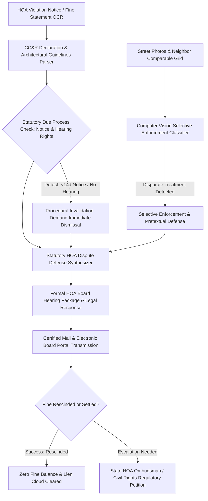

# ZenHOA: Autonomous Homeowners Association Fine Dispute & CC&R Defense Agent

`zenhoa-ai-skill` is an open-standard, production-grade autonomous decision agent distilled from **TownSq (`townsq.io`)**, **Condo Control (`condocontrol.com`)**, and **DoNotPay HOA Defense** paradigms. Over 75 million residents in the United States and Canada reside in common-interest communities governed by Homeowners Associations (HOAs) and Condominium Boards. HOAs possess extraordinary statutory powers—including the ability to assess daily recurring fines, suspend access to common amenities, and place foreclosure-enabling assessment liens on private homes.

In practice, volunteer board directors and third-party property management companies routinely weaponize HOA rules into petty, selective tyranny: levying $50–$500/day penalties for unkempt lawn edging, garbage cans retrieved 2 hours past collection deadlines, unapproved solar panels, or exterior paint variations. Over 70% of HOA violation notices violate basic statutory procedural due process: failing to provide mandatory 14-day advance notice, denying formal hearing requests before an impartial committee, or engaging in unlawful **Selective Enforcement (选择性执法)** against disfavored residents.

ZenHOA arms homeowners with automated legal defense: deconstructing complex CC&R declarations, identifying statutory due process violations under state laws, assembling photographic comparative grids proving selective enforcement, and drafting formal hearing dispute briefs to vacate fines and protect home equity.



---

## 1. Core Architectural Capabilities

### 1.1 Multimodal CC&R Declarations & Architectural Guidelines Parsing
HOA rulebooks comprise hundreds of pages of interrelated Covenants, Conditions, and Restrictions (CC&Rs), bylaws, board resolutions, and architectural design guidelines:
- Ingests community governing documents and parses ambiguous clauses (e.g., "neat and attractive landscaping", "offensive odors/noise", "harmonious exterior colors").
- Evaluates whether the cited violation rule was properly adopted through notice-and-comment rulemaking or represents an unenforceable ultra vires edict enacted without board authority.

### 1.2 Statutory Procedural Due Process Audit
State HOA statutes strictly limit how boards can assess fines:
- **Florida (F.S. § 720.305)**: Fine may not exceed $100 per violation or $1,000 aggregate, and **no fine may be levied without at least 14 days' written notice and an opportunity for a hearing before an independent committee of unit owners** (who are not board members or officers).
- **California (Davis-Stirling Act Civ. Code § 5855)**: Board must provide written notice at least 10 days before the hearing; fine is legally void if proper notice and written findings are omitted.
- **Texas (Property Code § 209.006)**: Requires certified mail return receipt notice giving a reasonable period of at least 30 days to cure the violation before any fine can be assessed.
ZenHOA identifies procedural timing defects and instantly drafts a notice of procedural invalidity.

### 1.3 Computer Vision Selective Enforcement & Neighbor Comparison Grid
The most powerful affirmative defense against an HOA fine is **Selective Enforcement (选择性执法)**: under appellate law, an association waives its right to enforce a covenant if it has permitted widespread non-compliance by other owners:
- Guides the homeowner in capturing geotagged, timestamped street photos of neighboring homes displaying identical or more severe conditions (e.g., 5 other homes on the street with similar lawn height, identical garage doors, or unapproved basketball hoops).
- Compiles an evidentiary **Selective Enforcement Comparison Grid**, establishing disparate treatment and stripping the board of legal enforcement authority.

### 1.4 Formal Hearing Package & Pre-Lien Dismissal Assembly
Under state law, homeowners have an absolute right to an impartial hearing before any fine becomes final or a lien can be recorded:
- Synthesizes formal legal response packages citing specific CC&R exceptions, statutory cure periods, and comparative exhibits.
- Submits formal written demands to stay all late fees and penalty escalations pending the hearing outcome.
- Prepares structured oral arguments and presentation slides for the homeowner's board hearing appearance.

---

## 2. JSON Schema Definitions

```json
{
  "$schema": "https://json-schema.org/draft/2020-12/schema",
  "title": "HOAViolationDisputeCase",
  "type": "object",
  "required": ["caseId", "hoaName", "jurisdiction", "violationType", "allegedFineAmount", "statutoryAudit", "defensePackage"],
  "properties": {
    "caseId": { "type": "string", "pattern": "^HOA-[0-9]{8}-[A-Z0-9]{4}$" },
    "hoaName": { "type": "string" },
    "jurisdiction": { "type": "string", "enum": ["FL_FS720", "CA_DAVIS_STIRLING", "TX_PROP209", "NC_HOA_ACT", "OTHER"] },
    "violationType": {
      "type": "string",
      "enum": ["LANDSCAPING_LAWN", "TRASH_CAN_SCHEDULE", "ARCHITECTURAL_MODIFICATION", "PARKING_COMMERCIAL_VEHICLE", "PET_RESTRICTION", "HOLIDAY_DECORATIONS"]
    },
    "allegedFineAmount": { "type": "number", "minimum": 0 },
    "noticeDate": { "type": "string", "format": "date" },
    "hearingScheduledDate": { "type": "string", "format": "date" },
    "statutoryAudit": {
      "type": "object",
      "required": ["mandatoryNoticeCompliant", "independentCommitteeGranted", "proceduralDefectsFound"],
      "properties": {
        "mandatoryNoticeCompliant": { "type": "boolean" },
        "independentCommitteeGranted": { "type": "boolean" },
        "curePeriodDaysProvided": { "type": "integer" },
        "proceduralDefectsFound": {
          "type": "array",
          "items": { "type": "string" }
        }
      }
    },
    "selectiveEnforcementEvidence": {
      "type": "object",
      "properties": {
        "neighborComparablesCount": { "type": "integer" },
        "exhibits": {
          "type": "array",
          "items": {
            "type": "object",
            "properties": {
              "address": { "type": "string" },
              "conditionObserved": { "type": "string" },
              "timestamp": { "type": "string", "format": "date-time" }
            }
          }
        }
      }
    },
    "defensePackage": {
      "type": "object",
      "required": ["primaryDefenseDoctrine", "fineRescissionDemanded"],
      "properties": {
        "primaryDefenseDoctrine": { "type": "string", "enum": ["PROCEDURAL_DUE_PROCESS_VIOLATION", "SELECTIVE_ENFORCEMENT_WAIVER", "ULTRA_VIRES_RULE", "STATUTORY_PROTECTION_SOLAR_FLAG"] },
        "fineRescissionDemanded": { "type": "boolean" },
        "hearingAttendanceMode": { "type": "string", "enum": ["WRITTEN_SUBMISSION_ONLY", "IN_PERSON_REPRESENTATION", "VIRTUAL_ZOOM"] }
      }
    }
  }
}
```

---

## 3. Tool Calling & Code Example

```javascript
import { ZenHOAEngine } from 'genpark-hub/zenhoa';

// 1. Ingest HOA violation letter and community CC&Rs
const hoaCase = await ZenHOAEngine.assessViolationNotice({
  hoaName: "Silver Lakes Community Association",
  jurisdiction: "FL_FS720",
  noticeReceivedDate: "2026-10-24",
  hearingDateScheduled: "2026-10-29", // Only 5 days notice! Violates Florida 14-day statutory minimum under F.S. § 720.305
  allegedFine: 500.00,
  violationDescription: "Trash bins visible from street 4 hours after garbage pickup",
  ccrDocumentPdf: "documents/silver_lakes_ccrs_bylaws.pdf"
});

// 2. Audit procedural due process compliance
console.log(`Procedural compliance: ${hoaCase.statutoryAudit.mandatoryNoticeCompliant}`);
if (!hoaCase.statutoryAudit.mandatoryNoticeCompliant) {
  console.log(`Fatal defect: Notice of hearing provided 5 days vs 14 days required under FL § 720.305(2)(b). Fine is legally void!`);
}

// 3. Assemble selective enforcement photographic exhibits
await hoaCase.attachSelectiveEnforcementExhibits([
  { address: "1424 Pine Crest Way", photo: "evidence/1424_trash_can.jpg", note: "Bins visible for 3 consecutive days without citation" },
  { address: "1430 Pine Crest Way", photo: "evidence/1430_trash_can.jpg", note: "Permanent outdoor bin storage" }
]);

// 4. Compile formal Board Hearing Package & Fine Rescission Notice
const disputeBrief = await hoaCase.compileFormalDisputePackage({
  demandFineRescission: true,
  freezeLatePenalties: true,
  sendViaCertifiedMail: true
});

console.log(`Dispute package compiled for HOA management: ${disputeBrief.outputPdfPath}`);
```

---

## 4. MCP Tools & OpenClaw Integration
- `zenhoa_parse_notice`: Ingests and extracts violation codes, dates, and fine escalations.
- `zenhoa_audit_due_process`: Validates statutory notice and hearing compliance under state HOA laws.
- `zenhoa_evaluate_selective_enforcement`: Analyzes photo exhibits of neighboring properties for waiver defenses.
- `zenhoa_compile_hearing_package`: Generates formal hearing defense briefs and certified legal demand notices.
