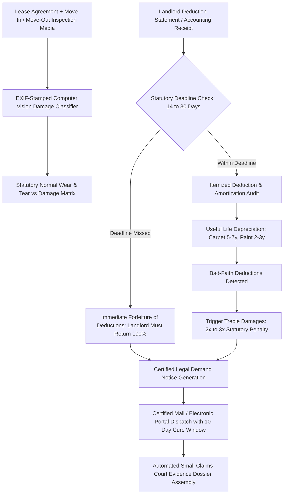

# ZenLease: Autonomous Tenant Rights, Security Deposit Recovery & Habitability Enforcement Agent

`zenlease-ai-skill` is an open-standard autonomous decision agent distilled from **Tenantcube (`tenantcube.com`)**, **JustFix (`justfix.org`)**, and **Roost (`joinroost.com`)**. Rental housing represents 30% to 50% of monthly household expenditures, yet over 40% of tenants fall victim to predatory landlord practices: illegal withholding of security deposits, fraudulent inflation of repainting/cleaning bills, fabricated wear-and-tear deductions, and willful neglect of essential repairs.

ZenLease transforms asymmetric landlord-tenant friction into automated statutory enforcement.



---

## 1. Core Architectural Capabilities

### 1.1 Multimodal Move-In / Move-Out Inspection Audit
Ingests pre-tenancy and post-tenancy photos and walkthrough videos. Analyzes embedded EXIF timestamps, GPS coordinates, and photometric lighting. Applies computer vision segmentation to classify wall marks, scuffs, and carpet fibers, verifying they fall strictly within statutory **Normal Wear and Tear (自然正常磨损)** rather than tenant negligence.

### 1.2 Statutory Accounting Deadline Enforcement
Tenancy laws strictly mandate the number of days a landlord has to deliver an itemized written accounting together with the remaining balance:
- **New York**: 14 calendar days (NY GOB § 7-108). Failure to provide itemized statement within 14 days results in **immediate total forfeiture** of the deposit.
- **California**: 21 calendar days (Cal. Civ. Code § 1950.5).
- **Texas / Illinois**: 30 calendar days.
- **United Kingdom**: 10 days post-agreement under TDS/DPS/MyDeposits schemes.
If the statutory postmark deadline expires by even one day, ZenLease automatically invokes the statutory forfeiture clause, barring the landlord from asserting any counterclaims against the deposit.

### 1.3 Amortization & Useful Life Depreciation Audit
Landlords frequently attempt to bill departing tenants for 100% of new hardwood flooring, carpet replacement, or total apartment repainting. ZenLease enforces HUD (US Department of Housing and Urban Development) and state depreciation tables:
$$\text{Allowable Deduction} = \text{Replacement Cost} \times \left(1 - \frac{\text{Actual Age of Item}}{\text{Statutory Useful Life}}\right)$$
*Example*: If carpet with a 5-year useful life was installed 4 years ago and suffers localized staining, the landlord can at most deduct $20\%$ of the replacement cost, not $100\%$. Charging full replacement is classified as prima facie bad faith.

### 1.4 Bad-Faith Treble Damages Escalation (惩罚性三倍赔偿)
Where a landlord retains a deposit in bad faith, statutory law awards punitive damages:
- California: Up to **$2\times$ deposit amount** in punitive damages + full deposit recovery.
- New York: **$2\times$ punitive penalty**.
- Texas: **$3\times$ wrongfully withheld amount + \$100 + reasonable attorney fees**.
ZenLease drafts the pre-litigation certified demand letter highlighting the statutory multiplier, compelling property managers and corporate landlords to settle immediately.

### 1.5 Habitability Repair Enforcement (Notice to Cure)
For active tenancies experiencing broken heating/cooling, water leaks, or pest infestations, ZenLease parses municipal housing codes and generates formal **14-Day Notices to Cure Habitability Violations**, establishing the statutory foundation for rent withholding or Repair-and-Deduct remedies.

---

## 2. JSON Schema Definitions

```json
{
  "$schema": "https://json-schema.org/draft/2020-12/schema",
  "title": "TenantDepositRecoveryCase",
  "type": "object",
  "required": ["caseId", "leaseDetails", "depositAmount", "stateJurisdiction", "landlordNoticeDate", "accountingAudit"],
  "properties": {
    "caseId": { "type": "string", "pattern": "^DEP-[0-9]{8}-[A-Z0-9]{4}$" },
    "stateJurisdiction": { "type": "string", "enum": ["CA", "NY", "TX", "IL", "FL", "WA", "UK"] },
    "depositAmount": { "type": "number", "minimum": 0 },
    "leaseEndDate": { "type": "string", "format": "date" },
    "landlordNoticeDate": { "type": "string", "format": "date" },
    "statutoryDeadlineDays": { "type": "integer" },
    "isDeadlineViolated": { "type": "boolean" },
    "accountingAudit": {
      "type": "object",
      "properties": {
        "claimedDeductions": { "type": "number" },
        "disallowedDeductions": { "type": "number" },
        "wearAndTearDisallowances": {
          "type": "array",
          "items": {
            "type": "object",
            "properties": {
              "item": { "type": "string" },
              "landlordBilled": { "type": "number" },
              "allowedAmortization": { "type": "number" },
              "legalBasis": { "type": "string" }
            }
          }
        }
      }
    },
    "statutoryRecoveryTotal": {
      "type": "object",
      "required": ["baseDepositRefund", "punitiveTrebleDamages", "totalDemanded"],
      "properties": {
        "baseDepositRefund": { "type": "number" },
        "punitiveTrebleDamages": { "type": "number" },
        "totalDemanded": { "type": "number" }
      }
    }
  }
}
```

---

## 3. Tool Calling & Code Example

```javascript
import { ZenLeaseEngine } from 'genpark-hub/zenlease';

// 1. Audit landlord's security deposit withholding letter
const depositCase = await ZenLeaseEngine.auditWithholdingNotice({
  state: "NY",
  leaseEndDate: "2026-09-30",
  landlordLetterPostmark: "2026-10-18", // 18 days later! Exceeds NY 14-day limit
  originalDeposit: 3200,
  landlordDeductions: [
    { item: "Repaint entire living room", amount: 1200 },
    { item: "Carpet steam cleaning", amount: 450 }
  ]
});

// 2. Check statutory timeline violation
if (depositCase.isDeadlineViolated) {
  console.log("Landlord missed the 14-day statutory deadline under NY GOB § 7-108. All deduction rights are completely forfeited!");
}

// 3. Dispatch formal demand for full deposit + 2x bad-faith statutory penalty
const legalNotice = await depositCase.compileCertifiedDemand({
  statutoryMultiplier: 2, // Treble / Double damages
  settlementCureWindowDays: 10,
  tenantPayoutAccount: "routing:021000021;account:9876543210"
});

console.log(`Demand dispatched. Potential recovery: $${legalNotice.totalDemanded}`);
```

---

## 4. MCP Tools & OpenClaw Integration
- `zenlease_audit_deposit_timeline`: Validates move-out date against statutory postmark deadlines.
- `zenlease_amortize_damage`: Evaluates carpet/painting depreciation against HUD useful life tables.
- `zenlease_generate_certified_demand`: Generates legally binding, certified demand notices citing state civil codes.
