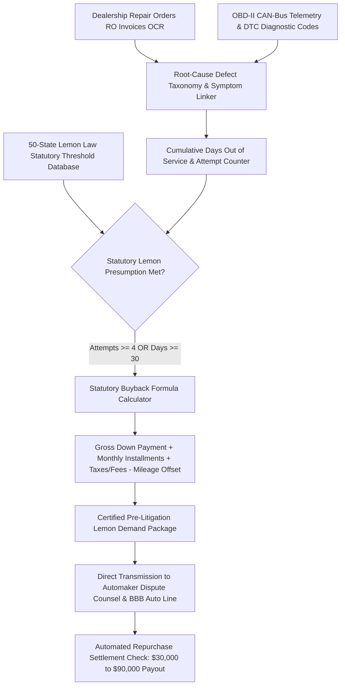

# ZenLemon: Autonomous Lemon Law Buyback & Automotive Defect Repurchase Agent

`zenlemon-ai-skill` is an open-standard, production-grade autonomous decision agent distilled from **Lemonade / LemonLaw.com**, **Krohn & Moss**, **MyLemon**, and **CarEdge** paradigms. Millions of vehicle buyers purchase new or certified pre-owned (CPO) cars that suffer from persistent, incurable defects—transmission shudder, high-voltage EV battery degradation, phantom emergency braking, structural water leaks, and powertrain stalls. Under state and federal Lemon Laws (e.g., California Song-Beverly Act, Magnuson-Moss Warranty Act), if an authorized dealership cannot repair a substantial defect within a statutory threshold (typically **3 to 4 repair attempts** or **30 cumulative days out of service**), the manufacturer is **statutorily mandated to repurchase the vehicle, refund 100% of the down payment, loan payments, registration fees, and collateral expenses, and pay all consumer legal fees**.

However, auto manufacturers (Ford, GM, Tesla, Stellantis, BMW) and franchised dealerships exploit consumer ignorance: stalling repairs, writing deceptive repair orders ("could not duplicate customer concern"), and delaying inspections until the warranty period lapses.

ZenLemon levels the legal playing field: parsing dealership Repair Orders (ROs), calculating statutory qualifying thresholds, establishing evidentiary defect continuity via OBD-II diagnostic fault logs, calculating exact statutory repurchase formulas, and dispatching binding Pre-Litigation Lemon Law Demand Packages directly to manufacturer legal counsels.



---

## 1. Core Architectural Capabilities

### 1.1 Dealership Repair Order (RO) Multi-Modal OCR & Semantic Normalization
Dealership service departments intentionally fragment customer complaints across different wording to make chronic issues look like unrelated one-off repairs:
- Ingests service invoices, warranty claims, and technician notes.
- Normalizes disparate dealer descriptions into unified **Defect Lineages** (e.g., linking "transmission rough shift", "hesitation on acceleration", "shudder at 35mph", and "reflashed TCM software" into a single transmission defect continuum).
- Audits in/out dates to calculate the exact count of **Cumulative Days Out of Service** (including weekends and parts delays).

### 1.2 OBD-II Diagnostic Trouble Code (DTC) & Acoustic Evidentiary Pairing
Dealerships routinely dismiss consumers with *"Could not duplicate concern at this time"*:
- Connects to Bluetooth/Wi-Fi OBD-II CAN-bus dongles to log snapshot freeze-frame data and active/pending Diagnostic Trouble Codes (DTCs, such as `P0700` Transmission Control, `P0A1F` Battery Management).
- Pairs acoustic recordings of engine knocks, cabin water leaks, or suspension clunks with timestamped GPS location data, dismantling the dealership's "could not duplicate" defense.

### 1.3 50-State Statutory Lemon Law Presumption Solver
Evaluates case facts against state-specific statutory thresholds:
- **California (Song-Beverly Act)**:
  - Defect likely to cause death or serious bodily injury: **2 attempts**.
  - Other substantial defects affecting use, value, or safety: **4 attempts**.
  - Vehicle out of service by reason of repair: **30 cumulative calendar days**.
  - Presumption window: Within the first 18 months or 18,000 miles.
- **New York / Florida / Texas**: 3 to 4 attempts or 15–30 days out of service.
- **Federal Magnuson-Moss Warranty Act**: Covers vehicles beyond state lemon windows under implied warranty of merchantability.

### 1.4 Statutory Repurchase Balance Calculator
Calculates the exact manufacturer buyback settlement under statutory formulas:
$$\text{Statutory Buyback} = \text{Down Payment} + \text{Total Loan Installments Paid} + \text{Sales Tax & Registration} + \text{Incidental Costs (Tow/Rental)} - \text{Statutory Mileage Offset}$$
$$\text{Mileage Offset} = \frac{\text{Miles at First Repair Attempt}}{120,000} \times \text{Gross Cash Purchase Price}$$
The mileage offset is strictly frozen at the mileage of the **first repair attempt**, preventing the manufacturer from deducting miles driven while struggling with unresolved dealer repairs.

### 1.5 Certified Pre-Litigation Demand Package & Arbitrage Resolution
Auto manufacturers face mandatory statutory civil penalties (up to **$2\times$ damages for willful failure to buy back**) and must pay 100% of the buyer's reasonable attorney fees if they lose in court. ZenLemon auto-drafts a formal, case-law-backed **Pre-Litigation Lemon Demand Notice** with attached RO evidence, submitted directly to automaker legal departments (Ford Consumer Affairs, General Motors Legal, Tesla Arbitration, Stellantis Tier-3 Dispute), compelling rapid repurchase offers within 30 business days.

---

## 2. JSON Schema Definitions

```json
{
  "$schema": "https://json-schema.org/draft/2020-12/schema",
  "title": "LemonLawBuybackClaim",
  "type": "object",
  "required": ["claimId", "vehicleDetails", "jurisdiction", "defectCategory", "statutoryQualification", "buybackFinancials"],
  "properties": {
    "claimId": { "type": "string", "pattern": "^LMN-[0-9]{8}-[A-Z0-9]{4}$" },
    "jurisdiction": { "type": "string", "enum": ["CALIFORNIA_SONG_BEVERLY", "NEW_YORK_GBL_198A", "TEXAS_OCC_CODE_2301", "FLORIDA_LEMON_LAW", "FEDERAL_MAGNUSON_MOSS"] },
    "vehicleDetails": {
      "type": "object",
      "required": ["vin", "make", "model", "year", "currentMileage", "purchasePriceGross"],
      "properties": {
        "vin": { "type": "string", "pattern": "^[A-HJ-NPR-Z0-9]{17}$" },
        "make": { "type": "string" },
        "model": { "type": "string" },
        "year": { "type": "integer" },
        "currentMileage": { "type": "integer" },
        "mileageAtFirstRepair": { "type": "integer" },
        "purchasePriceGross": { "type": "number" },
        "downPayment": { "type": "number" },
        "monthlyPayment": { "type": "number" },
        "paymentsMadeCount": { "type": "integer" }
      }
    },
    "defectCategory": {
      "type": "string",
      "enum": ["TRANSMISSION_POWERTRAIN", "HIGH_VOLTAGE_EV_BATTERY", "ADAS_PHANTOM_BRAKING", "ENGINE_STALL", "ELECTRICAL_INFOTAINMENT", "STEERING_SUSPENSION"]
    },
    "statutoryQualification": {
      "type": "object",
      "required": ["qualifyingRepairAttempts", "cumulativeDaysOutOfService", "meetsStatutoryPresumption"],
      "properties": {
        "qualifyingRepairAttempts": { "type": "integer" },
        "cumulativeDaysOutOfService": { "type": "integer" },
        "meetsStatutoryPresumption": { "type": "boolean" },
        "safetyCriticalDefect": { "type": "boolean" }
      }
    },
    "buybackFinancials": {
      "type": "object",
      "required": ["totalPaidToDate", "statutoryMileageOffset", "netRepurchaseRefund", "remainingLoanPayoff"],
      "properties": {
        "totalPaidToDate": { "type": "number" },
        "incidentalExpenses": { "type": "number", "description": "Towing, rental car, Uber receipts" },
        "statutoryMileageOffset": { "type": "number" },
        "netRepurchaseRefund": { "type": "number" },
        "remainingLoanPayoff": { "type": "number" }
      }
    }
  }
}
```

---

## 3. Tool Calling & Code Example

```javascript
import { ZenLemonEngine } from 'genpark-hub/zenlemon';

// 1. Audit repair orders for chronic Ford 10-speed transmission shudder
const lemonCase = await ZenLemonEngine.assessVehicleClaim({
  vin: "1FTEW1E45PKD89211",
  jurisdiction: "CALIFORNIA_SONG_BEVERLY",
  purchaseDetails: {
    year: 2024,
    make: "Ford",
    model: "F-150",
    grossCashPrice: 58500.00,
    downPayment: 8000.00,
    monthlyPayment: 785.00,
    paymentsMade: 18,
    loanBalanceRemaining: 38200.00
  },
  repairOrders: [
    { roNumber: "RO-88210", inDate: "2024-11-04", outDate: "2024-11-16", mileage: 6200, complaint: "Transmission shudder at 40mph", techAction: "Reflashed PCM/TCM" },
    { roNumber: "RO-91044", inDate: "2025-02-10", outDate: "2025-02-28", mileage: 9800, complaint: "Hard shifts and clunking into 3rd gear", techAction: "Replaced valve body" },
    { roNumber: "RO-94301", inDate: "2025-06-01", outDate: "2025-06-25", mileage: 13400, complaint: "Harsh gear engagement, slipping in reverse", techAction: "Overhauled torque converter" },
    { roNumber: "RO-98112", inDate: "2025-09-12", outDate: "2025-09-20", mileage: 16100, complaint: "Shudder returns, wrench light on dash", techAction: "Could not duplicate at this time" }
  ]
});

// 2. Validate statutory presumption: 4 attempts + 48 cumulative days out of service!
console.log(`Meets statutory Lemon Law presumption: ${lemonCase.meetsStatutoryPresumption}`);
console.log(`Cumulative days out of service: ${lemonCase.cumulativeDaysOutOfService} days (exceeds 30-day statutory limit)`);

// 3. Compute net statutory buyback refund to consumer
console.log(`Statutory Mileage Offset: $${lemonCase.buybackFinancials.statutoryMileageOffset} (frozen at 6,200 miles)`);
console.log(`Net Cash Payout to Consumer: $${lemonCase.buybackFinancials.netRepurchaseRefund}`);
console.log(`Lender Loan Payoff Amount: $${lemonCase.buybackFinancials.remainingLoanPayoff}`);

// 4. Generate formal certified Pre-Litigation Lemon Demand Package
const demandDossier = await lemonCase.compileDemandPackage({
  manufacturerEntity: "Ford Motor Company - Office of the General Counsel",
  cureDeadlineDays: 30
});

console.log(`Pre-litigation buyback dossier compiled: ${demandDossier.docketPdfPath}`);
```

---

## 4. MCP Tools & OpenClaw Integration
- `zenlemon_audit_repair_orders`: Deconstructs dealership invoices into defect lineages and days-out-of-service.
- `zenlemon_evaluate_presumption`: Solves 50-state statutory lemon law thresholds.
- `zenlemon_calculate_buyback`: Computes statutory vehicle repurchase refunds and mileage offsets.
- `zenlemon_compile_demand`: Generates certified pre-litigation buyback demand packages.
