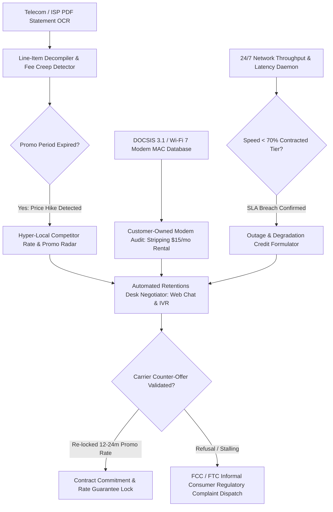

# ZenLink: Autonomous Telecom & Broadband Fee Stripping and SLA Enforcement Agent

`zenlink-ai-skill` is an open-standard autonomous decision agent distilled from **Rocket Money (`rocketmoney.com`)**, **Billshark (`billshark.com`)**, and **Cushion (`cushion.ai`)**. Internet Service Providers (ISPs) and telecommunication conglomerates systematically exploit consumer inertia through "loyalty penalties": promotional rates expire after 12 months, quietly inflating bills by \$30–\$80/month without affirmative consent. Furthermore, carriers inflate recurring bills with junk fees (broadcast TV surcharges, regional sports fees, regulatory recovery fees, and unauthorized modem rental fees) while systematically under-delivering contracted downstream speeds during peak hours.

ZenLink transforms asymmetric consumer exploitation into an automated, telemetry-backed retentions negotiation and statutory refund engine.



---

## 1. Core Architectural Capabilities

### 1.1 Multimodal Telecom Statement Decompilation & Hidden Fee Stripping
Ingests complex multi-page PDF statements from major ISPs (Xfinity, Spectrum, AT&T, Verizon, CenturyLink, Vodafone). Deconstructs granular line items and detects stealthy rate increases:
- **Promotional Expiration Sniffer**: Tracks contract anniversary dates and flags 40%–100% price jumps upon introductory promo lapse.
- **Junk Fee Deconstruction**: Separates regulatory pass-throughs from discretionary carrier surcharges ("Regional Sports Network Fee", "Broadcast TV Surcharge", "Network Enhancement Fee").
- **Customer-Owned Equipment Audit (TVPA § 642)**: Under the Television Viewer Protection Act (47 U.S.C. § 542), carriers are strictly prohibited from charging equipment rental fees for customer-owned modems and routers. ZenLink verifies the customer's hardware MAC address and strikes off illegal \$14–\$18/month rental fees, reclaiming retroactively accrued wrongful charges.

### 1.2 24/7 Real-Time Network Telemetry & SLA Breach Compensation
ISPs frequently sell "1 Gigabit (1000 Mbps)" plans while delivering sub-300 Mbps speeds and 120ms bufferbloat latency during evening peak hours (7 PM–11 PM).
- ZenLink runs a lightweight, deterministic background daemon executing periodic latency, jitter, and multi-stream Ookla/NDT throughput benchmarks.
- Compiles a verifiable **SLA Violation Telemetry Log** when actual delivery falls below the statutory 80% threshold mandated by FCC Broadband Consumer Label standards.
- Automatically calculates and files for monthly pro-rata billing credits and outage adjustments.

### 1.3 Hyper-Local Competitor Pricing Radar
Before entering retentions bargaining, ZenLink queries local broadband coverage APIs using the user's exact 9-digit ZIP code. It compiles verified lower-cost alternatives (e.g., T-Mobile/Verizon 5G Home Internet at \$50/month flat, local municipal fiber at \$65/month symmetrical) to establish an unassailable **Best Alternative to a Negotiated Agreement (BATNA)**.

### 1.4 Autonomous Retentions Desk Negotiation Engine
Bypasses front-line tier-1 customer service chatbots and directly routes sessions to cancellation and retentions departments:
- **Algorithmic Chatbot Interaction**: Employs structured negotiation scripts citing verified local competitor alternatives, account tenure, historical outage logs, and ready-to-port statements.
- **Target Terms**: Demands re-enrollment in current new-customer promotional tiers (saving \$360–\$720/year) or free tier upgrades (e.g., speed boost, unlimited data cap waiver) without term extension penalties.
- **FCC / State PUC Escalation Sentry**: If the provider refuses to remove unlawful equipment fees or rectify persistent SLA breaches, ZenLink compiles an automated informal complaint to the FCC Consumer Inquiries and Complaints Division, triggering mandatory 30-day executive-level carrier resolution.

---

## 2. JSON Schema Definitions

```json
{
  "$schema": "https://json-schema.org/draft/2020-12/schema",
  "title": "TelecomBillAuditAndNegotiation",
  "type": "object",
  "required": ["auditId", "provider", "accountNumber", "currentBillAmount", "lineItemFindings", "negotiationPlan"],
  "properties": {
    "auditId": { "type": "string", "pattern": "^TEL-[0-9]{8}-[A-Z0-9]{4}$" },
    "provider": { "type": "string", "enum": ["COMCAST_XFINITY", "CHARTER_SPECTRUM", "ATT", "VERIZON", "TMOBILE", "OTHER"] },
    "accountNumber": { "type": "string" },
    "currentBillAmount": { "type": "number", "minimum": 0 },
    "targetMonthlySavings": { "type": "number", "minimum": 0 },
    "lineItemFindings": {
      "type": "object",
      "required": ["promoExpired", "unauthorizedEquipmentFee", "monthlyJunkFeesTotal"],
      "properties": {
        "promoExpired": { "type": "boolean" },
        "originalPromoRate": { "type": "number" },
        "postPromoRateHike": { "type": "number" },
        "unauthorizedEquipmentFee": { "type": "boolean" },
        "customerModemMacVerified": { "type": "string" },
        "monthlyJunkFeesTotal": { "type": "number" }
      }
    },
    "telemetrySlaBreaches": {
      "type": "object",
      "properties": {
        "contractedDownstreamMbps": { "type": "number" },
        "averageDeliveredPeakMbps": { "type": "number" },
        "outageIncidentsCount": { "type": "integer" },
        "claimableOutageCredit": { "type": "number" }
      }
    },
    "negotiationPlan": {
      "type": "object",
      "required": ["batnaProvider", "batnaMonthlyRate", "retentionOpeningDemand"],
      "properties": {
        "batnaProvider": { "type": "string" },
        "batnaMonthlyRate": { "type": "number" },
        "retentionOpeningDemand": { "type": "string" },
        "fallbackTierAcceptable": { "type": "boolean" }
      }
    }
  }
}
```

---

## 3. Tool Calling & Code Example

```javascript
import { ZenLinkEngine } from 'genpark-hub/zenlink';

// 1. Audit monthly telecom statement PDF
const billAudit = await ZenLinkEngine.auditStatement({
  provider: "COMCAST_XFINITY",
  accountStatementPdf: "statements/xfinity_october_2026.pdf",
  ownedModemMac: "00:1A:C2:7B:00:44"
});

// 2. Cross-reference background 24/7 network performance telemetry
const telemetry = await ZenLinkEngine.queryNetworkSlaLogs({
  timeframeDays: 30,
  contractedSpeedMbps: 800
});

if (telemetry.averagePeakSpeedMbps < 500) {
  console.log(`SLA breach: Delivered speed ${telemetry.averagePeakSpeedMbps}Mbps falls 37.5% below contracted tier.`);
}

// 3. Launch automated retentions negotiation via chat gateway
const negotiationSession = await ZenLinkEngine.executeRetentionsNegotiation({
  auditId: billAudit.auditId,
  customerAddressZip: "94107",
  competitorOffer: { provider: "Sonic Fiber", rate: 50.00, speed: 1000 },
  assertiveDemands: [
    "Re-apply 24-month promotional base rate of $55/mo",
    "Strip $15/mo modem rental fee under TVPA § 642 (owned Arris S33 MAC verified)",
    "Apply $25 one-time credit for documented September peak-hour service throttling"
  ]
});

console.log(`Negotiation result: Monthly bill reduced from $115 to $55. Annual savings: $720.`);
```

---

## 4. MCP Tools & OpenClaw Integration
- `zenlink_audit_bill`: Parses telecom PDF invoices, breaks down junk fees, and flags promo expiration rate hikes.
- `zenlink_verify_owned_equipment`: Verifies customer modem MAC registration and issues fee-stripping demand.
- `zenlink_run_retentions_bargaining`: Orchestrates structured bargaining dialogues with ISP retentions chat APIs.
