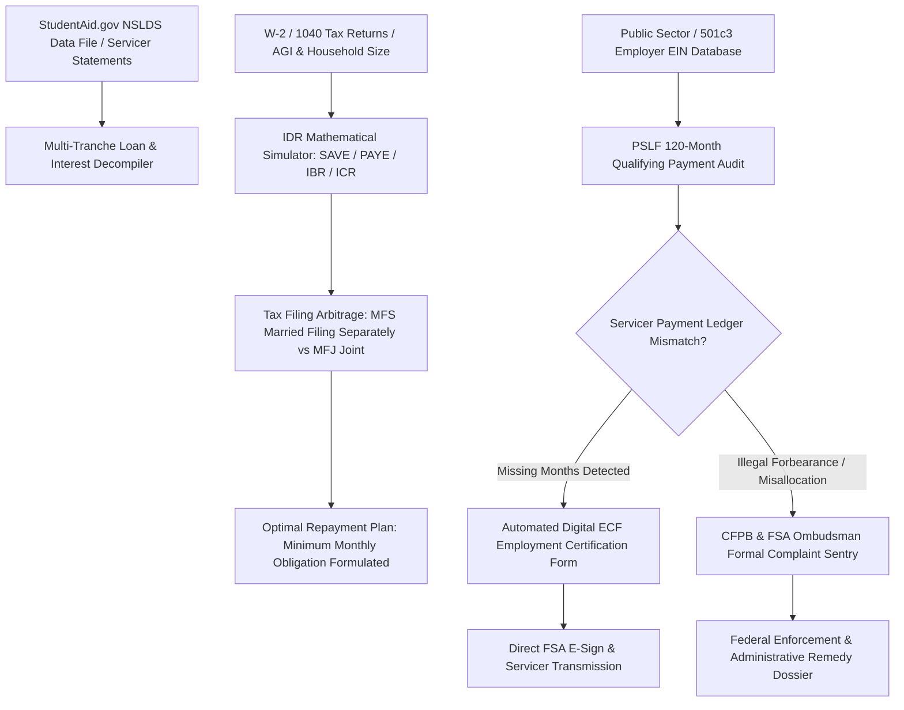

# ZenLoan: Autonomous Student Loan Repayment & PSLF Forgiveness Optimization Agent

`zenloan-ai-skill` is an open-standard autonomous decision agent distilled from **Summer (`meetsummer.com`)**, **Savi (`bysavi.com`)**, and **Chipper (`chipper.app`)**. With over \$1.7 Trillion in outstanding student loan debt, borrowers face an intentionally opaque bureaucratic maze managed by third-party servicers (MOHELA, Nelnet, Aidvantage). Servicers systematically commit clerical errors: miscounting qualifying payments, delaying electronic employment certifications, illegally capitalizing accrued interest, and misallocating overpayments across high-interest tranches.

ZenLoan serves as an algorithmic fiduciary agent for the borrower—minimizing monthly cash outflows, maximizing statutory debt discharge, and enforcing consumer rights.



---

## 1. Core Architectural Capabilities

### 1.1 Multi-Tranche NSLDS & Servicer Statement Ingestion
Ingests raw `.txt` NSLDS data files directly from StudentAid.gov and PDF billing statements from servicers (MOHELA, Nelnet, Aidvantage). Decompiles every loan tranche into its underlying statutory parameters: Direct Subsidized, Direct Unsubsidized, Parent PLUS, FFEL, Perkins, cumulative principal, capitalized interest, and weighted average interest rate.

### 1.2 Income-Driven Repayment (IDR) & Tax Filing Arbitrage Simulator
Calculates discretionary income across all federal repayment programs:
$$\text{Discretionary Income} = \text{AGI} - (\text{Poverty Line Multiplier} \times \text{Federal Poverty Guideline})$$
- Evaluates **SAVE / PAYE / IBR / ICR** schedules under varying federal poverty guidelines (150%–225% FPL thresholds).
- **Tax Status Optimization (MFS vs. MFJ)**: Simulates the borrower's total household tax liability vs. student loan repayment savings when filing Married Filing Separately (MFS) vs. Married Filing Jointly (MFJ), isolating the borrower's individual income and frequently lowering monthly required payments to **\$0/month**.

### 1.3 PSLF 120-Month Ledger Audit & Clerical Error Detection
For public sector, municipal, healthcare, and 501(c)(3) non-profit employees pursuing Public Service Loan Forgiveness (PSLF):
- Scans every billing cycle across the borrower's 10-year repayment history against servicer transactional databases.
- Identifies systemic servicer defects: qualifying payments mislabeled as "non-qualifying deferment", payments during administrative processing forbearance, and failure to apply one-time IDR account adjustments.
- Compiles missing payment dates into a structured audit manifest ready for retrospective credit.

### 1.4 Automated Digital ECF (Employment Certification Form) Engine
Cross-references employer EINs with IRS 501(c)(3) non-profit and federal/state government agency registries. Automatically drafts and dispatches pre-filled PSLF Employment Certification Forms (ECF) directly to authorized HR signatories via DocuSign/Acrobat APIs, followed by automated ingestion and submission to the federal PSLF central servicer.

### 1.5 CFPB & FSA Ombudsman Regulatory Dispute Escalator
When loan servicers stall applications, commit billing misallocations, or refuse to correct payment counts within 30 days:
- ZenLoan compiles a legally airtight **CFPB Regulatory Dispute Dossier** citing 12 U.S.C. § 5531 (Unfair, Deceptive, or Abusive Practices) and Higher Education Act statutory mandates.
- Submits complaints simultaneously to the Consumer Financial Protection Bureau and the Federal Student Aid Ombudsman, triggering high-priority administrative remediation.

---

## 2. JSON Schema Definitions

```json
{
  "$schema": "https://json-schema.org/draft/2020-12/schema",
  "title": "StudentLoanOptimizationCase",
  "type": "object",
  "required": ["caseId", "borrowerProfile", "totalDebt", "optimalPlan", "pslfAudit"],
  "properties": {
    "caseId": { "type": "string", "pattern": "^LOAN-[0-9]{8}-[A-Z0-9]{4}$" },
    "borrowerProfile": {
      "type": "object",
      "required": ["agi", "householdSize", "maritalStatus", "isPublicSectorEmployee"],
      "properties": {
        "agi": { "type": "number", "minimum": 0 },
        "householdSize": { "type": "integer", "minimum": 1 },
        "maritalStatus": { "type": "string", "enum": ["SINGLE", "MARRIED_JOINT", "MARRIED_SEPARATE"] },
        "isPublicSectorEmployee": { "type": "boolean" },
        "employerEin": { "type": "string" }
      }
    },
    "totalDebt": { "type": "number" },
    "optimalPlan": {
      "type": "object",
      "required": ["planName", "calculatedMonthlyPayment", "recommendedTaxStatus", "projectedForgivenessAmount"],
      "properties": {
        "planName": { "type": "string", "enum": ["SAVE", "PAYE", "IBR", "STANDARD_10Y"] },
        "calculatedMonthlyPayment": { "type": "number" },
        "recommendedTaxStatus": { "type": "string", "enum": ["MFJ", "MFS", "N/A"] },
        "projectedForgivenessAmount": { "type": "number" },
        "yearsToForgiveness": { "type": "number" }
      }
    },
    "pslfAudit": {
      "type": "object",
      "properties": {
        "servicerReportedCount": { "type": "integer" },
        "verifiedAuditedCount": { "type": "integer" },
        "uncountedEligiblePayments": { "type": "integer" },
        "monthsRemainingTo120": { "type": "integer" },
        "cfpbEscalationRequired": { "type": "boolean" }
      }
    }
  }
}
```

---

## 3. Tool Calling & Code Example

```javascript
import { ZenLoanEngine } from 'genpark-hub/zenloan';

// 1. Ingest Federal StudentAid NSLDS data file & borrower financial profile
const loanCase = await ZenLoanEngine.analyzeLoanPortfolio({
  nsldsFilePath: "data/nslds_my_student_data.txt",
  taxReturn: { agi: 68000, filingStatus: "MARRIED_JOINT", spouseAgi: 92000, dependents: 2 },
  employment: { employerName: "Memorial County Hospital", ein: "12-3456789", nonProfitType: "501c3" }
});

// 2. Simulate IDR plans with Married Filing Separately (MFS) arbitrage
const simulation = await loanCase.optimizeRepaymentPlan();
console.log(`Optimal Plan: ${simulation.optimalPlan.planName}`);
console.log(`Monthly Payment with MFS: $${simulation.optimalPlan.calculatedMonthlyPayment} (vs $840 on standard)`);

// 3. Audit PSLF payment counts and catch missing servicer months
const pslfAudit = await loanCase.auditPSLFLedger({ servicer: "MOHELA" });
if (pslfAudit.uncountedEligiblePayments > 0) {
  console.log(`Caught ${pslfAudit.uncountedEligiblePayments} uncredited payments! Generating ECF and CFPB rectification petition.`);
  await loanCase.dispatchCFPBPetition();
}
```

---

## 4. MCP Tools & OpenClaw Integration
- `zenloan_parse_nslds`: Ingests and standardizes federal NSLDS loan records.
- `zenloan_simulate_idr`: Computes monthly payments across SAVE, PAYE, and IBR programs.
- `zenloan_audit_pslf_ledger`: Cross-references servicer records to identify uncredited qualifying payments.
- `zenloan_generate_cfpb_petition`: Auto-compiles formal CFPB and Ombudsman dispute petitions.
