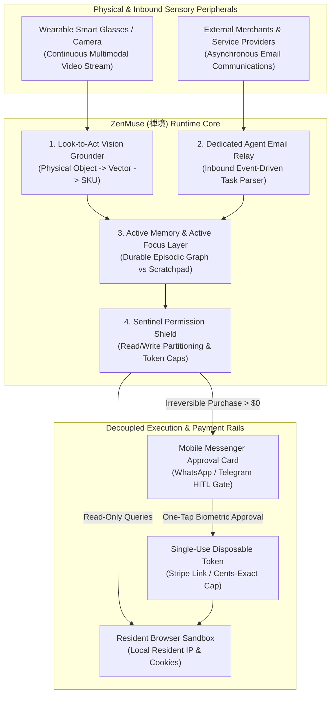

# zenmuse-ai-skill (ZenMuse · 禅境)

> *"The mind mirrors the world, silent yet all-perceiving." (鉴照万象，灵动无声。)*  
> Autonomous Multimodal Real-World Vision Grounding, Dedicated Inbound Agent Email Relay, Active Memory & Focus Cognitive Architecture, and Sentinel Permission Gate distilled from **Meta Muse (Muse Wonder & Spark 2026)**.

---

## 1. Overview & Architectural Problem Statement

When personal AI agents transition from text-bound chat interfaces to true real-world executive proxies, they encounter severe physical and operational bottlenecks:

1. **The Physical-Digital Semantic Void**: Consumers encounter products in physical stores, art galleries, and restaurants. Requiring users to take photos, save images, upload files, and type prompts breaks natural human flow. Wearable devices (smart glasses, spatial cameras) need continuous sub-500ms multi-modal grounding directly into verified merchant SKUs without manual intervention.
2. **The Asynchronous Communications Chasm**: Real-world service fulfillment (flight re-bookings, medical appointments, warranty negotiations, B2B quotes) still predominantly flows through **email threads**. Conventional agents cannot independently receive, parse, and respond to asynchronous external third-party emails without exposing the user's primary personal email inbox to scraping and spam.
3. **Context Collapse & Long-Horizon Goal Decay**: In conventional LLMs, long-term goals decay across turns as working memory is polluted by temporary browser scraping logs and fleeting tool outputs. Agents lose track of persistent user shopping objectives spanning weeks or seasons.
4. **Binary All-or-Nothing Permission Traps**: Granting an agent full browser automation or credit card access creates catastrophic risk, while prompting the user for every trivial page load creates severe alert fatigue.

**ZenMuse (禅境)**, distilled from **Meta Muse's latest 2026 architectural paradigm (Muse Wonder & Muse Spark)**, solves these challenges through four foundational pillars:
* **Wearable "Look-and-Act" Grounding (`LookToActGrounder`)**: Ingests continuous visual frames from wearable smart glasses, converting observed real-world objects into normalized merchant catalog queries and staging cart items in the background.
* **Dedicated Inbound Agent Email Relay (`AutonomousEmailWorker`)**: Provisions a persistent, isolated agent email address (`agent_<id>@openclaw.local` or public relay) capable of independently negotiating reservations, parsing vendor PDF invoices, and reconciling confirmations.
* **Active Memory & Active Focus Cognitive Architecture (`ActiveMemoryFocusGovernor`)**: Partitions runtime context into ephemeral execution scratchpads and durable episodic preference graphs, preserving multi-month purchasing intents without hallucination.
* **Sentinel Multi-Tier Permission Shield (`SentinelPermissionGate`)**: Strictly enforces read/write capability boundaries, automatically handling low-risk read operations while dispatching rich interactive approval cards to mobile messengers before executing irreversible monetary commitments.



---

## 2. Core Capabilities

### 2.1 Wearable Multimodal Real-World Vision Grounding (`LookToActGrounder`)
* Interfaces with wearable camera streams (Ray-Ban Meta, spatial headsets, phone cameras) to detect consumer goods, apparel, furniture, and barcode identifiers in real time.
* Extracts multi-vector feature representations (color palette, silhouette, material texture, brand typography) and matches them against normalized global product knowledge graphs.
* Synthesizes background shopping carts: when a user examines an item in a boutique, ZenMuse cross-references 100+ merchants for wholesale pricing, fabric composition, and stock availability, delivering audio whispers or haptic wrist taps.

### 2.2 Dedicated Agent Inbound Email Relay (`AutonomousEmailWorker`)
* Assigns each autonomous task or user agent a private, dedicated email relay endpoint (`<user_agent_hash>@agent.openclaw.io`).
* Users forward travel itineraries, airline delay notices, hospital bills, or contractor quotes directly to their agent's inbox.
* Employs stateful email-parsing agents that:
  * Extract attachments (PDF receipts, EOBs, warranty claims).
  * Auto-draft professional negotiation replies (e.g. requesting fee breakdowns or fee waivers).
  * Stage outgoing emails in a draft queue awaiting Sentinel approval before dispatch.

### 2.3 Active Memory & Active Focus Cognitive Architecture (`ActiveMemoryFocusGovernor`)
* **Active Focus (Dynamic Task Graph)**: Separates the immediate transactional task graph (e.g., "Find noise-canceling headphones for upcoming flight") from ambient chatter.
* **Active Memory (Durable Episodic Graph)**: Maintains long-term user preferences, size profiles, brand dislikes, and lifestyle constraints across months of multi-app operation without context window degradation.
* Periodically compresses and synthesizes raw session history into cryptographic episodic vectors stored exclusively in the local Secure Enclave.

### 2.4 Sentinel Multi-Tier Permission Shield (`SentinelPermissionGate`)
* Partitions all agent tool invocations into strict permission tiers:
  * **Tier 0 (Unrestricted Read)**: Querying public search engines, parsing public URLs, checking weather, benchmarking spot energy tariffs.
  * **Tier 1 (Guarded Read)**: Inspecting local calendar events, reading forwarded inbound agent emails.
  * **Tier 2 (Staged Write)**: Adding items to carts, filling out web forms, drafting outgoing correspondence.
  * **Tier 3 (Irreversible Commit)**: Finalizing monetary payments, canceling existing bookings, submitting legal appeals.
* Tier 3 actions strictly trigger interactive WhatsApp/Telegram action cards with explicit financial breakdown and one-tap biometric sign-off.

### 2.5 Disposable Virtual Card Rail & Stripe Link Protection (`DisposableTokenPaymentRail`)
* Dynamically provisions single-use, merchant-locked virtual card numbers with exact spending ceilings (cents-exact budget caps).
* Binds transactions to Stripe Link buyer protection guarantees, shielding consumers from fraudulent over-billing or unfulfilled orders.

---

## 3. MCP Tool Interface Specifications

```typescript
// MCP Tool: Ground physical image stream into verified digital SKUs
interface GroundPhysicalProductRequest {
  imageFrameBase64: string;
  spatialContext?: {
    geoLatitude?: number;
    geoLongitude?: number;
    merchantHint?: string;
  };
  maxPriceBudgetUsd?: number;
}

interface GroundPhysicalProductResponse {
  identifiedItem: {
    category: string;
    detectedAttributes: string[];
    confidenceScore: number;
  };
  matchedSkuOffers: Array<{
    merchant: string;
    productTitle: string;
    directUrl: string;
    priceUsd: number;
    priceDeltaVsInStorePercent: number;
    inStock: boolean;
  }>;
  suggestedAction: 'stage_cart' | 'notify_user' | 'dismiss';
}

// MCP Tool: Process forwarded inbound email thread
interface InboundEmailTaskRequest {
  senderEmail: string;
  subject: string;
  emailBodyRaw: string;
  attachmentUrls?: string[];
}

interface InboundEmailTaskResponse {
  extractedIntent: 'flight_reschedule' | 'bill_audit' | 'reservation_confirm' | 'warranty_dispute' | 'general_notice';
  keyEntities: Record<string, any>;
  draftedReply?: string;
  requiresSentinelApproval: boolean;
  stagedActionPayload?: Record<string, any>;
}
```

---

## 4. Human-in-the-Loop (HITL) Safety & Governance

| Trigger Event | Permission Tier | Autonomous Action | HITL Escalation Protocol |
| :--- | :--- | :--- | :--- |
| **Wearable Object Grounding** | Tier 0 | **Background Staging** | Silently matches SKU and updates cart without vibrating or interrupting user unless price savings > 25%. |
| **Inbound Email Thread Reply** | Tier 2 | **Draft Prepared** | Renders proposed email draft on mobile messenger; requires human tap before sending. |
| **Monetary Card Checkout** | Tier 3 | **Halted & Locked** | Generates cents-exact virtual card and dispatches interactive payment card with full landed cost. |
| **Cross-Session Memory Update** | Tier 1 | **Vectorized Locally** | Summarizes behavioral preference delta and updates local Secure Enclave memory. |

---

## 5. Directory Structure & Verification

```
skills/zenmuse-ai-skill/
├── SKILL.md                          # Comprehensive specification and MCP interface
├── README.md                         # Quick start, star appeal banner, and documentation
├── schema/
│   ├── vision_grounding.json         # Real-world object to SKU normalization schema
│   └── email_relay_event.json        # Inbound email webhook event schema
└── tests/
    └── test_active_memory_sentinel.py # Unit tests for Sentinel permission gate and Active Memory
```
