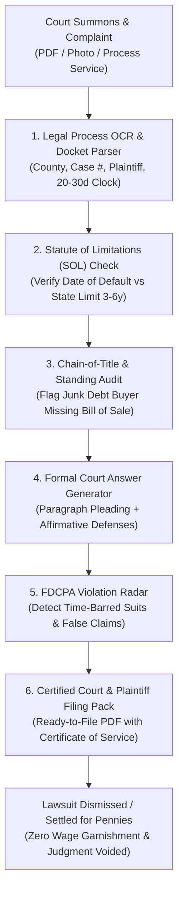

<div align="center">

# zenplea-ai-skill 🦞

[](https://opensource.org/licenses/MIT)
[](https://genpark.ai)
[](https://openclaw.ai)

**GenPark Autonomous Consumer Debt Lawsuit Defense, Summons & Complaint OCR, Statute of Limitations (SOL) Affirmative Defense & Court Answer Filing Engine**

</div>

---

## 📖 Skill Specification

```yaml
---
name: zenplea-ai-skill
description: Autonomous Consumer Debt Lawsuit Defense, Summons & Complaint OCR, Statute of Limitations (SOL) Affirmative Defense, Debt Buyer Chain-of-Title Sentry & Formal Court Answer Filing Engine distilled from SoloSuit, DoNotPay & Dispute. Ingests debt collection court summons, verifies time-barred statutory debt expiration, challenges third-party standing (Midland/Portfolio/Encore), compiles formal court-compliant verified answers with affirmative defenses, and weaponizes FDCPA violations into debt dismissals.
version: 1.0.0
license: MIT
---

# zenplea-ai-skill

## Overview
**ZenPlea (禅辩)** is an autonomous consumer debt litigation defense, court summons parsing, and small claims/debt-buyer arbitration skill for the GenPark ecosystem, distilled from **SoloSuit** (automated debt lawsuit answer filing), **DoNotPay** (automated consumer legal defense), and **Dispute** (small claims court automation).

Every year, predatory third-party debt collection conglomerates (such as Midland Credit Management, Portfolio Recovery Associates, and Encore Capital) purchase charged-off credit card and medical debts for pennies on the dollar ($0.01–$0.04 per dollar of face value) and unleash mass-automated civil lawsuits against everyday consumers. **Over 90% of defendants fail to file a formal legal Answer within the strict 20–30 day court deadline**, primarily due to the exorbitant cost of retaining private attorneys ($1,500–$3,500 retainer) and the intimidating formatting requirements of civil courts. This results in **automatic default judgments**, leading directly to frozen bank accounts, property judgment liens, and devastating 25% paycheck wage garnishments.

Operating local-first within OpenClaw, ZenPlea restores consumer legal parity:
1. **Court Summons & Complaint OCR**: Ingests legal process service documents, identifying court jurisdiction, case index number, plaintiff status (original creditor vs. third-party junk debt buyer), and jurisdictional response countdown clocks.
2. **Statute of Limitations (SOL) Expiration Arbiter**: Verifies the date of last payment against state-specific time-barred debt statutes (typically 3 to 6 years), establishing mandatory affirmative grounds for dismissal with prejudice.
3. **Chain-of-Title & Standing Sentry**: Scrutinizes plaintiff filings for lack of legal standing, demanding original signed account contracts, valid bills of sale, and complete unredacted assignment ledger sheets.
4. **Formal Court-Compliant Answer Generator**: Drafts court-certified Answers featuring structured paragraph-by-paragraph responses (Admit, Deny, Deny for Lack of Knowledge) alongside 12+ statutory affirmative defenses.
5. **Fair Debt Collection Practices Act (FDCPA) Counter-Arbitrage**: Identifies illegal collection harassment, statutory disclosure omissions, or filing on time-barred debt, weaponizing $1,000 per-violation statutory damages into complete lawsuit withdrawals or pennies-on-the-dollar zero-liability settlements.



---

## Core Capabilities

### 1. Court Summons & Complaint OCR Parser
- Ingests scanned or photographed civil court process documents across municipal, county, and district courts.
- Extracts and indexes:
  - Court Name, County, District, and Division.
  - Case / Docket Number.
  - Plaintiff Identity (Original Creditor vs. Third-Party Debt Buyer).
  - Plaintiff Legal Counsel and Process Service Address.
  - Sued Balance Breakdown (Principal, Alleged Interest, Attorney Fees).
  - Filing Deadline Countdown Clock (calculates calendar days to respond based on local rules of civil procedure).

### 2. Statute of Limitations (SOL) Arbiter
- Determines the governing jurisdiction's specific statute of limitations based on debt classification:
  - Open-Ended Accounts (Credit Cards).
  - Written Contracts (Personal / Auto Loans).
  - Oral Contracts / Open Accounts (Medical Bills).
- Cross-references consumer credit reports and bank records to pinpoint the exact Date of Last Activity / Default.
- If the statute of limitations has lapsed, ZenPlea asserts the **Time-Barred Debt Affirmative Defense**, commanding automatic statutory dismissal.

### 3. Chain-of-Title & Lack of Standing Sentry
- Third-party debt buyers purchase debts in bulk spreadsheets containing thousands of accounts with no original loan documents.
- ZenPlea raises **Lack of Subject Matter Standing**:
  - Demands the original signed contract bearing the consumer's signature.
  - Challenges broken chains of assignment (Originating Bank $\to$ Intermediate Fund $\to$ Current Plaintiff).
  - Demands itemized accounting proving how the alleged final balance was computed, disallowing ungrounded interest compounding.

### 4. Certified Court-Compliant Answer Generator
- Drafts formal legal Answers adhering to state civil procedure rules (e.g., California Judicial Council PLD-C-010, Texas Rules of Civil Procedure Rule 92, New York CPLR § 3018).
- Sequences:
  - **General & Specific Denials**: Asserts "Deny for Lack of Knowledge" on allegations requiring plaintiff documentary proof, forcing plaintiff to meet their legal burden of proof.
  - **Statutory Affirmative Defenses**: Automatically incorporates applicable defenses:
    - Statute of Limitations (Time-Barred).
    - Lack of Standing / No Privity of Contract.
    - Failure to State a Claim Upon Which Relief Can Be Granted.
    - Unconscionability & Usurious Interest Rates.
    - Failure to Attach Original Written Agreement.
  - **Certificate of Service**: Formulates formal certificate documenting delivery to plaintiff's attorney via certified mail.

### 5. FDCPA Counterclaim & Settlement Arbitrage
- Screens debt buyer conduct against the **Fair Debt Collection Practices Act (15 U.S.C. § 1692)**:
  - Suing on a time-barred debt (violation of § 1692e / § 1692f).
  - Misrepresenting the legal status, character, or amount of debt.
  - Threatening actions that cannot legally be taken.
- Assembles formal FDCPA counterclaims seeking up to **$1,000 statutory damages plus actual damages and legal fees**, providing overwhelming leverage to force immediate voluntary dismissals with prejudice.

---

## Standard ZenPlea Defense & Answer Dossier Schema

```json
{
  "protocol": "zenplea-defense/v1.0",
  "docket_metadata": {
    "jurisdiction": "Harris County Civil Court at Law No. 2, Texas",
    "case_number": "2026-CV-88192",
    "plaintiff": "Midland Credit Management, Inc.",
    "original_creditor": "Citibank, N.A.",
    "alleged_debt_amount": 4820.50,
    "service_date": "2026-10-10",
    "deadline_date": "2026-10-31",
    "days_remaining": 7
  },
  "defense_audit": {
    "statute_of_limitations": {
      "state_limit_years": 4,
      "date_of_last_payment": "2021-06-18",
      "elapsed_years": 5.35,
      "is_time_barred": true,
      "status": "CRITICAL_AFFIRMATIVE_DEFENSE"
    },
    "chain_of_title": {
      "original_promissory_attached": false,
      "individual_account_bill_of_sale_attached": false,
      "standing_vulnerability": "HIGH"
    },
    "fdcpa_violations_detected": [
      {
        "code": "15_USC_1692e_2",
        "description": "False representation of character/legal status of time-barred debt in court complaint",
        "statutory_damages_claimable": 1000.00
      }
    ]
  },
  "pleading_strategy": {
    "general_denial_applicable": true,
    "affirmative_defenses_invoked": [
      "Statute of Limitations (Tex. Civ. Prac. & Rem. Code § 16.004)",
      "Lack of Standing / Broken Chain of Assignment",
      "Failure to Mitigate Damages",
      "Unjust Enrichment"
    ],
    "counterclaim_action": "File FDCPA Counterclaim for $1,000 statutory damages or tender Mutual Walk-Away Release",
    "court_answer_pdf_ready": true
  }
}
```

---

## Operational Guidelines

1. **Clock Absolute Priority**: Missing court answer deadlines results in automatic default judgment; calculate filing deadlines immediately and establish red-alert escalation to user messengers.
2. **Never Admit Balances Prematurely**: When third-party debt buyers sue, always utilize "Deny for Lack of Information Sufficient to Form a Belief" to place the legal burden of proof onto the collector.
3. **Strict Verification of Proof of Service**: Formulate and attach a formal Certificate of Service verifying that an identical copy of the Answer was served to plaintiff counsel via USPS Certified Mail with return receipt.
4. **Local Enclave Confidentiality**: All legal records, case numbers, and financial default histories must be kept strictly within local Secure Enclave memory; never expose pending litigation records to public APIs.

```
