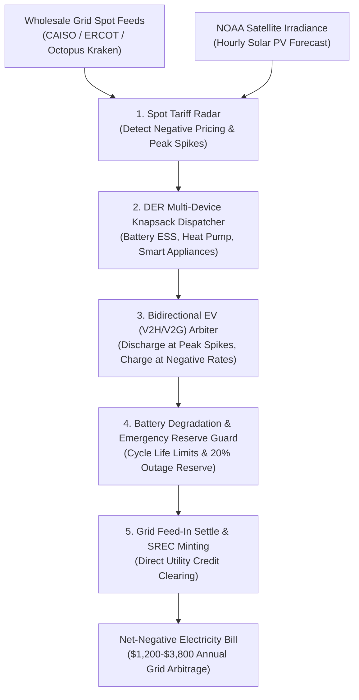

# zenpower-ai-skill

## Overview
**ZenPower (禅能)** is an autonomous dynamic energy arbitrage, wholesale spot tariff optimization, and distributed microgrid dispatch skill for the GenPark ecosystem, distilled from **Octopus Energy** (Kraken Flex VPP architecture), **Enphase Energy** (distributed micro-inverter and home storage coordination), and **Tesla Electric** (real-time automated utility bidding).

Modern deregulated power grids (CAISO, ERCOT, UK National Grid, Nord Pool) experience violent price volatility: during intense midday solar or overnight wind surges, wholesale electricity spot prices frequently collapse into **negative territory** (the grid literally pays consumers to absorb surplus power). Conversely, during peak demand events or winter freezes, spot tariffs explode by up to 100x (surging from \$0.04/kWh to \$5.00–\$9.00/kWh). Unmanaged households with electric vehicles (60–100 kWh batteries), stationary home energy storage systems (ESS, 10–30 kWh), and heat pumps bleed thousands of dollars annually on unaligned tariffs.

Operating local-first within OpenClaw, ZenPower transforms a residential home into an autonomous economic node:
1. **Wholesale Spot Tariff Radar**: Ingests day-ahead hourly wholesale spot pricing feeds, identifying negative pricing slots and peak price hazard windows.
2. **Distributed Energy Resource (DER) Dispatch Optimizer**: Solves a multi-device knapsack optimization schedule, dynamically steering EV charging, battery storage cycling, heat pump pre-heating/cooling, and domestic appliances into sub-cent or negative-cost windows.
3. **Vehicle-to-Home / Vehicle-to-Grid (V2H/V2G) Arbitrageur**: Discharges surplus EV and home battery energy during extreme peak grid stress events, monetizing stored power at 10x–50x wholesale premiums while preserving vehicle departure readiness.
4. **NOAA Solar Irradiance Yield Forecaster**: Synthesizes satellite meteorological telemetry to predict hour-by-hour rooftop photovoltaic (PV) generation, maximizing behind-the-meter self-consumption.
5. **Feed-in Tariff & SREC Credit Settlement**: Automatically logs grid export telemetry, mints Solar Renewable Energy Certificates (SRECs), and reconciles monthly utility credits.



---

## Core Capabilities

### 1. Real-Time Spot Tariff Radar & Negative Pricing Harvester
- Ingests 24-hour day-ahead market price vectors across dynamic tariff providers:
  - Octopus Agile / Intelligent Octopus API.
  - CAISO Day-Ahead & Real-Time LMP (Locational Marginal Price).
  - ERCOT Wholesale Spot Settlement Points.
  - Nord Pool Day-Ahead Elspot.
- Classifies intervals into:
  - **Negative Window ($P < \$0.00/kWh$)**: Maximizes charging; grid pays the user to consume power.
  - **Super-Off-Peak ($P \le \$0.05/kWh$)**: Charges home ESS and pre-cools/pre-heats domestic thermal mass.
  - **Standard Range ($P \in (\$0.05, \$0.25]/kWh$)**: Powers home via solar PV and battery; minimizes grid draw.
  - **Peak Hazard ($P > \$0.50/kWh$)**: Completely islands the home; triggers profitable V2G grid export.

### 2. Multi-Device DER Knapsack Dispatch Engine
- Models household energy assets as a discrete constraint satisfaction problem:
  - **Stationary Battery (ESS)**: Tesla Powerwall, Enphase IQ Battery, SolarEdge Home Battery.
  - **Electric Vehicles (EV)**: Tesla Fleet API, Enode, Smartcar, OCPP 1.6/2.0.1 smart chargers.
  - **Thermal Loads**: Ecobee, Nest, and heat pump water heaters (CTA-2045 / OpenADR).
- Solves linear optimization:
  $$\min \sum_{t=1}^{24} \left( P_{\text{grid}}(t) \cdot E_{\text{import}}(t) - P_{\text{export}}(t) \cdot E_{\text{export}}(t) \right)$$
  subject to target EV state-of-charge (SoC) $\ge 80\%$ by 07:00 AM.

### 3. Bidirectional EV (V2H / V2G) Peak Demand Response
- Interfaces with bidirectional DC fast chargers and AC onboard bidirectional systems (CCS-15118-20, NACS):
  - **V2H (Vehicle-to-Home)**: Feeds household loads directly from the EV battery during 4:00 PM – 9:00 PM peak utility windows, avoiding high retail rates.
  - **V2G (Vehicle-to-Grid)**: Exports up to 9.6 kW back into the municipal grid during critical peak pricing alerts (\$2.00–\$9.00/kWh), locking verified wholesale arbitrage revenue.

### 4. NOAA Solar Yield Modeling & Self-Consumption Sentry
- Pulls localized satellite cloud opacity and Global Horizontal Irradiance (GHI) from NOAA / Open-Meteo.
- Computes expected hourly solar generation adjusted for rooftop azimuth and tilt angle:
  $$E_{\text{PV}}(t) = A \cdot \eta \cdot \text{GHI}(t) \cdot (1 - \text{CloudCover}(t))$$
- Automatically schedules discretionary high-draw appliances (dishwasher, laundry drying, pool pumps) to sync with solar peaks, preventing curtailment.

### 5. SREC Credit Minting & Utility Settlement Engine
- Tracks kilowatt-hours of clean solar generation behind the meter.
- Auto-compiles generation certificates to register Solar Renewable Energy Certificates (SRECs) on regional registries (PJM GATS, NEPOOL GIS, WREGIS), monetizing clean energy credits (\$30–\$250/MWh).
- Reconciles net-metering utility statements against interval meter data (Green Button standard) to flag utility billing errors.

---

## MCP Tool Specifications

```json
{
  "tools": [
    {
      "name": "telemetry_wholesale_tariff_radar",
      "description": "Fetches day-ahead hourly electricity spot prices and grid carbon intensity across CAISO, ERCOT, Nord Pool, or Octopus APIs to identify arbitrage windows.",
      "parameters": {
        "type": "object",
        "properties": {
          "utility_or_iso": { "type": "string", "enum": ["octopus_uk", "caiso", "ercot", "nordpool"] },
          "zone_or_postcode": { "type": "string" },
          "forecast_horizon_hours": { "type": "integer", "default": 24 }
        },
        "required": ["utility_or_iso", "zone_or_postcode"]
      }
    },
    {
      "name": "dispatch_der_knapsack_optimizer",
      "description": "Calculates the mathematically optimal charge/discharge schedule for home battery storage, EV charging, and thermal loads based on dynamic tariffs.",
      "parameters": {
        "type": "object",
        "properties": {
          "battery_capacity_kwh": { "type": "number" },
          "battery_current_soc_percent": { "type": "number" },
          "ev_battery_capacity_kwh": { "type": "number" },
          "ev_target_soc_percent": { "type": "number", "default": 80 },
          "ev_departure_time": { "type": "string" },
          "tariff_schedule": { "type": "array", "items": { "type": "object" } }
        },
        "required": ["battery_capacity_kwh", "tariff_schedule"]
      }
    },
    {
      "name": "arbitrate_v2h_v2g_export",
      "description": "Executes automated vehicle-to-home or vehicle-to-grid power discharge during critical grid demand response events.",
      "parameters": {
        "type": "object",
        "properties": {
          "ev_vin": { "type": "string" },
          "current_export_tariff": { "type": "number" },
          "export_duration_minutes": { "type": "integer" },
          "minimum_vehicle_reserve_soc": { "type": "number", "default": 50 }
        },
        "required": ["ev_vin", "current_export_tariff"]
      }
    },
    {
      "name": "forecast_solar_irradiance_yield",
      "description": "Forecasts hour-by-hour rooftop solar photovoltaic output based on NOAA meteorological satellite data and system hardware specs.",
      "parameters": {
        "type": "object",
        "properties": {
          "system_capacity_kw": { "type": "number" },
          "latitude": { "type": "number" },
          "longitude": { "type": "number" },
          "panel_azimuth_degrees": { "type": "number", "default": 180 }
        },
        "required": ["system_capacity_kw", "latitude", "longitude"]
      }
    },
    {
      "name": "settle_grid_feedin_credits",
      "description": "Reconciles export meter interval logs against utility billing credits and compiles SREC renewable certificate minting dossiers.",
      "parameters": {
        "type": "object",
        "properties": {
          "utility_account_id": { "type": "string" },
          "billing_period_start": { "type": "string" },
          "billing_period_end": { "type": "string" }
        },
        "required": ["utility_account_id"]
      }
    }
  ]
}
```

---

## Autonomous HITL Safety Gates & Operating Protocol

1. **20% Blackout Emergency Reserve Shield**: ZenPower strictly prohibits discharging home batteries below 20% SoC during grid arbitrage operations, preserving essential backup power for critical home circuits in case of storm outages.
2. **Battery Degradation & Cycle Life Sentry**: Limits depth-of-discharge (DoD) to manufacturer-recommended optimal windows (15%–85% daily cycling) and prevents discharge if export price spread does not cover electrochemical levelized cost of storage ($LCOS \ge \$0.06/\text{kWh}$).
3. **Vehicle Departure Guarantee Gate**: Terminates V2G/V2H export operations at least 2 hours before user-configured departure time, ensuring the EV reaches target SoC without exception.
4. **Interactive WhatsApp / Telegram Grid Event Approval Card**:
   ```
   ⚡ [ZenPower Grid Arbitrage Alert]
   Event: ERCOT High-Demand Peak (Current Spot: $4.85/kWh)
   Action: Automated V2G Export Triggered
   
   Asset Status:
   - Tesla Model Y: 82% SoC (Exporting 7.2 kW for 90 mins)
   - Home Powerwall: 95% SoC (Supplying all domestic loads)
   
   Projected Earnings:
   - 10.8 kWh Exported @ $4.85/kWh = +$52.38 Net Cash Credit
   - Guaranteed Departure SoC: 65% (185 miles range maintained)
   
   [ ✅ Authorize Peak Export ]  [ 🛑 Island Home (No Export) ]
   ```
