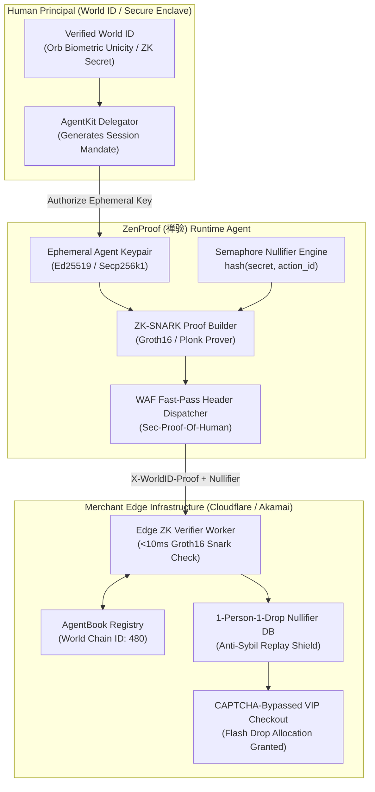

<div align="center">

# zenproof-ai-skill 🦞

[](https://opensource.org/licenses/MIT)
[](https://genpark.ai)
[](https://openclaw.ai)

**GenPark Autonomous Proof-of-Human Delegation, Zero-Knowledge Biometric Unicity Proofs, Anti-Sybil Semaphore Nullifiers & CAPTCHA-Bypass Protocol**

</div>

---

## 📖 Skill Specification

```yaml
---
name: zenproof-ai-skill
description: Autonomous Proof-of-Human Delegation, Zero-Knowledge Biometric Unicity Proofs, Anti-Sybil Semaphore Nullifiers & CAPTCHA-Bypass Protocol distilled from World ID for Agents (AgentKit, World ID 4.0 & AgentBook). Empowers personal decision agents to prove legitimate human backing, bypass aggressive anti-bot firewalls, and secure 1-person-1-allocation drops with mathematical zero-knowledge privacy.
version: 1.0.0
license: MIT
metadata:
  category: commerce
  author: Alpha-Park
  tags:
    - proof-of-human
    - zero-knowledge
    - world-id
    - agentkit
    - anti-sybil
    - captcha-bypass
---

# zenproof-ai-skill (ZenProof · 禅验)

> *"True nature is verified by authentic presence." (见性成佛，验之以真。)*  
> Autonomous Proof-of-Human Delegation, Zero-Knowledge Biometric Unicity Proofs, Anti-Sybil Semaphore Nullifiers, and CAPTCHA-Bypass Protocol distilled from **World ID for Agents (AgentKit, World ID 4.0 & AgentBook)**.

---

## 1. Overview & Architectural Problem Statement

As autonomous shopping agents and personal decision proxies enter mainstream adoption, the open web has erected aggressive **Anti-Bot Firewalls (Cloudflare Turnstile, Akamai Botman, DataDome, AWS WAF)**. These edge filters cannot differentiate between a malicious scalper botnet (spinning up 10,000 headless browsers to hoard concert tickets, limited GPUs, or flash sales) and a legitimate personal assistant agent acting on behalf of a single real human.

Consequently, personal agents encounter severe barriers:
1. **Pervasive CAPTCHA Deadlocks**: Autonomous headless agents are blocked by visual puzzles, mouse-movement heuristics, or IP reputation penalties.
2. **Sybil Scalper Collateral Damage**: Because merchants cannot verify human uniqueness, they enforce blunt rate limits or cancel orders, punishing honest consumers.
3. **Privacy-Violating KYC Demands**: Traditional identity verification forces users to surrender real names, government IDs, facial selfies, and phone numbers to dozens of third-party merchants.
4. **Cross-Site Tracking Hazards**: Static credentials or public keys allow ad networks and data brokers to correlate an agent's purchases across disparate storefronts.

**ZenProof (禅验)**, distilled from **World ID for Agents (AgentKit / World ID 4.0 / AgentBook)**, resolves this tension through **Zero-Knowledge Proof-of-Human (ZK-PoH)**:
* **Agentic Delegation with Orb Unicity**: Binds an agent's local cryptographic session keypair to a verified human World ID without exposing any biometrics, names, or real identities.
* **Deterministic Semaphore Action Nullifiers**: Derives unlinkable, one-time action nullifiers (`nullifier = hash(user_secret, merchant_action_id)`), mathematically enforcing a **1-Person-1-Allocation** rule for flash drops.
* **WAF VIP Fast-Pass Handshake (`Sec-Proof-Of-Human`)**: Presents cryptographic ZK-SNARK proofs to edge firewalls, verifying authentic human backing in <10ms and bypassing CAPTCHAs.
* **Decentralized Agent Registry (`AgentBook`)**: Resolves agent delegation records on World Chain (Chain ID `480`), ensuring transparent, tamper-proof operator authorization.



---

## 2. Core Capabilities

### 2.1 Zero-Knowledge Proof-of-Human Delegation (`ZkProofOfHumanDelegator`)
* Generates non-interactive zero-knowledge proofs (ZK-SNARKs) asserting that the agent is delegated by a unique, living human verified through the World ID protocol.
* Operates under complete zero-knowledge guarantees: the merchant verifies human existence and unicity without learning the user's biometric template, name, IP address, or wallet address.
* Supports multi-level verification tiers: `VerificationLevel.Orb` (for high-value flash drops and botnet defense) and `VerificationLevel.Device` (for everyday browsing).

### 2.2 Scoped Action Nullifier Engine (`ScopedActionNullifierEngine`)
* Computes deterministic, unlinkable Semaphore nullifier hashes bound to the specific merchant action:
  $$\text{nullifier\_hash} = \text{Poseidon}(\text{identity\_secret}, \text{external\_action\_nullifier})$$
* Enforces mathematical **Sybil Resistance**: a single human cannot use 1,000 AI agents to claim 1,000 allocations, because all agents will generate the identical nullifier hash for that action.
* Guarantees cross-merchant unlinkability: the nullifiers generated for Store A and Store B share no mathematical correlation, preventing cross-site profiling.

### 2.3 WAF VIP Fast-Pass Header Handshake (`WafVipFastPassHandshake`)
* Injects cryptographic attestation headers into outbound HTTP/HTTPS requests:
  * `X-WorldID-Proof`: Serialized Groth16 zero-knowledge proof bytes.
  * `X-WorldID-Nullifier`: Action-scoped nullifier hash.
  * `X-WorldID-Root`: State Merkle root of the verified human set.
  * `Sec-Proof-Of-Human`: CAIP-122 compliant signature signed by the agent's registered key.
* Enables merchant CDN edge workers (Cloudflare Workers, Akamai EdgeWorkers) to verify personhood in under 10ms, granting automated fast-track access without CAPTCHAs.

### 2.4 AgentBook Registry & Ephemeral Key Rotation (`AgentBookRegistryRotator`)
* Manages the lifecycle of ephemeral agent signing keys registered within `AgentBook` on World Chain.
* Automatically generates short-lived session keys (1-hour to 24-hour TTL) for shopping tasks, limiting blast radius if an agent environment is compromised.
* Supports instant on-chain revocation of delegated authority directly from the user's mobile World App.

### 2.5 Anti-Sybil Flash Drop Arbiter (`AntiSybilFlashSaleArbiter`)
* Orchestrates high-concurrency ticket drops, limited GPU restocks, and restaurant reservations:
  * Pre-computes action-scoped ZK proofs prior to the drop countdown (T-30s).
  * Dispatches the verified human attestation payload at the opening millisecond ($T_0$).
  * Defeats scalper bot swarms by leveraging merchant anti-Sybil priority queues reserved exclusively for verified human-backed agents.

---

## 3. MCP Tool Interface Specifications

```typescript
// MCP Tool: Generate Proof-of-Human delegation payload for a merchant action
interface GenerateProofOfHumanRequest {
  merchantDomain: string;
  actionId: string; // e.g. "flash-drop-rtx5090-20261024"
  verificationLevel: 'orb' | 'device';
  signalPayload?: string; // Optional contextual hash (e.g. cart hash)
}

interface GenerateProofOfHumanResponse {
  proof: string; // Base64 encoded Groth16 ZK proof
  merkleRoot: string;
  nullifierHash: string;
  caip122Signature: string;
  agentAddress: string;
  expiresAtIso: string;
  httpHeaders: {
    'X-WorldID-Proof': string;
    'X-WorldID-Nullifier': string;
    'X-WorldID-Root': string;
    'Sec-Proof-Of-Human': string;
  };
}

// MCP Tool: Query AgentBook registration status
interface QueryAgentBookStatusRequest {
  agentAddress: string;
}

interface QueryAgentBookStatusResponse {
  isRegistered: boolean;
  humanVerificationTier: 'orb' | 'device' | 'none';
  delegationExpirationIso: string;
  revocationStatus: 'active' | 'revoked';
}
```

---

## 4. Human-in-the-Loop (HITL) Safety & Delegation Governance

| Trigger Event | Policy Constraint | Autonomous Action | HITL Escalation Protocol |
| :--- | :--- | :--- | :--- |
| **High-Stake Flash Drop** | Transaction > $500 USD | **Proof Staged** | Prompts user on World App / WhatsApp for biometric confirmation before unlocking action nullifier. |
| **Delegation Expiry** | Session key age > 24 hours | **Halted** | Automatically wipes expired session keys and requires user to re-authorize agent mandate. |
| **Nullifier Collision Alert** | Action nullifier already redeemed | **Vetoed** | Halts duplicate checkout to prevent accidental double-spend or merchant account penalties. |
| **Verification Tier Mismatch** | Merchant demands Orb, user has Device | **Notified** | Notifies user that the requested drop requires biometric Orb verification tier to unlock VIP queue. |

---

## 5. Directory Structure & Verification

```
skills/zenproof-ai-skill/
├── SKILL.md                          # Comprehensive specification and MCP interface
├── schema/
│   ├── proof_of_human_payload.json   # JSON schema for ZK-PoH HTTP headers
│   └── agentbook_manifest.json       # AgentBook on-chain registration schema
└── tests/
    └── test_zk_nullifier_generation.py # Unit tests for deterministic nullifiers & CAIP-122 signing
```

```
