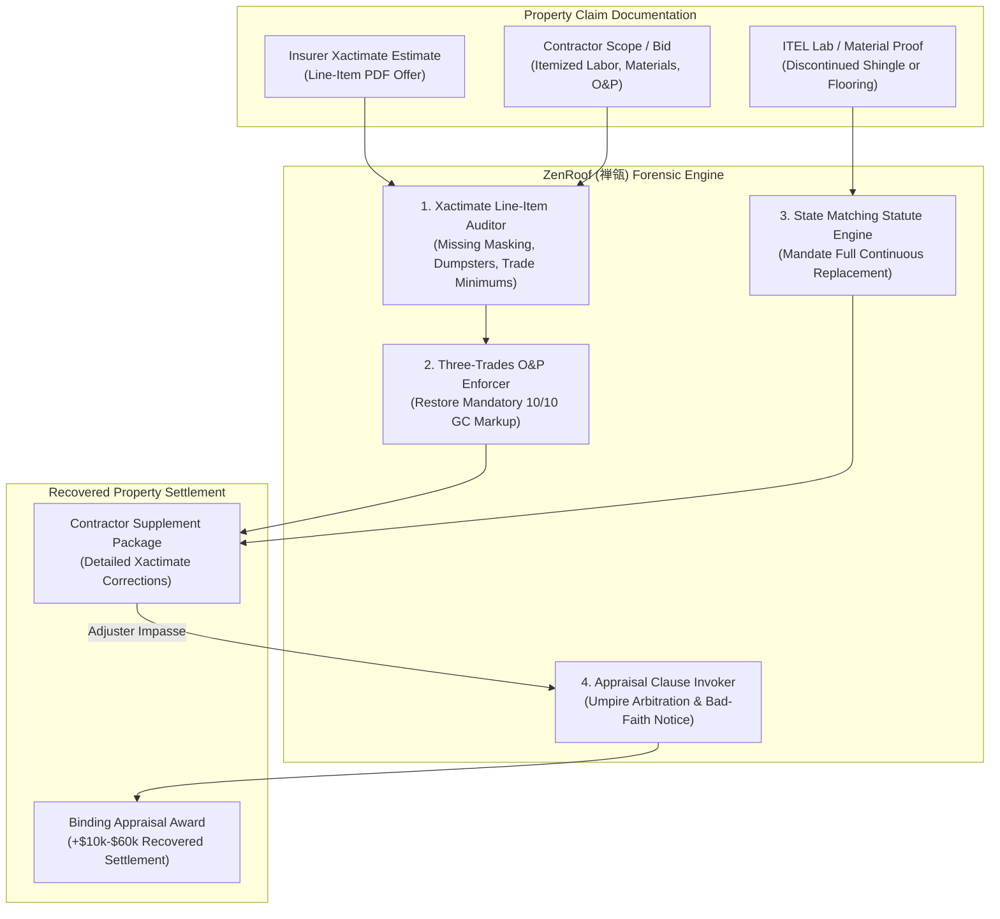

# zenroof-ai-skill (ZenRoof · 禅瓴)

> *"A roof is not repaired with mismatched patches; true shelter demands seamless restoration." (瓴瓦齐整，方御风雨；权衡损益，不纳偏私。)*  
> Autonomous Homeowners Property Insurance Claim Lowball Audit, Xactimate Forensic Re-Engineering, Three-Trades Overhead & Profit (O&P 10/10) Enforcement, State Matching Statute Assertion, and Policy Appraisal Clause Invocation Engine distilled from **United Policyholders (UPHelp), ClaimSupplementPro, Florida Matching Statute (FL Stat. § 626.9744), and IICRC S500 restoration standards**.

---

## 1. Overview & Architectural Problem Statement

When residential properties suffer catastrophic damage from hail, windstorms, frozen pipe water leaks, or fire, homeowners confront an institutional claims settlement complex designed to underpay property damage claims by **$10,000 to $60,000 per loss**. Insurance adjusters rely on industrial pricing software—most notably **Xactimate**—which carriers systematically configure to generate depressed "lowball" repair estimates:

1. **Systematic Scope & Line-Item Omission**: Insurers routinely omit mandatory ancillary restoration tasks from Xactimate scopes—such as contents manipulation, dust containment barriers, floor protection, masking, dumpster disposal fees, and local building code upgrades (Ordinance & Law coverage).
2. **Arbitrary 10/10 Overhead & Profit (O&P) Stripping**: Adjusters systematically delete the standard 20% General Contractor markup (10% Overhead, 10% Profit) by claiming "the homeowner hasn't hired a general contractor yet." Industry standards and established case law dictate that O&P is mandatory whenever a project reasonably requires **three or more distinct trades** (e.g., drywall, painting, roofing, flooring, electrical).
3. **Discontinued Material "Patchwork" Lowballs**: When wind or hail damages a portion of a roof, or water damages continuous hallway flooring, adjusters pay only for localized patches. If the existing shingle or flooring tile is discontinued, localized repairs leave an unsightly mismatched patchwork. Insurers intentionally ignore state **Matching Statutes & Regulations** (e.g., FL Stat. § 626.9744, Ohio Admin. Code 3901-1-54, Minn. Stat. § 65A.10) requiring full continuous replacement to restore a uniform appearance.
4. **Appraisal Clause Obfuscation**: Policy contracts contain a statutory **Appraisal Clause** allowing homeowners to bypass biased adjusters and submit the loss to an independent appraiser and umpire. Insurers delay and conceal this mechanism to force desperate homeowners into accepting partial checks.

**ZenRoof (禅瓴)** automates the forensic auditing and recovery of property claims:
* **Xactimate Scope & Line-Item Auditor (`XactimateScopeAuditor`)**: Performs cross-comparisons between the carrier's Xactimate PDF estimate and contractor restoration scopes, identifying missing trade labor, deflated unit prices, and omitted code compliance line items.
* **Three-Trades Overhead & Profit Enforcer (`OverheadAndProfitEnforcer`)**: Identifies multi-trade complexities across the damage scope, establishing legal entitlement to 10/10 O&P under state insurance department guidelines.
* **Continuous Matching Statute Assertion Engine (`MatchingStatuteAssertor`)**: Ingests ITEL or manufacturer discontinuation letters, citing state matching statutes to compel carrier coverage for full roof slope or open-concept continuous flooring replacement.
* **Homeowners Policy Appraisal Clause Invoker (`PropertyAppraisalInvoker`)**: Drafts formal statutory appraisal demand packages appointing certified independent property appraisers and forcing impartial umpire arbitration.



---

## 2. Core Architectural Subsystems

### 2.1 Xactimate Line-Item & Scope Auditor (`XactimateScopeAuditor`)
Deconstructs insurer estimates against IICRC S500/S520 restoration standards:
* **Missing Line Items**: Flags omitted masking tape, plastic floor protection, contents manipulation, and post-demolition HEPA vacuuming.
* **Depreciation Abuse**: Audits actual cash value (ACV) holdbacks, stripping excessive subjective depreciation applied to non-depreciable labor lines.
* **Building Code Compliance**: Activates Ordinance & Law endorsement provisions for mandatory updates (e.g. ice and water shield barriers, drip edges).

### 2.2 Three-Trades Overhead & Profit Enforcer (`OverheadAndProfitEnforcer`)
Calculates trade categorization across the repair scope:
* Evaluates distinct trades: (1) Roofing, (2) Drywall, (3) Painting, (4) Flooring, (5) Electrical, (6) HVAC.
* If $\ge 3$ distinct trades are required, automatically injects 10% Overhead and 10% Profit, citing state Department of Insurance bulletins and controlling appellate precedents.

### 2.3 State Matching Statute & Regulation Assertion (`MatchingStatuteAssertor`)
When building materials are no longer manufactured:
* Cites state-specific matching laws (e.g. Florida Stat. § 626.9744: "when a loss requires replacement of items and the replaced items do not match in quality, color, or size, the insurer shall make reasonable repairs or replacement of items in adjoining areas").
* Generates formal discontinuation notices with manufacturer documentation, legally barring patchwork settlements.

### 2.4 Contractual Property Appraisal Clause Invoker (`PropertyAppraisalInvoker`)
When the carrier refuses fair supplement agreements:
* Drafts a statutory Appraisal Demand Letter under the policy conditions.
* Appoints an independent, unbiased appraiser and establishes the 15-day timeline for carrier appraiser appointment, moving forward to neutral umpire selection.

---

## 3. OpenClaw MCP Tool Interfaces

```typescript
export interface XactimateEstimateLineItem {
  category: string;
  selector: string;
  description: string;
  quantity: number;
  unit: string;
  unitPriceUsd: number;
  depreciationPercent: number;
}

export interface AuditXactimateParams {
  claimNumber: string;
  policyNumber: string;
  carrierName: string;
  insurerEstimateRawText: string;
  contractorEstimateRawText: string;
  distinctTradesIdentified: string[];
  discontinuedMaterials: Array<{
    itemType: 'roofing_shingle' | 'siding' | 'hardwood_flooring' | 'ceramic_tile';
    brandModel: string;
    itelReportAvailable: boolean;
  }>;
}

export interface InvokePropertyAppraisalParams {
  insuredName: string;
  propertyAddress: string;
  carrierName: string;
  claimNumber: string;
  disputedDeltaUsd: number;
  independentAppraiserName: string;
  independentAppraiserContact: string;
  statutoryJurisdictionState: string;
}
```

---

## 4. Human-in-the-Loop (HITL) Guardrails

1. **Certified Scope Alignment**: All proposed supplement items must correspond to real, demonstrable physical damage documented by licensed contractor photographs.
2. **Appraisal Invocation Sign-Off**: The Appraisal Clause triggers a binding arbitration process; the homeowner must explicitly confirm intent before formal legal service on the insurer.
3. **No Unlicensed Adjusting**: ZenRoof acts as a technical audit and document compiler for the policyholder, preserving clear delineation of independent appraisal rights.
