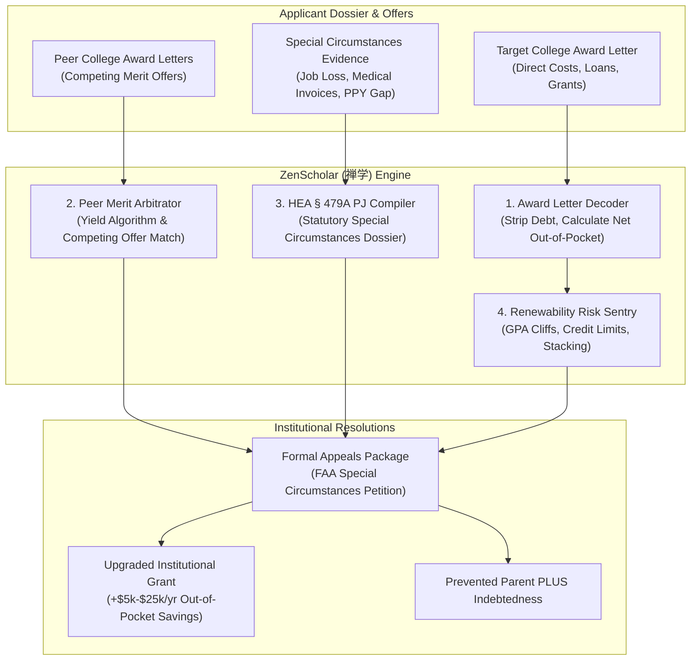

# zenscholar-ai-skill (ZenScholar · 禅学)

> *"Wisdom must not be mortgaged to usury; true learning begins when artificial barriers dissolve." (明德致知，解缚脱羁。)*  
> Autonomous College Tuition Negotiation, FAFSA Professional Judgment (HEA § 479A) Special Circumstances Appeals, and Peer Cross-Admit Merit Scholarship Arbitrage Engine distilled from **TuitionFit, MeritMore, and institutional financial aid discount matrices**.

---

## 1. Overview & Architectural Problem Statement

Higher education in the United States and abroad operates under a high-tuition, high-discount pricing model. Sticker prices for four-year private and out-of-state public universities routinely exceed **$40,000 to $90,000 per year** ($160,000 to $360,000 for a degree). However, according to the National Association of College and University Business Officers (NACUBO), the average tuition discount rate at private institutions exceeds **54%**. The published sticker price is essentially an artificial anchor; the actual price a student pays is determined by enrollment yield algorithms and strategic financial aid packaging.

Families navigate a minefield of structural asymmetries:

1. **Deceptive Financial Aid Award Packaging**: University award letters deliberately blend true "gift aid" (institutional grants, merit scholarships) with "self-help" debt (Federal Direct Unsubsidized Loans, predatory Parent PLUS loans with 9%+ interest and origination fees) and conditional Work-Study, misleading parents into believing an unaffordable school is "covered."
2. **The FAFSA Prior-Prior Year (PPY) Disconnect**: Federal Student Aid (FAFSA) calculations calculate the Student Aid Index (SAI) using tax returns from two years prior. Sudden catastrophic economic events—job termination, business failure, salary reductions, catastrophic unreimbursed medical expenses (>11% of AGI), divorce, or bereavement—are invisible to the automated federal formula.
3. **Unexercised Statutory Rights under HEA § 479A**: Section 479A of the Higher Education Act explicitly grants university Financial Aid Administrators (FAAs) the statutory authority of **Professional Judgment (PJ)** to override federal formulas, reduce the SAI, and increase institutional grant funding upon receipt of a documented Special Circumstances Appeal. Most families never file because they assume college award letters are non-negotiable.
4. **Peer Institution Merit Aid Arbitrage**: Colleges compete fiercely for qualified students to boost yield metrics before the National Candidate Reply Date (May 1). When an applicant receives a substantial merit scholarship from Peer Institution A, competing Peer Institution B will frequently match or increase its institutional discount by **$5,000 to $25,000 per year** when presented with a structured, respectful, and verified peer offer letter.

**ZenScholar (禅学)** automates the financial aid forensic audit and statutory appeal process:
* **True Net Price & Loan Packaging De-obfuscator (`AwardLetterDecoder`)**: Dissects financial aid letters, strips out interest-bearing debt, and calculates the true four-year net out-of-pocket cost and degree debt burden.
* **HEA § 479A Professional Judgment Dossier Compiler (`ProfessionalJudgmentCompiler`)**: Formulates formal statutory special circumstances appeals with verified mathematical models translating documented life changes into required SAI reductions.
* **Peer Cross-Admit Merit Aid Arbitrage Engine (`PeerMeritAidArbitrator`)**: Leverages competing offers from Carnegie-classified peer institutions to draft persuasive, respectful reconsideration appeals that trigger institutional yield-protection algorithms.
* **Scholarship Renewability & Cliff Risk Sentry (`RenewabilityRiskAuditor`)**: Analyzes GPA maintenance requirements (e.g. 3.5 GPA retention cliffs), stacking restrictions, and 4-year credit hour constraints.



---

## 2. Core Capabilities & Architectural Subsystems

### 2.1 Award Letter Decoder (`AwardLetterDecoder`)
Financial aid award letters frequently use deceptive nomenclature (e.g. labeling a \$45,000 Parent PLUS Loan as "Federal Direct Parent PLUS Award" under the "Financial Aid Total"). The decoder enforces strict accounting:
$$\text{True Net Out-of-Pocket Cost} = (\text{Direct COA Tuition} + \text{Mandatory Fees} + \text{Room \& Board}) - (\text{Institutional Grants} + \text{Endowed Merit Scholarships} + \text{Federal Pell Grants})$$
Any item requiring future repayment (Direct Subsidized, Direct Unsubsidized, Parent PLUS, Private Loans) or work performance (Federal Work-Study) is segregated into a "Debt & Labor Obligation" category.

### 2.2 HEA § 479A Professional Judgment Compiler (`ProfessionalJudgmentCompiler`)
Under 20 U.S.C. 1087tt (Higher Education Act Section 479A), Financial Aid Administrators are authorized to exercise professional judgment on a case-by-case basis. ZenScholar compiles evidence packages conforming to federal audit standards:
* **Income Reduction**: Calculates current projected calendar year income vs. Prior-Prior Year tax returns, isolating severance exhaustion dates, unemployment benefits, and annualized wage gaps.
* **Unreimbursed Medical Expenses**: Audits Schedule A IRS medical deductions and medical invoices exceeding 11% of the family's adjusted gross income.
* **Secondary Sibling Tuition**: Documents simultaneous private or higher-education tuition payments for siblings not reflected in the updated FAFSA SAI formula.
* **Dossier Output**: Produces a structured Cover Memorandum for the Director of Financial Aid, detailed financial delta worksheets, and third-party documentary exhibit lists.

### 2.3 Peer Cross-Admit Merit Aid Arbitrage (`PeerMeritAidArbitrator`)
Universities budget millions annually for discretionary "appeals pools" to recruit admitted students who are on the fence between rival institutions. ZenScholar executes multi-institution negotiation strategy:
1. **Peer Group Validation**: Confirms that competing colleges belong to identical or higher Carnegie classifications, US News ranking tiers, or athletic conferences (e.g., Boston University vs. Northeastern; Emory vs. Vanderbilt).
2. **Net Cost Differential Quantification**: Normalizes room, board, and tuition across offers to calculate the exact dollar gap between the target school and competing offers.
3. **Respectful Reconsideration Drafting**: Drafts an appeal that conveys high enthusiasm for the target institution, establishes the target school as the student's top choice, and respectfully requests reconsideration of merit funding based on the competing financial commitment.

---

## 3. OpenClaw MCP Tool Interfaces

```typescript
export interface AwardLetterItem {
  itemName: string;
  category: 'direct_grant' | 'merit_scholarship' | 'subsidized_loan' | 'unsubsidized_loan' | 'parent_plus_loan' | 'work_study' | 'other';
  amountPerYearUsd: number;
  isRenewable: boolean;
  renewalGpaRequirement?: number;
}

export interface DecodeAwardLetterParams {
  institutionName: string;
  academicYear: string;
  totalPublishedCoaUsd: number;
  directCostsTuitionFeesUsd: number;
  directCostsRoomBoardUsd: number;
  awardItems: AwardLetterItem[];
}

export interface CompileProfessionalJudgmentParams {
  studentName: string;
  targetInstitutionName: string;
  financialAidDirectorName?: string;
  circumstanceCategory: 'involuntary_income_loss' | 'catastrophic_medical' | 'one_time_income_spike' | 'eldercare_or_sibling_support' | 'divorce_separation';
  priorPriorYearAgiUsd: number;
  currentProjectedAgiUsd: number;
  unreimbursedOutofPocketExpensesUsd: number;
  narrativeChronology: string;
  supportingDocumentChecklist: string[];
}

export interface PeerMeritArbitrageParams {
  targetInstitution: {
    name: string;
    offeredGiftAidUsd: number;
    netOutofPocketUsd: number;
  };
  competingOffers: Array<{
    institutionName: string;
    carnegieClassification: string;
    offeredGiftAidUsd: number;
    netOutofPocketUsd: number;
    awardLetterVerified: boolean;
  }>;
  studentGpa: number;
  standardizedScore?: string;
  academicDepartmentInterest: string;
}
```

---

## 4. Human-in-the-Loop (HITL) Guardrails

1. **Strict Non-Ultimatum Tone Enforcement**: Negotiations must never issue hostile ultimatums or express entitlement. Appeals must always affirm that the target school is the preferred choice if financially viable.
2. **Absolute Fraud Prevention**: Every submitted financial figure (W-2s, 1040s, termination letters, medical receipts) must be strictly factual. ZenScholar will never suggest fabricating expenses or misrepresenting income.
3. **Irrevocable Final Approval**: No correspondence is ever transmitted automatically to a university admissions or financial aid office without explicit parental or student sign-off.
