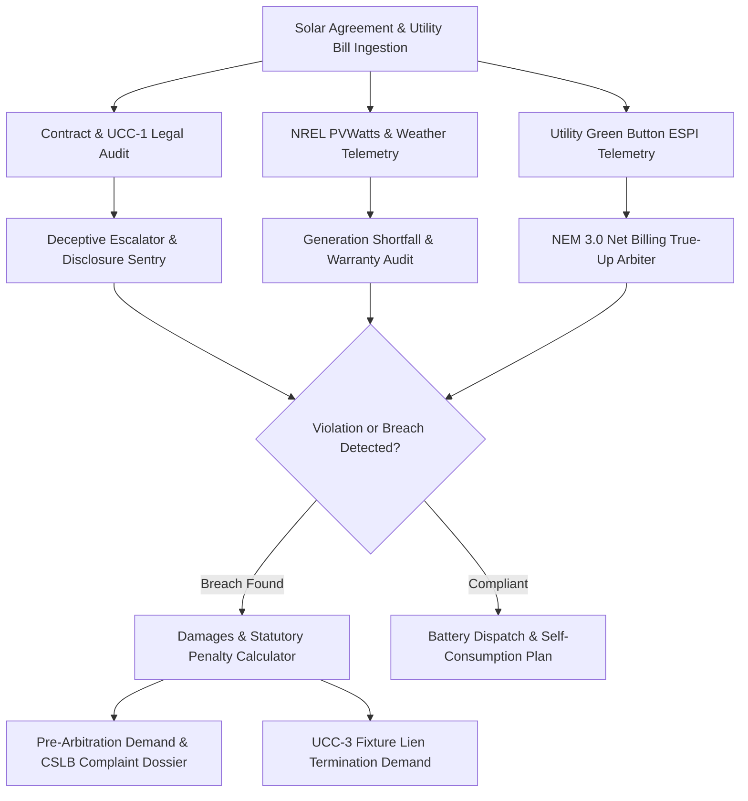

# zensolar-ai-skill

## Overview
**ZenSolar (禅阳)** is a production-grade autonomous rooftop solar consumer defense agent. It protects residential homeowners from predatory 25-year solar lease/PPA escalators, unmasks solar generation underperformance against NREL meteorological baselines, neutralizes utility NEM 3.0 surprise annual "True-Up" bills ($2,000–$5,000), and compiles statutory contract rescission dossiers to cancel illegal UCC-1 liens and force fair buyouts.



## Core Capabilities

### 1. Multimodal PPA Contract & UCC-1 Fixture Lien Audit
- Deconstructs 30–60 page solar leases, Power Purchase Agreements (PPAs), and financing disclosures (Truth in Lending Act / Reg Z).
- Audits statutory disclosure compliance under California AB 1070 (Solar Consumer Protection Guide), FTC Door-to-Door Sales Cooling-Off Rule (16 CFR Part 429), and state Home Improvement Sales Acts.
- Verifies county property deed records to identify unauthorized UCC-1 fixture liens that cloud property titles and block home sales or mortgage refinancing.

### 2. NREL PVWatts & Solar Inverter Telemetry Sentry
- Ingests solar inverter telemetry (Enphase Enlighten API, SolarEdge Monitoring API, or manual meter logs).
- Cross-references real-world solar irradiance using the NREL PVWatts v8 API and local NOAA meteorological station histories.
- Identifies persistent generation shortfalls (>15% deficit) caused by inverter clipping, thermal derating, microinverter failures, or unmodeled shading, calculating exact kWh loss and warranty compensation owed.

### 3. NEM 3.0 Net Billing Tariff True-Up Shock Neutralizer
- Parses utility Green Button XML/ESPI interval consumption data (PG&E, SCE, SDG&E, Duke Energy, FPL) to evaluate net energy metering.
- Audits annual "True-Up" reconciliation statements for meter multiplier errors, uncredited daytime solar generation, and peak non-bypassable charges.
- Computes optimized battery storage retrofit ROI (5–15 kWh LFP) to eliminate 4 PM–9 PM peak grid purchases and maximize local solar self-consumption.

### 4. Contract Rescission, CSLB Escalation & UCC-3 Lien Removal
- Auto-compiles formal pre-arbitration statutory demand packages alleging deceptive trade practices, fraudulent production estimates, and failure of consideration.
- Prepares ready-to-file regulatory complaint filings for the state Contractors State License Board (CSLB), State Attorney General Consumer Protection Division, and CFPB.
- Generates formal demands for UCC-3 financing statement termination to immediately clear clouds on homeowner title.

## Input JSON Schema

```json
{
  "$schema": "http://json-schema.org/draft-07/schema#",
  "title": "ZenSolarDisputePayload",
  "type": "object",
  "required": ["homeownerInfo", "systemDetails", "utilityData"],
  "properties": {
    "homeownerInfo": {
      "type": "object",
      "required": ["address", "state", "installationDate"],
      "properties": {
        "address": { "type": "string" },
        "state": { "type": "string", "maxLength": 2 },
        "installationDate": { "type": "string", "format": "date" }
      }
    },
    "systemDetails": {
      "type": "object",
      "required": ["contractType", "systemSizeKw", "providerName"],
      "properties": {
        "contractType": { "type": "string", "enum": ["PPA", "LEASE", "LOAN", "CASH_PURCHASE"] },
        "systemSizeKw": { "type": "number" },
        "providerName": { "type": "string" },
        "annualEscalatorPercent": { "type": "number" },
        "guaranteedAnnualProductionKwh": { "type": "number" },
        "actualAnnualProductionKwh": { "type": "number" },
        "hasUcc1Lien": { "type": "boolean" }
      }
    },
    "utilityData": {
      "type": "object",
      "required": ["utilityName", "rateTariff", "annualTrueUpBilled"],
      "properties": {
        "utilityName": { "type": "string" },
        "rateTariff": { "type": "string" },
        "annualTrueUpBilled": { "type": "number" },
        "netExportKwh": { "type": "number" },
        "netImportKwh": { "type": "number" }
      }
    }
  }
}
```

## Node.js Implementation Example

```javascript
import { ZenSolarArbiter } from '@alpha-park/zensolar-ai-skill';

const solarCase = {
  homeownerInfo: {
    address: '4521 Citrus Blossom Way, Riverside, CA 92506',
    state: 'CA',
    installationDate: '2022-03-15'
  },
  systemDetails: {
    contractType: 'PPA',
    systemSizeKw: 8.4,
    providerName: 'Sunnova / Rooftop Sales Direct LLC',
    annualEscalatorPercent: 2.9,
    guaranteedAnnualProductionKwh: 12800,
    actualAnnualProductionKwh: 8900,
    hasUcc1Lien: true
  },
  utilityData: {
    utilityName: 'Southern California Edison (SCE)',
    rateTariff: 'TOU-D-PRIME / NEM 3.0',
    annualTrueUpBilled: 3410.50,
    netExportKwh: 4200,
    netImportKwh: 7800
  }
};

const arbiter = new ZenSolarArbiter({
  nrelApiKey: process.env.NREL_API_KEY,
  enableCslbFormatting: true
});

const auditResult = await arbiter.auditSolarContractAndProduction(solarCase);
console.log('Production Deficit:', auditResult.productionShortfallPercent + '%');
console.log('Contractor Warranty Liability:', '$' + auditResult.warrantyReimbursementOwed);
console.log('Statutory Violations Identified:', auditResult.statutoryViolations);

const demandDossier = await arbiter.generateRescissionAndLienReleaseDemand(auditResult);
console.log('Demand Letter Ready for Dispatch. Pages:', demandDossier.pageCount);
```
