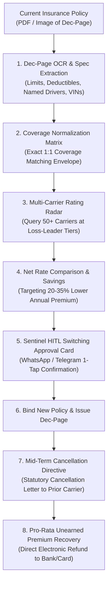

<div align="center">

# zensure-ai-skill 🦞

[](https://opensource.org/licenses/MIT)
[](https://genpark.ai)
[](https://openclaw.ai)

**GenPark Autonomous Insurance Policy Re-Shopping, Declarations Page (Dec-Page) OCR Ingestion, Algorithmic Price Surcharge Neutralizer & Mid-Term Switching**

</div>

---

## 📖 Skill Specification

```yaml
---
name: zensure-ai-skill
description: Autonomous Insurance Policy Re-Shopping, Declarations Page (Dec-Page) OCR Ingestion, Algorithmic Price Optimization Surcharge Neutralizer, Mid-Term Switching & Pro-Rata Refund Engine distilled from CoverageCat and Jerry. Ingests existing P&C policy declaration pages, normalizes coverage limits (100k/300k/100k, deductibles, endorsements), queries multi-carrier rating APIs for identical loss-leader tiers, automatically executes mid-term carrier switching, and reclaims unearned pro-rata premium refunds.
version: 1.0.0
license: MIT
---

# zensure-ai-skill

## Overview
**ZenSure (禅保)** is an autonomous property and casualty (P&C) insurance policy audit, automated multi-carrier re-shopping, and unearned premium recovery skill for the GenPark ecosystem, distilled from **CoverageCat** (algorithmic insurance optimization and risk modeling) and **Jerry** (automated policy re-shopping, dec-page parsing, and frictionless switching).

Insurance pricing is built upon an aggressive corporate practice known as **"Price Optimization" (the Loyalty Penalty)**: insurers quietly increase renewal premiums by 15%–25% year after year on existing policyholders who rarely shop around, while reserving heavily subsidized loss-leader rates for newly acquired customers. As a result, the average household loses **$800 to $1,500 annually in excess premiums** across auto, homeowners, renters, and umbrella coverages for completely identical policy protections.

Operating local-first within OpenClaw, ZenSure eliminates the insurance loyalty penalty:
1. **Dec-Page OCR & Structured Ingestion**: Scans policy Declarations Pages (Dec-Pages), extracting bodily injury liability ($100k/$300k), property damage ($100k), comprehensive/collision deductibles, uninsured motorist protections, and custom endorsements.
2. **Normalized Multi-Carrier Rate Arbitrage**: Maps the user's driver profile and coverage envelope against 50+ national and regional insurance carrier rating APIs, discovering equivalent-protection policies at wholesale new-customer pricing.
3. **Renewal Creep & Surcharge Sentry**: Automatically benchmarks rates at T-45 days before annual policy renewals, alerting the user whenever rate drift exceeds 5%.
4. **Mid-Term Switching & Cancellation Autopilot**: Legally cancels inflated policies mid-term without waiting for renewal cycles, issuing formal cancellation directives to the legacy insurer.
5. **Unearned Pro-Rata Refund Reclamation**: Calculates the legacy insurer's unearned premium balance to the exact day and enforces statutory 100% pro-rata refund disbursement directly back to the consumer.



---

## Core Capabilities

### 1. Declarations Page (Dec-Page) OCR & Structured Ingestion
- Ingests policy Declarations Pages across auto, homeowners, renters, and umbrella lines.
- Extracts and standardizes:
  - Bodily Injury Liability per Person / per Accident (e.g., $100,000 / $300,000).
  - Property Damage Liability (e.g., $100,000).
  - Comprehensive & Collision Deductibles ($500, $1,000).
  - Uninsured / Underinsured Motorist (UM/UIM) limits.
  - Medical Payments (MedPay) or Personal Injury Protection (PIP).
  - Active Endorsements: OEM parts replacement, roadside assistance, rental car reimbursement, water backup.
  - Insured Vehicles (VINs, annual mileage, primary use) and Named Drivers.

### 2. Multi-Carrier Parallel Rate Arbitrage
- Simultaneously queries 50+ franchised carriers and digital underwriters (e.g., Progressive, Travelers, Nationwide, Safeco, Clearcover).
- Eliminates "Apples-to-Oranges" traps: enforces strict parity by forbidding algorithmic carriers from quoting lower prices by secretly dropping limits or increasing deductibles.
- Identifies new-customer promotional acquisition discounts (loss leaders) and multi-policy bundling arbitrage.

### 3. Renewal Creep & Loyalty Tax Sentry
- Initiates an automated market benchmark 45 days prior to every policy expiration date.
- Calculates the **Rate Inflation Delta ($\Delta R$)**:
  $$\Delta R = \frac{\text{New Renewal Premium} - \text{Baseline Premium}}{\text{Baseline Premium}}$$
- If $\Delta R > 0.05$ without any corresponding at-fault claims or moving violations, ZenSure flags the policy as suffering from carrier price optimization and prepares switching candidates.

### 4. Mid-Term Switching & Instant Policy Binding
- Debunks the myth that consumers must wait until renewal dates: insurance policies in all 50 US states can be legally canceled at any time by the policyholder.
- Coordinates seamless zero-gap transitions: binds the new policy with the exact start date and minute of the old policy cancellation, preventing statutory coverage lapses that trigger DMV penalties or lender escrow notices.
- Dispatches electronic binder certificates directly to vehicle lienholders and mortgage escrow servicers.

### 5. Statutory Pro-Rata Unearned Premium Reclamation
- Computes unearned premium entitlement based on statutory pro-rata formulas:
  $$\text{Refund} = \text{Prepaid Premium} \times \left(1 - \frac{\text{Days In Force}}{\text{Total Policy Term Days}}\right)$$
- Generates certified cancellation notices to prior carrier accounting departments forbidding improper "short-rate" penalty fee deductions on standard personal lines.
- Monitors refund tracking until funds settle via ACH or original payment card.

---

## Standard ZenSure Audit & Re-Shopping Dossier Schema

```json
{
  "protocol": "zensure-audit/v1.0",
  "audit_timestamp": "2026-10-24T12:00:00Z",
  "current_carrier": "Legacy Mutual Insurance Co.",
  "policy_type": "Personal Auto Policy (PAP)",
  "term_dates": "2026-04-15 to 2027-04-15",
  "current_annual_premium": 2180.00,
  "normalized_coverage_envelope": {
    "bodily_injury_liability": "$100,000 / $300,000",
    "property_damage_liability": "$100,000",
    "comprehensive_deductible": 500.00,
    "collision_deductible": 500.00,
    "uninsured_motorist_bi": "$100,000 / $300,000",
    "rental_reimbursement": "$45/day (max $1,350)",
    "roadside_assistance": true
  },
  "market_arbitrage_results": [
    {
      "carrier": "Tier-1 Underwriting Alliance",
      "quoted_annual_premium": 1460.00,
      "annual_net_savings": 720.00,
      "savings_percentage": 33.03,
      "coverage_match_score": 1.0,
      "underwriting_tier": "loss_leader_preferred"
    }
  ],
  "mid_term_execution_plan": {
    "effective_switch_date": "2026-11-01",
    "days_in_force_legacy": 200,
    "total_term_days": 365,
    "projected_unearned_refund": 985.48,
    "legacy_cancellation_directive_prepared": true
  }
}
```

---

## Operational Guidelines

1. **Strict 1:1 Coverage Envelope Parity**: Never compromise liability protection for lower price; strictly prohibit auto-recommending state minimum liability limits ($25k/$50k/$25k) which leave user assets vulnerable to catastrophic civil litigation.
2. **Zero-Lapse Execution Clock**: Ensure new policy binder is fully active and verified before sending the cancellation notice to the previous carrier to prevent DMV registration suspensions.
3. **Escrow Notification Coordination**: When re-shopping homeowners policies, automatically notify mortgage escrow servicers (loan number, mortgagee clause) to update escrow disbursement schedules without escrow shortages.
4. **Local Enclave Driver Privacy**: Driver license numbers, Social Security numbers, and claim history reports (CLUE) must remain encrypted in local vault storage and only transmitted to licensed rater APIs over TLS 1.3.

```
