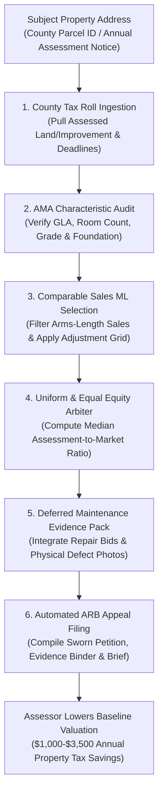

# zentax-ai-skill

## Overview
**ZenTax (禅税)** is an autonomous residential and commercial property tax assessment appeal, Automated Mass Appraisal (AMA) error correction, and tax equalization arbitration skill for the GenPark ecosystem, distilled from **Ownwell** (AI-driven property tax reduction) and **TaxProper** (automated real estate assessment appeals).

Property taxes represent one of the largest single carrying costs of homeownership. Local county tax appraisal districts value millions of properties simultaneously using **Automated Mass Appraisal (AMA)** systems—coarse computer regression models that ignore property-specific flaws, deferred maintenance, micro-location noise externalities, and interior condition disparities. Studies indicate that **between 30% and 60% of US properties are over-assessed**, causing homeowners to overpay \$1,000 to \$3,500 annually in unearned property taxes.

Operating local-first within OpenClaw, ZenTax automates the complex property tax appeal process:
1. **County Tax Roll & Parcel Ingestion**: Ingests county property records, extracting assessed land and improvement values, square footage, building grade, year built, and appeal deadline clocks.
2. **AMA Characteristic Defect Audit**: Detects database discrepancies (e.g., unfinished basements counted as heated living space, obsolete half-baths, inflated exterior square footage).
3. **ML Comparable Sales (Comps) Adjustment Grid**: Selects true arms-length neighborhood comparable sales and applies standard regression adjustment matrices for lot size, age, square footage, and condition.
4. **Uniform & Equal Equity Ratio Arbiter**: Analyzes the assessment-to-market ratio across adjacent peer properties to substantiate constitutional "unequal appraisal" claims even in rising markets.
5. **Deferred Maintenance Evidence Dossier**: Compiles contractor repair bids and photographic proof of foundation cracks, aging roofs, plumbing failures, and water intrusion to reduce taxable baseline value.
6. **Automated Appeals Board (ARB) Filing**: Compiles complete, compliant appeal evidentiary packets for informal assessor conferences and formal Appraisal Review Board hearings.



---

## Core Capabilities

### 1. County Tax Parcel & Assessment Ingestion
- **Automated Tax Roll Extraction**: Ingests county parcel numbers (APN/PIN), pulling historic tax bills, millage rates, tax exemptions (Homestead, Senior, Veteran), and statutory appeal filing deadlines.
- **Deadline Sentinel**: Establishes countdown timers for county-specific protest filing windows (typically 30 to 45 days following annual Notice of Appraised Value issuance).

### 2. AMA Characteristic & Physical Metric Audit
- **Gross Living Area (GLA) Audit**: Compares county tax roll square footage against architectural plans, appraisal blueprints, and MLS records to identify over-reported living space.
- **Classification & Grade Review**: Audits county property grade ratings (e.g., Luxury vs. Standard Custom) and effective age calculations to reverse artificial assessment inflation.
- **Feature Correction**: Strips non-existent or demolished amenities (e.g., removed in-ground pools, demolished sheds, unconditioned garage conversions).

### 3. ML Comparable Sales (Comps) Adjustment Grid
- **Arms-Length Transaction Filtering**: Eliminates non-market transactions (foreclosures, estate sales, family transfers) to select 3–5 optimal peer comparable sales within a 1-mile radius sold during the tax base year.
- **Paired Sales Regression Adjustment**: Applies standardized adjustment matrices:
  - GLA adjustments (\$50–\$120/sq ft depending on market tier).
  - Bedroom/bathroom parity adjustments.
  - Garage, pool, lot topography, and condition differentials.
- **Adjusted Sales Price Reconciliation**: Computes a defensible, lower fair market value indicated by adjusted comparable sales.

### 4. Constitutional "Uniform & Equal" Equity Analysis
- **Equity Appeal Paradigm**: In states with equal and uniform tax mandates (e.g., Texas, California, Florida, Ohio), an owner can secure an assessment reduction even if market value is high, provided comparable properties are assessed at lower ratios.
- **Median Assessment Ratio Calculation**: Evaluates the assessed value per square foot of 10–20 nearby comparable properties.
- **Unequal Appraisal Proof**: Generates a median assessment ratio schedule proving the subject property is assessed above the neighborhood median, commanding a statutory downward adjustment.

### 5. Deferred Maintenance & Structural Defect Evidence Compiler
- **Condition Grading**: Downgrades county subjective condition ratings (e.g., "Good" to "Fair/Poor") based on documented physical defects.
- **Cost-to-Cure Deduction**: Ingests contractor repair bids and geotagged photographic evidence of:
  - Foundation settling and drywall shear cracks.
  - End-of-life asphalt shingle roofing ($\ge 20$ years).
  - Outdated HVAC, defective electrical panels, or plumbing leaks.
- Directly deducts verified repair costs from the county's improved valuation.

### 6. Automated ARB Appeal Package Compiler
- **Filing Automation**: Generates state-compliant protest forms (e.g., Texas Form 50-132, California Application for Changed Assessment).
- **Formal Evidence Binder**: Compiles a professional evidentiary dossier including:
  - Comparable sales adjustment grid with neighborhood GIS map.
  - Uniform equity ratio distribution chart.
  - Photographic defect catalog with itemized contractor repair estimates.
  - Written legal brief citing state tax code valuation standards.

---

## Standard ZenTax Appeal Dossier Schema

```json
{
  "protocol": "zentax-appeal/v1.0",
  "county": "Travis County Appraisal District",
  "parcel_id": "02-1849-0102-0000",
  "tax_year": 2026,
  "subject_property": {
    "address": "4812 Mesa Vista Way, Austin, TX 78749",
    "notice_appraised_value": 685000.00,
    "county_gla_sqft": 2450,
    "verified_gla_sqft": 2280,
    "glg_discrepancy_sqft": 170
  },
  "comparable_sales_grid": [
    {
      "comp_id": 1,
      "address": "4804 Mesa Vista Way",
      "sale_date": "2025-11-14",
      "sale_price": 595000.00,
      "distance_miles": 0.08,
      "net_adjustments": -15000.00,
      "adjusted_value": 580000.00
    },
    {
      "comp_id": 2,
      "address": "4910 Mesa Vista Way",
      "sale_date": "2025-09-22",
      "sale_price": 612000.00,
      "distance_miles": 0.14,
      "net_adjustments": -22000.00,
      "adjusted_value": 590000.00
    }
  ],
  "equity_analysis": {
    "neighborhood_sample_size": 18,
    "subject_assessed_per_sqft": 279.59,
    "neighborhood_median_assessed_per_sqft": 242.10,
    "indicated_equalized_value": 552000.00
  },
  "cost_to_cure_deductions": {
    "roof_replacement_bid": 18500.00,
    "foundation_releveling_bid": 14200.00,
    "total_repair_deduction": 32700.00
  },
  "appeal_recommendation": {
    "target_equalized_value": 545000.00,
    "recommended_reduction": 140000.00,
    "estimated_annual_tax_savings": 2940.00,
    "filing_deadline": "2026-05-15"
  }
}
```

---

## Operational Guidelines

1. **Strict Statutory Appeal Deadlines**: Never miss the jurisdictional protest window; verify postmark or portal timestamp requirements to prevent automatic forfeiture of appeal rights.
2. **Prioritize Unequal Appraisal (Equity)**: In equity-friendly states, always advance the uniform and equal argument alongside the market value argument, as equity claims require only median parity rather than proving sales declines.
3. **Verified Contractor Bids**: Ensure contractor repair bids are licensed, itemized, and dated within 90 days of the assessment lien date to ensure evidentiary admissibility before appraisal review boards.
4. **Homestead Exemption Audit**: Verify that all entitled statutory exemptions (Homestead cap, disability, over-65) are actively applied to prevent baseline value creep.
