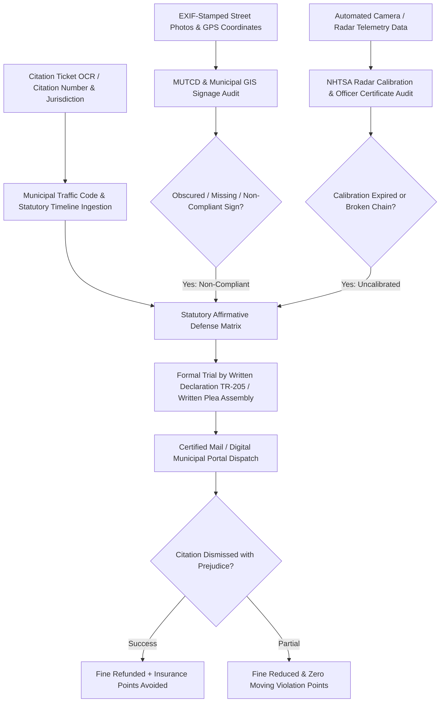

# ZenTicket: Autonomous Traffic Citation Defense & Camera Calibration Challenge Agent

`zenticket-ai-skill` is an open-standard, production-grade autonomous decision agent distilled from **DoNotPay (`donotpay.com` - The Original Robot Lawyer)**, **Off The Record (`offtherecord.com`)**, and **WinIt (`winitapp.com`)**. Municipalities and automated red-light/speed camera contractors (Verra Mobility, Conduent) rely on traffic and parking citations as aggressive municipal revenue engines—generating over **$5.5 Billion annually in predatory fines**. Over 80% of citations contain fatal procedural defects: obscured or non-compliant street signs, faded red/yellow curb paint, expired speed radar calibration certificates, or broken chains of custody. Yet 95% of drivers simply pay the $75–$350 fine out of fear and inconvenience, triggering devastating 15%–30% auto insurance rate spikes for 36 months.

ZenTicket arms drivers with algorithmic legal defense: identifying statutory defects, cross-referencing municipal GIS signage registries, verifying automated radar calibration logs, and auto-compiling formal **Trial by Written Declaration** packages to dismiss citations without requiring courtroom appearances.



---

## 1. Core Architectural Capabilities

### 1.1 Multimodal Citation & Summons Reverse Decompilation
Ingests photos of paper citations or digital summons numbers from municipal portals (NYC Pay or Dispute, SFMTA, Chicago Department of Revenue, LA Parking Violations Bureau). Parses:
- **Citing Officer Details & Badge / Unit Number**
- **Exact Violation Code** (e.g., CVC 22350 Basic Speed Law, NYC Parking Rule 4-08 Street Cleaning, Chicago 9-64-070 Street Meter)
- **Mandatory Contest Deadline Countdown** (typically 21–30 calendar days before late penalty escalation).

### 1.2 MUTCD Signage Standards & Municipal GIS Audit
Municipalities must strictly adhere to the federal **Manual on Uniform Traffic Control Devices (MUTCD)** and municipal parking signage regulations:
- Ingests user-submitted street-level photos with EXIF timestamps and GPS coordinates.
- Cross-references municipal street furniture GIS databases.
- Identifies fatal procedural flaws: signage mounted below statutory height limits (less than 7 feet), obscured by tree foliage within 100 feet, faded curb paint lacking minimum chromatic reflectivity, or street sweeping signs posted with less than 24 hours required notice.

### 1.3 Automated Speed & Red-Light Camera Radar Calibration Challenge
Automated traffic enforcement cameras are strictly regulated by state codes and NHTSA guidelines:
- Submits automated public records requests (FOIA / Public Records Act) or queries municipal inspection portals for the specific camera unit's **Certificate of Calibration** and technician maintenance logs.
- Asserts statutory dismissal defenses if:
  1. The Doppler radar or Lidar tuning fork test has not been certified within the statutory 3-year or 6-month window;
  2. The yellow light clearance interval is shorter than the statutory minimum dictated by approach speed (e.g., less than 3.6 seconds for 35 mph zones);
  3. The issuing authority failed to establish a photographic chain-of-custody verifying the registered owner was the actual driver.

### 1.4 Formal "Trial by Written Declaration" (TR-205) Compilation
Under California Vehicle Code § 40902 and equivalent state statutes, drivers are entitled to contest infractions entirely by mail without stepping foot into a courtroom:
- Synthesizes clear, evidentiary written briefs citing relevant appellate case law and statutory exceptions.
- Formulates factual declarations and attaches timestamped photographic exhibits.
- If the citing officer fails to submit their written response within the statutory deadline, the court enters an immediate dismissal, and all prepaid bail amounts are refunded 100%.

---

## 2. JSON Schema Definitions

```json
{
  "$schema": "https://json-schema.org/draft/2020-12/schema",
  "title": "TrafficCitationDefenseCase",
  "type": "object",
  "required": ["caseId", "citationNumber", "jurisdiction", "violationCode", "statutoryDeadline", "defenseStrategy"],
  "properties": {
    "caseId": { "type": "string", "pattern": "^TCK-[0-9]{8}-[A-Z0-9]{4}$" },
    "citationNumber": { "type": "string" },
    "jurisdiction": { "type": "string", "enum": ["CALIFORNIA_TRAFFIC", "NYC_FINANCE", "SFMTA", "CHICAGO_FINANCE", "TEXAS_MUNICIPAL", "FLORIDA_COUNTY", "OTHER"] },
    "violationCode": { "type": "string" },
    "fineAmount": { "type": "number", "minimum": 0 },
    "statutoryDeadline": { "type": "string", "format": "date" },
    "citationType": { "type": "string", "enum": ["PARKING", "SPEEDING_OFFICER", "SPEEDING_CAMERA", "RED_LIGHT_CAMERA", "HOV_LANE"] },
    "proceduralDefectsDetected": {
      "type": "array",
      "items": {
        "type": "object",
        "properties": {
          "defectType": { "type": "string", "enum": ["SIGNAGE_OBSCURED", "RADAR_CALIBRATION_EXPIRED", "YELLOW_LIGHT_TOO_SHORT", "FADED_CURB", "MANDATORY_FIELD_BLANK"] },
          "statutoryReference": { "type": "string" },
          "evidenceDescription": { "type": "string" }
        }
      }
    },
    "defenseStrategy": {
      "type": "object",
      "required": ["filingMethod", "primaryArgument", "expectedDismissalProbability"],
      "properties": {
        "filingMethod": { "type": "string", "enum": ["TRIAL_BY_WRITTEN_DECLARATION", "ADMINISTRATIVE_INFORMAL_HEARING", "WRITTEN_PLEA_NOT_GUILTY"] },
        "primaryArgument": { "type": "string" },
        "expectedDismissalProbability": { "type": "number", "minimum": 0, "maximum": 1 }
      }
    }
  }
}
```

---

## 3. Tool Calling & Code Example

```javascript
import { ZenTicketEngine } from 'genpark-hub/zenticket';

// 1. Ingest traffic citation photo and extract violation metadata
const ticketCase = await ZenTicketEngine.ingestCitation({
  citationImage: "evidence/speed_camera_sf_nov2026.jpg",
  jurisdiction: "SFMTA",
  declaredDate: "2026-10-15"
});

console.log(`Violation: ${ticketCase.violationCode} | Fine: $${ticketCase.fineAmount}`);

// 2. Audit red-light/speed camera calibration and yellow light interval
const cameraAudit = await ticketCase.auditCameraTelemetry({
  cameraLocationId: "SF-GEARY-3200",
  incidentTimestamp: "2026-10-15T14:22:10Z"
});

if (cameraAudit.calibrationDefectFound) {
  console.log(`Procedural defect: Speed radar calibration expired 42 days prior to incident under NHTSA guidelines!`);
}

// 3. Compile formal California Trial by Written Declaration (Form TR-205)
const legalDossier = await ticketCase.compileTrialByDeclaration({
  driverStatement: "Operating safely with traffic flow under safe conditions",
  includeRadarDefect: true,
  includeSignageExhibits: true,
  refundBailCheckMailingAddress: "123 Market St, San Francisco, CA"
});

console.log(`Formal TR-205 Court Document Generated: ${legalDossier.docketPdfPath}`);
```

---

## 4. MCP Tools & OpenClaw Integration
- `zenticket_parse_citation`: OCR extraction of citation codes and deadline dates.
- `zenticket_audit_signage`: Verifies photo exhibits against MUTCD signage standards.
- `zenticket_verify_radar_calibration`: Checks municipal records for speed camera sensor calibration logs.
- `zenticket_generate_declaration`: Compiles state-specific Trial by Written Declaration packages.
