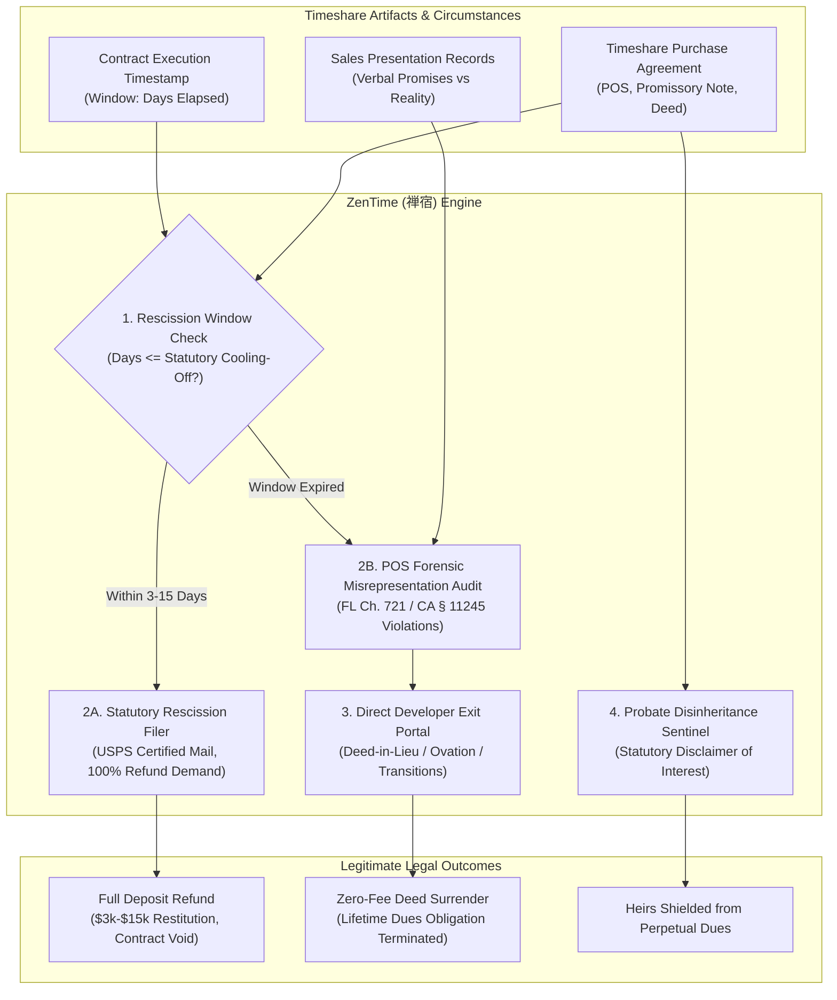

# zentime-ai-skill (ZenTime · 禅宿)

> *"True rest demands no perpetual debt; release the anchor that binds future generations." (解缚脱羁，还归清净；卸千金之累，断世代之枷。)*  
> Autonomous Timeshare Contract Rescission, Developer Misrepresentation Forensic Audit, Direct Developer Deed-Back Surrender & Perpetual Maintenance Fee Disinheritance Engine distilled from **Florida Vacation Plan and Timesharing Act (FL Stat. Ch. 721), California Vacation Ownership and Time-share Act (CA Bus. & Prof. Code § 11210 et seq.), and the Uniform Disclaimer of Property Interests Act**.

---

## 1. Overview & Architectural Problem Statement

Over 10 million households across the United States, Europe, and Mexico own timeshare vacation products marketed by hospitality conglomerates (Wyndham Destinations, Marriott Vacations Worldwide, Hilton Grand Vacations, Diamond Resorts, Westgate). While presented during multi-hour high-pressure sales presentations as prestigious "real estate investments," the vast majority of timeshare contracts are structured as **perpetual liabilities**:

1. **The Compounding Maintenance Fee Trap**: Timeshare owners are legally obligated to pay annual maintenance dues and unpredictable "special assessments" that escalate by **5% to 10% annually** ($1,500 to $4,000+ per year). Unlike real estate, secondary market resale value for timeshares is virtually \$0 (often listed on eBay for \$1 without buyers).
2. **Deceptive High-Pressure Sales Inducements**: Sales representatives systematically violate state consumer protection statutes by verbally asserting that timeshares "appreciate in value," "can easily be rented out to cover costs," or "can be refinanced at low bank rates," directly contradicting fine print buried in 150-page Public Offering Statements (POS).
3. **The Multi-Million Dollar "Exit Company" Scam Industry**: Aggrieved owners attempting to escape are preyed upon by fraudulent third-party "timeshare exit companies" demanding **\$5,000 to \$10,000 in upfront fees**, only to perform fraudulent deed transfers or vanish entirely—prompting nationwide FTC and State Attorney General enforcement actions.
4. **The Hereditary Liability Threat**: Most timeshare deeds contain perpetual "in perpetuity" clauses that pass the recurring annual maintenance fee liability to heirs (adult children) through probate unless formally disclaimed under statutory property law.

**ZenTime (禅宿)** provides an authentic, zero-upfront-scam legal escape mechanism:
* **Statutory Cooling-Off Rescission Engine (`StatutoryRescissionEngine`)**: Enforces state-specific cancellation windows (e.g., Florida 10 days, California 7 days, Nevada 5 days, South Carolina 5 days, Mexico PROFECO 5 business days), generating non-negotiable certified cancellation notices demanding 100% deposit refunds.
* **Sales Deception & POS Discrepancy Forensic Audit (`SalesDeceptionAuditor`)**: Cross-examines verbal sales pitch notes and recorded presentations against the developer's registered Public Offering Statement (POS), compiling statutory violations under state timeshare acts (FL Stat. § 721.11 / CA Bus. & Prof. Code § 11245).
* **Direct Zero-Upfront-Fee Developer Surrender (`DirectDeveloperSurrenderNegotiator`)**: Bypasses middlemen to interface directly with official developer loss-mitigation portals (Wyndham Ovation / Certified Exit, Marriott Transitions, HGV Horizons), leveraging audited legal exposure to secure mutual deed-back (Deed-in-Lieu of Foreclosure) and unconditional release.
* **Probate Liability Disinheritance Sentinel (`ProbateDisinheritanceSentinel`)**: Generates formal statutory Disclaimers of Property Interest under state probate codes (Uniform Disclaimer of Property Interests Act), permanently immunizing children and heirs from inheriting timeshare debt.



---

## 2. Core Architectural Subsystems

### 2.1 Statutory Cooling-Off Rescission Engine (`StatutoryRescissionEngine`)
When an owner acts promptly following a high-pressure presentation, state law grants an absolute right to cancel:
* **Jurisdictional Clocks**: Florida Stat. § 721.06 (10 days from signing or POS receipt), California Bus. & Prof. Code § 11238 (7 days), Nevada NRS 119A.410 (5 days), Hawaii HRS § 514E-8 (7 days), Mexico Consumer Protection Law Art. 56 (5 business days).
* **Certified Mail Execution**: Generates an audit-proof Notice of Cancellation citing the exact statutory subsection, calculated deadline, and explicit demand for full refund within statutory timelines (e.g., 20 days in Florida).

### 2.2 Sales Deception & POS Discrepancy Forensic Audit (`SalesDeceptionAuditor`)
For contracts outside the cooling-off window, ZenTime identifies statutory fraudulent inducement:
* **Investment Misrepresentation**: Citing statutory prohibitions against representing timeshares as financial investments (FL Stat. § 721.11(4)(a)).
* **Rental Guarantee Falsehoods**: Documenting unfulfilled promises that developer rental desks would cover all maintenance fees.
* **Exchange Program Deceptions**: Auditing misleading point-valuation tables compared to real-world RCI or Interval International booking availability.

### 2.3 Direct Developer Surrender & Loss Mitigation (`DirectDeveloperSurrenderNegotiator`)
Bypasses fraudulent exit brokers to engage authentic corporate inventory recovery programs:
* Enforces developer eligibility rules (mortgage balance paid in full, maintenance fees current).
* Presents the developer's legal compliance team with the documented deceptive practices dossier.
* Negotiates a formal Deed-in-Lieu of Foreclosure with mutual general releases, completely extinguishing future maintenance fee liabilities with zero upfront broker fees.

### 2.4 Probate Liability Disinheritance Sentinel (`ProbateDisinheritanceSentinel`)
Under state property law and the Uniform Disclaimer of Property Interests Act (UDPIA):
* Formulates formal statutory Disclaimers of Property Interest for named beneficiaries and adult children.
* Submits verified notices to the estate executor and the county recorder of deeds, legally refusing timeshare inheritance without forfeiting other estate assets.

---

## 3. OpenClaw MCP Tool Interfaces

```typescript
export interface TimeshareContractAnalysis {
  developerName: string;
  contractExecutionDate: string;
  propertyJurisdiction: 'FL' | 'CA' | 'NV' | 'HI' | 'SC' | 'Mexico' | 'Other';
  statutoryCoolingOffDays: number;
  rescissionWindowStatus: 'open' | 'expired';
  daysRemainingInWindow: number;
  annualMaintenanceFeeUsd: number;
  mortgageBalanceUsd: number;
}

export interface StatutoryRescissionNoticeParams {
  ownerNames: string[];
  contractNumber: string;
  resortName: string;
  developerCorporateAddress: string;
  jurisdictionStatute: string;
  downPaymentAmountUsd: number;
  paymentMethod: 'credit_card' | 'wire' | 'cashier_check';
}

export interface DeveloperSurrenderDemandParams {
  ownerNames: string[];
  contractNumber: string;
  developerExitProgram: 'Wyndham_Ovation' | 'Marriott_Transitions' | 'HGV_Horizons' | 'Westgate_Legacy' | 'Other';
  documentedMisrepresentations: Array<{
    category: 'investment_claim' | 'rental_income_guarantee' | 'maintenance_fee_cap' | 'resale_assistance';
    detailChronology: string;
  }>;
  mortgagePaidInFull: boolean;
}

export interface ProbateDisclaimerParams {
  beneficiaryFullName: string;
  decedentFullName: string;
  timeshareLegalDescription: string;
  countyOfDeedRecord: string;
  stateProbateCodeSection: string;
}
```

---

## 4. Human-in-the-Loop (HITL) Guardrails

1. **Absolute Prohibition of Upfront Fee Brokers**: ZenTime will never recommend or partner with third-party exit companies demanding upfront thousands of dollars.
2. **Mortgage Truth Disclosure**: Owners with active unpaid promissory notes are clearly advised that deed surrender requires addressing outstanding principal balances.
3. **Certified Delivery Enforcement**: Rescission letters must be sent via USPS Certified Mail with Return Receipt Requested or trackable international courier, never regular email alone.
