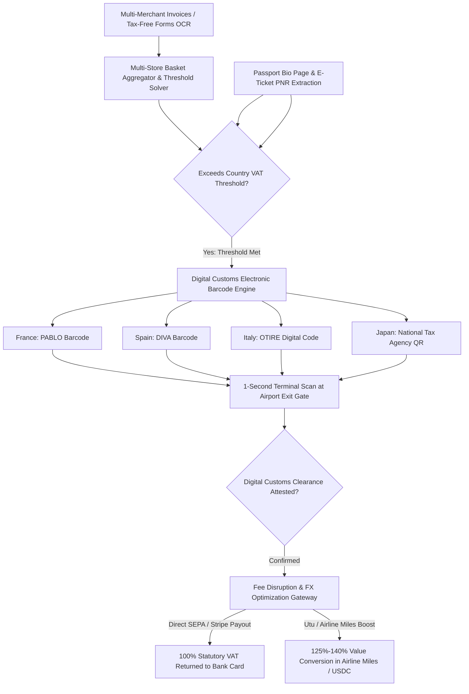

# ZenVAT: Autonomous Cross-Border Travel VAT Refund & Customs Validation Agent

`zenvat-ai-skill` is an open-standard, production-grade autonomous decision agent distilled from **Utu (`utu.global`)**, **Wevat (`wevat.com`)**, and **Planet / Global Blue** paradigms. International travelers shopping in Europe (EU statutory VAT ranging from 12% to 27%), the UK, Japan, and Singapore are legally entitled to full tax refunds on personal consumer purchases. However, legacy airport refund monopolies (Global Blue, Planet Payment) systematically skim **35% to 50% of the passenger's legitimate refund** through exorbitant "admin handling fees" and rigged FX exchange spreads. Furthermore, travelers must endure 2-hour physical queues at airport customs desks for physical ink stamps, resulting in over **€4.5 Billion in VAT refunds going completely abandoned every year**.

ZenVAT automates the entire cross-border refund lifecycle: deconstructing itemized retail receipts, aggregating purchases across stores to surpass statutory spending thresholds, generating verified electronic customs barcodes (PABLO/DIVA), and routing 100% of the statutory cash refund directly into traveler bank accounts or digital wallets without middleman skimming.



---

## 1. Core Architectural Capabilities

### 1.1 Multimodal Retail Receipt Ingestion & Aggregation
Travelers frequently buy goods across multiple boutiques where individual receipts fall just below the statutory single-store spending threshold (e.g., €100.01 in France, €0 in Spain, €50 in Germany, ¥5,000 in Japan):
- Ingests store sales receipts, Apple Pay electronic receipts, and standard merchant invoices.
- Groups purchases within the same calendar month and regulatory envelope.
- Through digital tax-free partnership protocols (Wevat model), bundles disparate merchant receipts into a single certified digital export dossier, unlocking tax refund eligibility for otherwise disqualified small purchases.

### 1.2 Multi-Jurisdiction Statutory VAT Solver
Computes exact statutory net entitlements across all destination tax systems:
$$\text{Refund Amount} = \text{Gross Purchase Price} \times \left( \frac{\text{VAT Rate}}{1 + \text{VAT Rate}} \right) - \text{Zero Platform Skim}$$
- **France (20% Standard VAT)**: Reclaims up to 16.7% of gross retail spending.
- **Spain (21% VAT)**: Zero minimum spend threshold; full electronic DIVA integration.
- **Italy (22% VAT)**: Standard €70.01 threshold with OTIRE real-time customs clearance.
- **Japan (10% Consumption Tax)**: Automated passport VJW (Visit Japan Web) tax-exempt QR linking.

### 1.3 Digital Customs Kiosk Barcode Engine (No Airport Lines)
Completely eliminates the archaic need to wait in 2-hour physical customs officer lines:
- Connects directly to government customs electronic export databases (**France PABLO**, **Spain DIVA**, **Italy OTIRE**).
- Generates a single high-density 2D barcode on the user's mobile device.
- At the departure terminal (CDG, MAD, FCO, BCN, HND), the traveler simply holds their smartphone screen up to the automated customs kiosk scanner for a **1-second green-light digital clearance**.

### 1.4 Predatory Middleman Fee Stripping & Payout Maximization
Legacy operators (Global Blue) deduct up to 40% in processing surcharges and force a secondary 5%–8% loss through predatory currency conversion spreads:
- ZenVAT routes the certified customs export attestation through open fintech APIs (Utu / Wevat / Direct SEPA rails).
- Delivers **up to 100% of the statutory refund** in the purchase currency without hidden FX markups.
- Offers programmatic **Points Arbitrage (Utu Boost Model)**: Optionally converts refunds into airline loyalty miles (Flying Blue, KrisFlyer, Qatar Privilege Club) at up to a **125%–140% value multiplier**.

---

## 2. JSON Schema Definitions

```json
{
  "$schema": "https://json-schema.org/draft/2020-12/schema",
  "title": "CrossBorderVATRefundDossier",
  "type": "object",
  "required": ["dossierId", "traveler", "jurisdiction", "totalGrossSpend", "statutoryVATClaimable", "customsValidation"],
  "properties": {
    "dossierId": { "type": "string", "pattern": "^VAT-[0-9]{8}-[A-Z0-9]{4}$" },
    "jurisdiction": { "type": "string", "enum": ["FRANCE_PABLO", "SPAIN_DIVA", "ITALY_OTIRE", "GERMANY_CUSTOMS", "JAPAN_TAXFREE"] },
    "traveler": {
      "type": "object",
      "required": ["passportNumber", "nationality", "residenceCountry", "departureFlightDate"],
      "properties": {
        "passportNumber": { "type": "string" },
        "nationality": { "type": "string" },
        "residenceCountry": { "type": "string" },
        "departureFlightDate": { "type": "string", "format": "date" },
        "departureAirportIATA": { "type": "string", "pattern": "^[A-Z]{3}$" }
      }
    },
    "receiptSummary": {
      "type": "object",
      "properties": {
        "receiptCount": { "type": "integer" },
        "totalGrossSpendEUR": { "type": "number" },
        "totalStatutoryVATEUR": { "type": "number" },
        "legacyOperatorEstimatedPayoutEUR": { "type": "number", "description": "Global Blue payout after 38% fee skimming" },
        "zenVATDirectPayoutEUR": { "type": "number", "description": "ZenVAT payout capturing 100% net statutory refund" }
      }
    },
    "customsValidation": {
      "type": "object",
      "required": ["barcodeFormat", "barcodePayload", "kioskType"],
      "properties": {
        "barcodeFormat": { "type": "string", "enum": ["PDF417", "QR_CODE", "CODE128"] },
        "barcodePayload": { "type": "string" },
        "kioskType": { "type": "string" },
        "validationStatus": { "type": "string", "enum": ["PENDING_SCAN", "VALIDATED_GREEN", "INSPECTION_REQUIRED"] }
      }
    },
    "payoutPreference": {
      "type": "object",
      "required": ["method"],
      "properties": {
        "method": { "type": "string", "enum": ["DIRECT_CARD_EUR", "SEPA_IBAN", "USDC_ONCHAIN", "AIRLINE_MILES_BOOST"] },
        "destinationIdentifier": { "type": "string" },
        "projectedMultiplier": { "type": "number", "default": 1.0 }
      }
    }
  }
}
```

---

## 3. Tool Calling & Code Example

```javascript
import { ZenVATEngine } from 'genpark-hub/zenvat';

// 1. Ingest receipts from European vacation (Paris & Madrid)
const vatDossier = await ZenVATEngine.compileRefundDossier({
  jurisdiction: "FRANCE_PABLO",
  traveler: {
    passportNumber: "E8921044A",
    nationality: "USA",
    residenceCountry: "USA",
    departureAirport: "CDG",
    departureDate: "2026-11-15"
  },
  receipts: [
    { merchant: "Galeries Lafayette", amountEUR: 850.00, vatRate: 0.20 },
    { merchant: "Le Bon Marché", amountEUR: 420.00, vatRate: 0.20 },
    { merchant: "Boutique Artisan", amountEUR: 130.00, vatRate: 0.20 }
  ]
});

console.log(`Total Gross Spend: €${vatDossier.totalGrossSpend}`);
console.log(`Statutory VAT: €${vatDossier.statutoryVAT} (vs Global Blue estimate: €${vatDossier.legacyOperatorPayout})`);

// 2. Generate government PABLO digital customs barcode
const customsBarcode = await vatDossier.generateCustomsBarcode();
console.log(`PABLO Barcode ready for 1-second CDG kiosk scan: ${customsBarcode.barcodePayload}`);

// 3. Confirm 1-second kiosk scan and route 100% payout
const settlementReceipt = await vatDossier.settleRefund({
  kioskValidationId: "PABLO-CDG-20261115-9921",
  payoutMethod: "DIRECT_CARD_EUR",
  cardToken: "tok_visa_network_token_9821"
});

console.log(`Settled: €${settlementReceipt.payoutAmountEUR} transferred with 0% middleman deduction.`);
```

---

## 4. MCP Tools & OpenClaw Integration
- `zenvat_compile_receipts`: Ingests receipt invoices and calculates statutory VAT entitlements.
- `zenvat_generate_customs_barcode`: Issues electronic PABLO/DIVA/OTIRE departure barcodes.
- `zenvat_verify_kiosk_attestation`: Validates electronic customs clearance proof.
- `zenvat_settle_payout`: Executes zero-fee payout routing to bank cards, SEPA, or airline miles.
