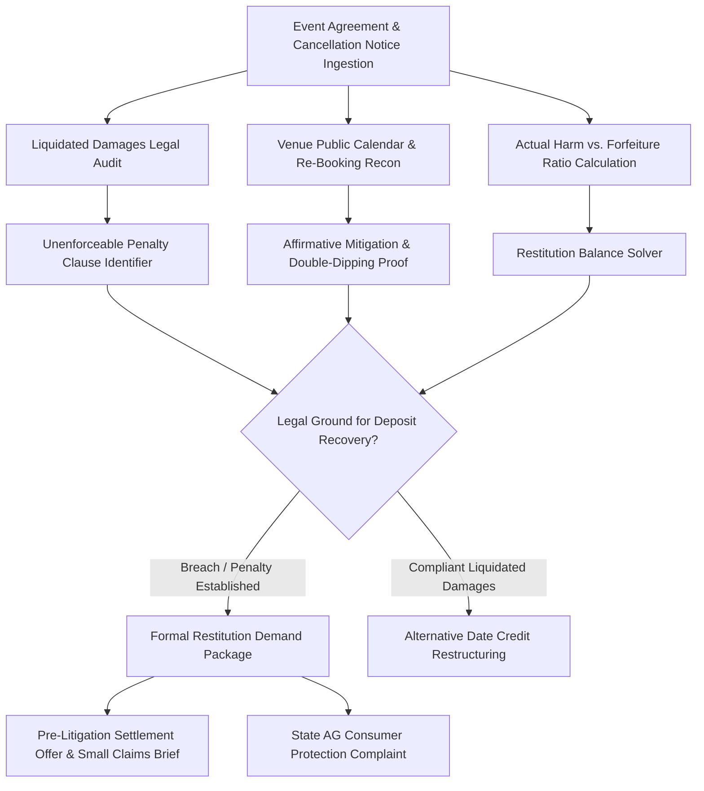

# zenvow-ai-skill

## Overview
**ZenVow (禅约)** is an autonomous wedding and luxury hospitality event consumer defense agent. It protects couples and event hosts from predatory "100% non-refundable deposit" forfeiture clauses ($10,000–$35,000) when unexpected emergencies, severe health crises, or family tragedies force the cancellation or rescheduling of a venue or vendor contract months or years in advance. By auditing contract language under the common law **Penalty Doctrine (Restatement (Second) of Contracts § 356 & UCC § 2-718)**, gathering digital evidence of affirmative mitigation (e.g., proving the venue successfully re-booked the date to another client at full market rates), and asserting statutory limits on unreasonable liquidated damages, ZenVow compels venues, caterers, and photographers to return unearned deposits or issue full-credit rescheduling agreements.



## Core Capabilities

### 1. Multimodal Event Contract & Penalty Clause Ingestion
- Ingests complex venue rental agreements, catering contracts, photography retainers, and wedding planning agreements.
- Scans contractual clauses against the foundational common law doctrine prohibiting punitive liquidated damages:
  - **Restatement (Second) of Contracts § 356**: Liquidated damages must represent a reasonable forecast of anticipated or actual harm; damages that disproportionately exceed actual losses are void as unenforceable penalties against public policy.
  - **UCC § 2-718 & State Civil Codes (e.g. California Civil Code § 1671)**: A contractual clause liquidating damages is invalid if it was unreasonable under the circumstances existing at the time the contract was made.

### 2. Affirmative Duty to Mitigate Reconnaissance Engine
- In common law jurisdictions, commercial vendors have an affirmative legal duty to make reasonable commercial efforts to mitigate their damages by re-selling the cancelled date.
- Crawls public venue booking engines, interactive wedding date reservation calendars, and social media geotags (Instagram/The Knot wedding registries) to verify if the venue successfully re-contracted the date to another party.
- Upon discovering a replacement booking, generates conclusive proof of **Unjust Enrichment / Double-Dipping**, legally extinguishing the venue's claim of financial loss and mandating an immediate return of the original deposit.

### 3. Force Majeure & Frustration of Purpose Trigger Sentry
- Assesses unforeseen supervening events (severe meteorological events, government emergency health orders, venue structural destruction, military deployment).
- Formulates affirmative legal defenses under the doctrines of **Impossibility of Performance** and **Frustration of Purpose**, legally terminating the contract without penalty and releasing all parties from executory obligations.

### 4. Pre-Litigation Restitution Demand & Small Claims Package
- Compiles formal, certified pre-litigation demand packets complete with contractual cross-examinations, re-booking evidence exhibits, and statutory civil code citations.
- Prepares court-ready complaints for county Small Claims or municipal conciliation courts, maximizing pressure on venue management to settle out of court and issue wire refunds.

## Input JSON Schema

```json
{
  "$schema": "http://json-schema.org/draft-07/schema#",
  "title": "ZenVowDisputePayload",
  "type": "object",
  "required": ["eventInfo", "contractDetails", "cancellationContext"],
  "properties": {
    "eventInfo": {
      "type": "object",
      "required": ["scheduledDate", "eventType", "venueName", "state"],
      "properties": {
        "scheduledDate": { "type": "string", "format": "date" },
        "eventType": { "type": "string", "enum": ["WEDDING", "CORPORATE", "ANNIVERSARY", "GALA"] },
        "venueName": { "type": "string" },
        "state": { "type": "string", "maxLength": 2 }
      }
    },
    "contractDetails": {
      "type": "object",
      "required": ["totalContractValue", "depositPaid", "liquidatedDamagesPercent"],
      "properties": {
        "totalContractValue": { "type": "number" },
        "depositPaid": { "type": "number" },
        "liquidatedDamagesPercent": { "type": "number" },
        "contractSigningDate": { "type": "string", "format": "date" },
        "hasArbitrationClause": { "type": "boolean" }
      }
    },
    "cancellationContext": {
      "type": "object",
      "required": ["noticeDate", "daysPriorToEvent", "reasonCategory"],
      "properties": {
        "noticeDate": { "type": "string", "format": "date" },
        "daysPriorToEvent": { "type": "integer" },
        "reasonCategory": { 
          "type": "string", 
          "enum": ["PERSONAL_EMERGENCY", "FORCE_MAJEURE_WEATHER", "MEDICAL_CRISIS", "MUTUAL_CANCELLATION"] 
        },
        "isVenueRebooked": { "type": "boolean" },
        "venueRebookingProofUrl": { "type": "string" }
      }
    }
  }
}
```

## Node.js Implementation Example

```javascript
import { ZenVowArbiter } from '@alpha-park/zenvow-ai-skill';

const weddingCase = {
  eventInfo: {
    scheduledDate: '2025-06-21',
    eventType: 'WEDDING',
    venueName: 'The Grand Meadow Estate & Vineyard',
    state: 'CA'
  },
  contractDetails: {
    totalContractValue: 28500.00,
    depositPaid: 14250.00,
    liquidatedDamagesPercent: 100,
    contractSigningDate: '2024-05-10',
    hasArbitrationClause: false
  },
  cancellationContext: {
    noticeDate: '2024-11-15',
    daysPriorToEvent: 218,
    reasonCategory: 'PERSONAL_EMERGENCY',
    isVenueRebooked: true,
    venueRebookingProofUrl: 'https://thegrandmeadow.com/calendar?date=2025-06-21'
  }
};

const arbiter = new ZenVowArbiter({
  jurisdiction: 'CA',
  enforceDutyToMitigate: true
});

const auditResult = await arbiter.auditContractAndMitigation(weddingCase);
console.log('Penalty Clause Enforceability:', auditResult.isPenaltyClauseVoid ? 'VOID UNENFORCEABLE PENALTY' : 'VALID');
console.log('Unjust Enrichment Identified:', '$' + auditResult.unjustEnrichmentAmount);
console.log('Mandatory Restitution Due:', '$' + auditResult.refundableRestitutionTarget);

const demandDossier = await arbiter.generateRestitutionDemandPackage(auditResult);
console.log('Certified Legal Demand Package Ready. Total Pages:', demandDossier.pageCount);
```
