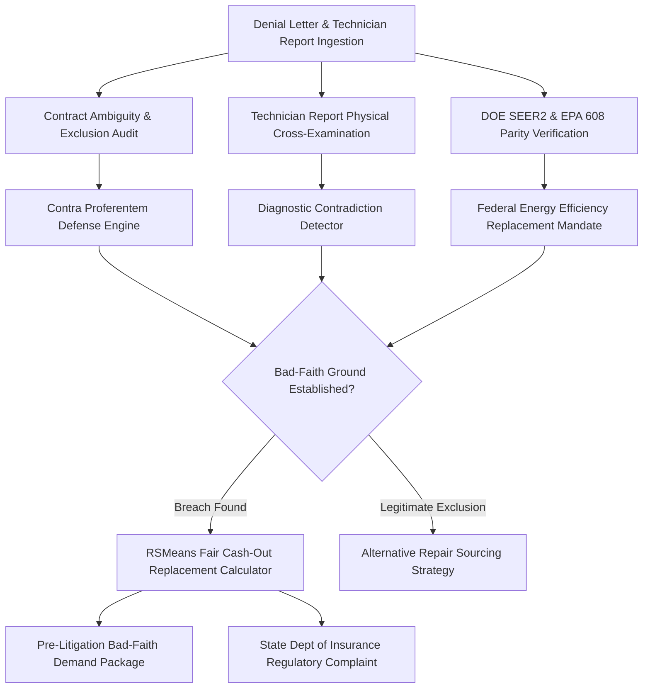

# zenwarranty-ai-skill

## Overview
**ZenWarranty (禅保)** is an autonomous home warranty claim defense and bad-faith dispute agent. It protects homeowners from predatory service contract claim denials on expensive HVAC systems, water heaters, plumbing, and major appliances. By deconstructing ambiguous contract exclusion clauses, cross-examining technician diagnostic reports for physical contradictions, enforcing DOE 2023 SEER2 replacement parity, and asserting state insurance commissioner bad-faith remedies, ZenWarranty forces home warranty carriers to fund full replacements or issue RSMeans-indexed cash payouts ($5,000–$15,000).



## Core Capabilities

### 1. Contract Exclusion & Ambiguity Matrix Ingestion
- Ingests home warranty service contract terms, limit-of-liability schedules, and system riders.
- Applies the legal doctrine of *Contra Proferentem* (ambiguities in unilateral service contracts are strictly construed against the warranty company).
- Invalidates boilerplate exclusions ("pre-existing condition", "normal wear and tear", "improper maintenance") when the provider cannot produce prior inspection proof of pre-existing failure.

### 2. Technician Diagnostic Report Cross-Examination
- Ingests contractor diagnostic invoices, technician notes, pressure logs, and photo evidence.
- Cross-examines statements for technical and physical impossibilities (e.g., claiming "corrosion caused catastrophic refrigerant leak" on indoor aluminum coils where failure was due to factory brazing defects or thermal vibration).
- Exposes warranty company third-party administrator (TPA) steering scripts designed to coerce contractors into falsifying cause-of-failure codes.

### 3. Federal SEER2 & EPA 608 Code Parity Mandate
- Verifies compliance with the Department of Energy (DOE) 2023 SEER2 efficiency standards and EPA SNAP Clean Air regulations.
- Rebuts warranty company attempts to perform piecemeal condenser replacements with obsolete R-22 or mismatched SEER equipment, establishing statutory requirements for complete matched indoor/outdoor split-system replacements.

### 4. RSMeans Regional Cash-Out & Bad-Faith Insurance Dossier
- Computes true replacement costs using RSMeans regional labor and material construction cost indexes.
- Replaces lowball "cash-in-lieu" offers ($200–$400) with full replacement valuations ($6,000–$14,000).
- Compiles certified pre-litigation demand packets citing the NAIC Model Unfair Claims Settlement Practices Act and prepares instant-file complaints to the State Department of Insurance.

## Input JSON Schema

```json
{
  "$schema": "http://json-schema.org/draft-07/schema#",
  "title": "ZenWarrantyDisputePayload",
  "type": "object",
  "required": ["claimInfo", "equipmentDetails", "denialData"],
  "properties": {
    "claimInfo": {
      "type": "object",
      "required": ["warrantyCompany", "policyNumber", "claimNumber", "serviceFeePaid"],
      "properties": {
        "warrantyCompany": { "type": "string" },
        "policyNumber": { "type": "string" },
        "claimNumber": { "type": "string" },
        "serviceFeePaid": { "type": "number" }
      }
    },
    "equipmentDetails": {
      "type": "object",
      "required": ["equipmentType", "make", "model", "ageYears"],
      "properties": {
        "equipmentType": { "type": "string", "enum": ["HVAC_CONDENSER", "HEAT_PUMP", "WATER_HEATER", "REFRIGERATOR", "PLUMBING_MAIN"] },
        "make": { "type": "string" },
        "model": { "type": "string" },
        "ageYears": { "type": "number" },
        "refrigerantType": { "type": "string" }
      }
    },
    "denialData": {
      "type": "object",
      "required": ["denialReasonCited", "technicianFindings", "cashInLieuOffered"],
      "properties": {
        "denialReasonCited": { "type": "string" },
        "technicianFindings": { "type": "string" },
        "cashInLieuOffered": { "type": "number" },
        "contractorReplacementQuote": { "type": "number" }
      }
    }
  }
}
```

## Node.js Implementation Example

```javascript
import { ZenWarrantyArbiter } from '@alpha-park/zenwarranty-ai-skill';

const warrantyCase = {
  claimInfo: {
    warrantyCompany: 'American Home Shield (AHS)',
    policyNumber: 'AHS-8829103-TX',
    claimNumber: 'CLM-2024-91024',
    serviceFeePaid: 100.00
  },
  equipmentDetails: {
    equipmentType: 'HVAC_CONDENSER',
    make: 'Carrier',
    model: '24ABB336A003',
    ageYears: 9,
    refrigerantType: 'R-410A'
  },
  denialData: {
    denialReasonCited: 'Lack of Maintenance & Secondary Rust/Corrosion',
    technicianFindings: 'Compressor grounded out due to excessive rust on outer cabinet and alleged failure to clean coils annually.',
    cashInLieuOffered: 350.00,
    contractorReplacementQuote: 9400.00
  }
};

const arbiter = new ZenWarrantyArbiter({
  stateJurisdiction: 'TX',
  rsmeansRegion: 'Dallas-Fort Worth'
});

const evaluation = await arbiter.auditDenialAndContract(warrantyCase);
console.log('Denial Merits Score:', evaluation.denialValidityScore + '/100 (Unfounded)');
console.log('SEER2 Matching Mandate:', evaluation.matchingMandateApplies);
console.log('RSMeans Fair Cash Value:', '$' + evaluation.rsmeansFairValuation);

const demandDossier = await arbiter.generateBadFaithDemandAndDeptOfInsurancePacket(evaluation);
console.log('Bad-Faith Demand Letter and TDI Complaint Dossier Generated. Size:', demandDossier.fileSizeKb + ' KB');
```
