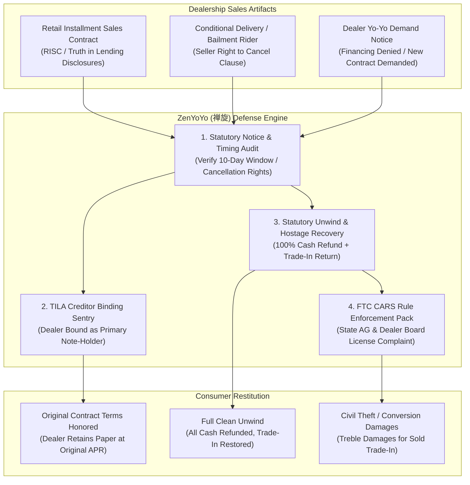

# zenyoyo-ai-skill (ZenYoYo · 禅旋)

> *"A covenant sealed in writing cannot be unwound at arbitrary whim; no dealer may hold equity hostage." (立券成契，岂容反覆；挟车要价，法不容私。)*  
> Autonomous Automotive Dealership "Yo-Yo Financing" & Spot Delivery Scam Defense, FTC CARS Rule Enforcement, TILA 15 U.S.C. § 1601 Truth in Lending Disclosure Lock, and Trade-In Hostage Recovery Engine distilled from **the FTC CARS Rule (16 CFR Part 463), Truth in Lending Act (Regulation Z 12 CFR Part 1026), and NCLC Automobile Fraud standards**.

---

## 1. Overview & Architectural Problem Statement

Every year, hundreds of thousands of car buyers fall victim to the dealership **"Spot Delivery Scam"**, commonly known as **"Yo-Yo Financing"**:
1. **The Deceptive "Done Deal" Bait**: A consumer negotiates financing terms, signs a Retail Installment Sales Contract (RISC) and purchase paperwork, hands over a cash down payment and their existing trade-in vehicle, and drives home believing the purchase is finalized.
2. **The Predatory "Financing Fell Through" Call**: Days or weeks later, the dealership calls the buyer claiming the financing "was not approved" by third-party lenders. The dealership demands that the buyer immediately return to the showroom to sign a new contract with a significantly higher interest rate (e.g., jumping from 6.9% to 15.9%), thousands more in cash down payment, or a co-signer.
3. **The Trade-In Hostage Extortion**: If the consumer refuses to sign the predatory second contract and demands their old car and money back, the dealership claims they "already sold" the trade-in vehicle, refuses to return the cash down payment, or threatens to report the vehicle stolen or repossess it while charging hundreds in daily "rental and mileage fees."
4. **Federal & State Statutory Protections Ignored**: Dealerships routinely violate the **FTC CARS Rule (16 CFR Part 463)**, the federal **Truth in Lending Act (TILA, 15 U.S.C. § 1601 et seq.)**, and state auto dealer licensing laws (e.g. California Civil Code § 2982.7, Florida Stat. § 501.976) by misrepresenting credit finality and failing to provide the mandatory 100% statutory transaction unwind.

**ZenYoYo (禅旋)** automates consumer defense against dealership yo-yo coercion:
* **Spot Delivery & Bailment Agreement Forensic Auditor (`SpotDeliveryAuditor`)**: Scans purchase documents, conditional delivery agreements, and rider fine print to verify whether the dealership retained a lawful right to rescind and whether statutory notice deadlines (typically 10 days) have expired.
* **TILA Dealer Creditor Binding Sentry (`TilaCreditorBindingSentry`)**: Determines whether the dealership is named as the primary Creditor/Seller on the RISC without an integrated condition precedent. If so, under federal law, the dealer is legally bound to the agreed interest rate and monthly payments as the primary note-holder.
* **Statutory Unwind & Trade-In Hostage Recovery Engine (`TransactionUnwindEngine`)**: Generates formal statutory demands requiring the dealer to immediately refund 100% of down payments and return the trade-in vehicle without deducting mileage or cleaning fees, threatening civil theft and conversion claims.
* **FTC CARS Rule & Regulatory Enforcement Dossier (`FtcCarsViolationCompiler`)**: Compiles formal complaints to state Motor Vehicle Licensing Boards, State Attorneys General, and the FTC for unlawful deceptive spot delivery practices.



---

## 2. Core Architectural Subsystems

### 2.1 Spot Delivery & Statutory Notice Auditor (`SpotDeliveryAuditor`)
Audits dealer cancellation timing:
* **Statutory Deadlines**: Under state laws (e.g. California Automobile Sales Finance Act / Rees-Levering Act, Cal. Civ. Code § 2982.7; Washington RCW 46.70.180), a dealer typically has **10 calendar days** from vehicle delivery to rescind. If the dealer fails to give written notice within 10 days, the sale is final.
* **Procedural Defects**: Verifies whether the dealer gave formal written notice or merely made informal coercive phone calls. Oral notices do not satisfy statutory cancellation requirements.

### 2.2 TILA Dealer Creditor Binding Sentry (`TilaCreditorBindingSentry`)
Enforces the four-corners rule of contract law:
* **Dealer as Original Creditor**: In standard RISC contracts (e.g. Reynolds & Reynolds Form 553), the dealer is listed as the original creditor.
* **Failure to Assign Is Not Buyer's Breach**: If the dealer fails to sell the loan to an indirect lender (e.g. Ally, Capital One), that constitutes a merchant inventory financing problem, not a consumer default. The dealer is legally bound to hold the paper at the agreed APR.

### 2.3 Statutory Unwind & Trade-In Hostage Recovery Engine (`TransactionUnwindEngine`)
When the buyer elects to walk away rather than renegotiate:
* **100% Immediate Restitution**: Mandates refund of every dollar paid (down payment, doc fees, rebates) within statutory windows (e.g. 24–48 hours).
* **Ban on Usage Deductions**: State laws explicitly prohibit dealers from charging buyers for mileage, wear, or depreciation during the spot delivery period.
* **Trade-In Conversion Remedy**: If the dealer claims the trade-in vehicle has been sold or refuses to return it, ZenYoYo drafts a formal statutory notice for **Civil Conversion and Civil Theft**, establishing treble damages liability (3x fair market value of the trade-in).

### 2.4 FTC CARS Rule & Regulatory Enforcement Dossier (`FtcCarsViolationCompiler`)
Compiles evidence under 16 CFR Part 463:
* **Deceptive Financing Misrepresentations**: Documents dealer violations of 16 CFR § 463.3(e) (falsely representing that financing has been secured or finalized).
* **Multi-Agency Escalation**: Prepares simultaneous filings for the state Department of Motor Vehicles (DMV) Dealer Licensing Division, the CFPB, and the Federal Trade Commission.

---

## 3. OpenClaw MCP Tool Interfaces

```typescript
export interface YoYoContractAnalysis {
  purchaseDate: string;
  yoYoDemandDate: string;
  daysElapsed: number;
  stateJurisdiction: string;
  statutoryNoticeWindowDays: number;
  isNoticeUntimely: boolean;
  dealerListedAsPrimaryCreditor: boolean;
  tradeInVehicleVin?: string;
  tradeInStatedValueUsd?: number;
  cashDownPaymentUsd: number;
  newDemandedAprPercent?: number;
  originalAgreedAprPercent: number;
}

export interface AuditYoYoFinancingParams {
  buyerFullName: string;
  dealershipName: string;
  stateOfTransaction: string;
  riscAgreementRawText: string;
  conditionalDeliveryRiderRawText?: string;
  dealerCommunicationHistory: string[];
  tradeInDetails?: {
    makeModelYear: string;
    tradeInAllowanceUsd: number;
    dealerStatus: 'retained' | 'claimed_sold' | 'refusing_return';
  };
  downPaymentAmountUsd: number;
}

export interface GenerateUnwindDemandParams {
  buyerName: string;
  dealershipName: string;
  dealerGeneralManagerEmail: string;
  stateCode: string;
  originalPurchaseDate: string;
  tradeInMakeModel?: string;
  downPaymentRefundAmountUsd: number;
  unwindReason: 'statutory_deadline_expired' | 'refusal_of_predatory_terms' | 'unlawful_yo_yo';
}
```

---

## 4. Human-in-the-Loop (HITL) Guardrails

1. **Physical Possession Safety**: The consumer is advised not to surrender vehicle keys in a dealership back-room without having their trade-in keys and cash refund check physically in hand.
2. **Strict Non-Compliance with Oral Demands**: The user is instructed never to sign modified loan paperwork over the phone or in person under duress.
3. **Formal Verification of Notice**: All demand letters must be transmitted via certified mail and trackable email to dealership ownership and legal counsel.
